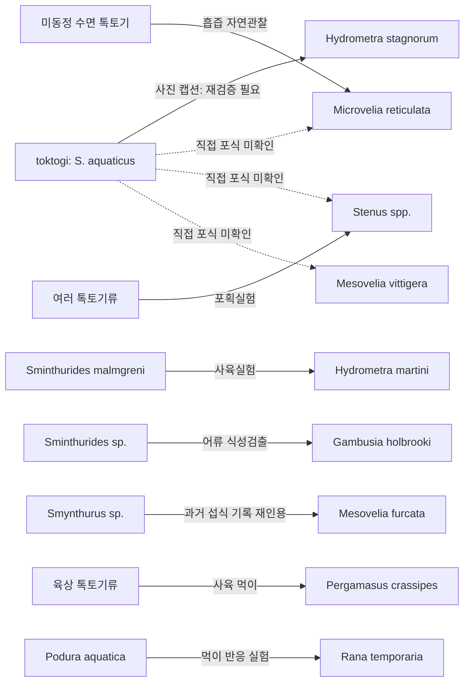

# 거미 이외 톡토기 천적 객체 색인 — 2DGP

> **버전:** 1.0 · **작성/검토:** 2026-11-17 · **대상 톡토기:** 물알둥근톡토기 *Sminthurides aquaticus* (`toktogi`) · **범위:** 거미목(Araneae)을 제외한 포식자/포식 후보 8개 객체

## 1. 핵심 판정

- ***Hydrometra stagnorum*:** 프랑스 자연사 사진에 ***S. aquaticus*를 섭식**한다는 설명이 있다. 다만 **양 종의 독립 동정·반복 확인이 없는 사진 보고**이며, 한국의 동시 출현은 미확인이다. [N01]
- ***Microvelia reticulata*:** 톡토기류의 **흡즙 관찰**이 보고돼 있지만 **먹이 톡토기의 종이 명시되지 않았다**. [N02]
- ***Hydrometra martini*:** ***S. malmgreni***를 먹이로 한 **사육실험**이 있다. 대상 *S. aquaticus*와는 **다른 종**이다. [N03]
- ***Gambusia holbrooki*:** 위 내용물/식성 연구에서 ***Sminthurides* sp.**가 먹이로 확인됐으나, **종 식별은 없다**. [N04]
- ***Stenus* 속:** 여러 종의 톡토기 포획 행동 실험이 존재한다. 수면의 *S. aquaticus*를 먹었다는 직접 기록은 **미확인**이다. [N05]
- ***Mesovelia* 속:** 역사문헌의 ***M. furcata*–*Smynthurus* 섭식 보고**가 있지만, 이번 객체인 ***M. vittigera***와는 **다른 종**이다. [N06]
- ***Pergamasus crassipes*, *Rana temporaria*:** 다른 톡토기를 대상으로 한 연구가 있지만 각각 **토양 응애**·**유럽 개구리**여서 `toktogi` 수면 먹이망의 주 천적으로 배치하지 않는다. [N07][N08]

**근거 등급:** A사진=대상 톡토기 종이 적힌 사진 관찰(독립 동정 미확인), B속=같은 톡토기 속 먹이 기록, C=다른 톡토기류 섭식 실험·관찰, D=서식지·근연종 정보에 근거한 후보. **어느 경우든 포식률·공격속도·주식 여부는 미확인**.

## 2. 객체 일람

| 객체 ID · 파일 | 분류군/분류 수준 | 크기 예시(성체) | 관련 포식 증거 | 한국 적용 |
|---|---|---|---|---|
| [`predator_hydrometra_stagnorum`](../C221_hydrometra_stagnorum/document/predator_hydrometra_stagnorum.md) | 노린재목 **종** | **9–12.5mm** | **A사진** *S. aquaticus* 섭식 캡션 | 한국 분포 미확인 |
| [`predator_microvelia_reticulata`](../C231_microvelia_reticulata/document/predator_microvelia_reticulata.md) | 노린재목 **종** | **1.4–1.8mm** | **C** 미동정 톡토기 흡즙 | 한국 목록 등재 |
| [`predator_hydrometra_martini`](../C222_hydrometra_martini/document/predator_hydrometra_martini.md) | 노린재목 **종** | **7.7–10.15mm** | **B속** *S. malmgreni* 사육실험 | 북미 종; 국내 미확인 |
| [`predator_stenus`](../C251_stenus/document/predator_stenus.md) | 딱정벌레목 **속** | *S. koreanus* **3.2–3.3mm** | **C** 톡토기 포획 실험 | 국내 속·종 기록 있음 |
| [`predator_mesovelia_vittigera`](../C241_mesovelia_vittigera/document/predator_mesovelia_vittigera.md) | 노린재목 **종** | **2.0–3.5mm** | **D/C** 근연 *M. furcata* 기록, 자체는 미확인 | 국내 출현 표본 확인 |
| [`predator_gambusia_holbrooki`](../C261_gambusia_holbrooki/document/predator_gambusia_holbrooki.md) | 어류 **종** | 암컷 최대 **6cm SL** | **B속** *Sminthurides* sp. 식성 조사 | 국내 출현 별도 검증 |
| [`predator_pergamasus_crassipes`](../C271_pergamasus_crassipes/document/predator_pergamasus_crassipes.md) | 포식성 응애 **종** | 종별 수치 미확인 | **C** 육상 톡토기 사육 먹이 | 연못 수면 적용 낮음 |
| [`predator_rana_temporaria`](../C281_rana_temporaria/document/predator_rana_temporaria.md) | 양서류 **종** | 대개 **6–8cm** | **C** *Podura aquatica* 반응 실험 | 한국 자생종 아님 |

> **크기 주의:** 위 크기는 몸길이로서, 어류의 **표준체장(SL)**과 곤충의 몸길이는 측정 방식이 다르다. *Stenus*는 속이므로 한 종의 수치를 속 전체로 일반화하지 않는다.

## 3. 먹이망 연결 — 종 불일치와 포식 단계 구분



- **실선 화살표:** 해당 자료의 먹이/포식자 간 연결을 표시. 관계 유형(사진·사육·식성검출 등)은 각 화살표에 명시.
- **점선:** 물알둥근톡토기와 해당 후보 사이의 **미검증 관계**. 실제 먹이 연결로 확정하면 안 됨.
- **공통 주의:** 같은 속에서 포식이 확인돼도 다른 종까지 동일하게 먹는다고 가정하지 않는다.

## 4. 2DGP 적용 우선순위

- **국내 수면 현장조사 우선:** *M. reticulata*, *M. vittigera*, 한국산 *Stenus* spp. 한국 분포·물가 서식 근거가 있는 반면 대상 톡토기와의 먹이 관계는 미확인이다.
- **종 수준 사진 검증:** *H. stagnorum* 기록의 포식자와 먹이 동정, 촬영일·연속 영상·장면별 섭식 확인을 우선 검토.
- **먹이망 비교 모델:** *H. martini*와 *G. holbrooki*는 근연 속/종 수준 직접 연구로 **가설 검증용**에 적합하지만 국내 토착 포식자로 임의 설정하지 않는다.
- **별도 환경 객체:** *P. crassipes*는 토양층, *R. temporaria*는 유럽 양서류 개체군에만 우선 연결한다.

## 5. 통일된 관찰 필드

```yaml
predator_object_id: string
prey_scientific_name: string  # 미동정 시 정확한 분류수준을 기입
prey_identification_rank: species_or_genus_or_family_or_unknown
interaction_type: encounter_or_attack_or_capture_or_feed_or_regurgitate_or_scavenge
habitat_layer: water_surface_or_floating_leaf_or_muddy_bank_or_soil_or_water_column
life_stage: egg_or_juvenile_or_adult_or_unknown
evidence_type: photo_or_video_or_experiment_or_gut_contents_or_habitat_inference
source_uri: string
predation_probability: null  # 실측할 때만 입력
```

## 6. 핵심 외부 출처

- [N01] [JB Nature — *Hydrometra stagnorum*이 *Sminthurides aquaticus*를 먹는 사진 캡션](https://www.jbnature.com/insectes/hemipteres/hydrom%C3%A9trid%C3%A9s).
- [N02] [Wanzen-im-Ruhrgebiet, *Microvelia reticulata* 생태·톡토기 흡즙 기록](https://www.wanzen-im-ruhrgebiet.de/artenprofile/veliidae/microvelia-reticulata/).
- [N03] [Taylor & Wood (2000), *H. martini* 사육](https://doi.org/10.2307/3496223).
- [N04] [García-Berthou (1999), *G. holbrooki* 식성 연구](https://doi.org/10.1006/jfbi.1999.0983).
- [N05] [Betz (1998), *Stenus* 포획 실험](https://doi.org/10.1111/j.1469-7998.1998.tb00058.x).
- [N06] [Hungerford (1917), *M. mulsanti* 생활사(Butler의 *M. furcata*–톡토기 먹이기록 재인용)](https://doi.org/10.1155/1917/57095).
- [N07] [Hartenstein (1962), *P. crassipes* 생활사·먹이](https://doi.org/10.1093/aesa/55.2.196).
- [N08] [Messer 외(2000), 톡토기 방어물질과 포식자 반응](https://doi.org/10.1078/S0031-4056(04)70041-4).
- **프로젝트 원본:** `toktogi(3).md` → `toktogi_ecosystem.md` → `toktogi_food_chain.md`; 비교 분류군: `spider_objects_index.md`.

> **재사용 정책:** 새 종별 자료가 나오면 포식자·먹이의 **학명/동정수준·서식지·날짜·행동 단계·원문 출처**를 함께 기록한다. 이번 파일은 실제 포식률·사냥 속도를 정량화한 자료가 아니며, 프로젝트 객체의 관계 근거를 추적하기 위한 연구 명세서다.
