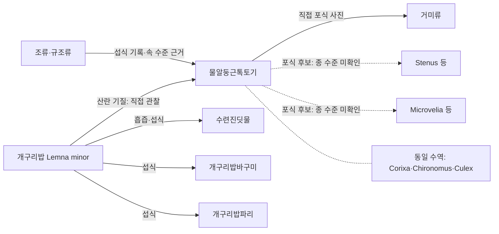

# 물알둥근톡토기 생태계 관계 명세서

> **파일명:** `toktogi_ecosystem.md`  
> **버전:** 1.0  
> **작성일:** 2026-11-03  
> **대상 종:** 물알둥근톡토기, *Sminthurides aquaticus*  
> **범위:** 천적, 같은 수역의 공존 생물, 부유식물 공유 곤충, 먹이망 및 미확인 관계  
> **기초 자료:** 사용자 제공 `toktogi(3).md` + 외부 학술자료·자연사 관찰 기록

## 1. 요약

- 물알둥근톡토기는 연못·웅덩이 등의 **잔잔한 수면**, 수면 가장자리, 개구리밥(*Lemna minor*) 등 부유식물 표면에서 사는 아주 작은 **육각류(톡토기강)**이다. 현생 분류에서 일반적인 곤충강과 구별된다. 암컷은 최대 약 **1.0 mm**, 수컷은 대략 **0.3–0.4 mm**로 기록된다. [원본 명세서]
- 이 종을 **거미가 포식하는 사진 관찰**은 존재한다. 그러나 거미의 종, 포식 빈도, 지역별 중요도는 확인되지 않았다. [E01]
- 이탈리아 코파로(Copparo)의 한 연못 조사에서는 이 종과 함께 ***Corixa punctata*, *Chironomus plumosus*, *Culex pipiens***가 보고됐다. 이것은 **동일 조사 수역 출현**의 근거이지, 서로 잡아먹거나 직접 접촉했다는 증거가 아니다. [E02]
- ***Stenus* 반날개류**, ***Microvelia* 깨알소금쟁이류**, 거미·물고기·일부 노린재·딱정벌레는 **다른 톡토기 또는 톡토기류 일반**의 천적 연구를 근거로 관심 대상이다. 이 종에 대한 종별 포식률은 미확인이다. [E03][E04][E05]
- **수련진딧물** *Rhopalosiphum nymphaeae*, **개구리밥바구미** *Tanysphyrus lemnae*, **개구리밥파리** *Lemnaphila scotlandae*는 같은 부유식물 이용에 따른 **공존 후보**다. 해당 톡토기 종과의 동시 출현·경쟁은 별도 검증해야 한다. [E06][E07]

## 2. 근거 수준과 해석 규칙

| 등급 | 의미 | 허용되는 표현 |
|---|---|---|
| **A — 대상 종 직접 관찰** | *S. aquaticus*에 대해 포식·행동을 직접 기록 | “직접 포식 관찰됨”, “산란 관찰됨” |
| **B — 동일 수역 출현** | 한 연구의 조사 수역에서 대상 종과 함께 목록에 등장 | “같은 수역에서 확인됨” |
| **C — 상위분류·근연종 근거** | 다른 톡토기 종 또는 톡토기류 일반에서 포식·공존 확인 | “톡토기류의 천적으로 알려짐” |
| **D — 서식지 기반 후보** | 서식 위치·이용 식물이 겹쳐 관계를 추정 | “접촉·공존 가능성”, “조사 후보” |
| **U — 미확인** | 대상 종 수준의 관찰·실험 근거를 확보하지 못함 | 확정 관계나 확률로 기재 금지 |

**필수 원칙:** “같은 연못에 존재”, “같은 식물에 존재”, “포식 가능”, “실제로 먹음”은 서로 다른 주장이다. 하나를 다른 하나의 증거로 사용하지 않는다.

## 3. 기본 서식 공간과 자원

| 구역 | 대표 자원·구조 | 물알둥근톡토기의 이용 |
|---|---|---|
| **수면** | 수면장력, 조류·표면 미생물 | 보행·도약, 표면 자원 섭식 [원본 명세서] |
| **부유식물** | 개구리밥(*Lemna minor*) 잎 | 잎 표피에 산란홈을 만들고 알을 낳은 뒤 배설물 펠릿으로 덮는 행동이 직접 관찰됨 [E08] |
| **수면 가장자리** | 젖은 잎·나무·돌·식물 | 휴식·이동·먹이 탐색이 가능한 미세서식지 [원본 명세서] |
| **수중·바닥** | 부유 유기물·퇴적물 | 다른 수생 생물의 공간과 연결되지만, 대상 종이 상시 잠수 생활한다는 뜻은 아님 |

**먹이:** *S. aquaticus*의 조류 섭식은 자연사 관찰로 기록됐고, *Sminthurides* 속의 규조류 섭식도 안내되어 있다. 종별 먹이 비율·일일 섭식량은 미확인이다. [원본 명세서][E05]

## 4. 천적 및 포식 후보

| 대상 | 분류·학명 | 근거 수준 | 확인된 사실과 경계 |
|---|---|---|---|
| **거미류** | Araneae, 세부 종 미상 | **A** | 2009-09-13 프랑스에서 *S. aquaticus* `levanderi`형이 거미에게 포식되는 사진 기록. 가장 분명한 종 수준 직접 사례 [E01] |
| **깨알소금쟁이류** | *Microvelia reticulata* | **C** | 다른 수면 톡토기 *Podura aquatica*에 대한 포식자 반응·방어물질 연구가 존재. *S. aquaticus* 포식 사실로 전용할 수 없음 [E03] |
| **딱부리반날개류** | *Stenus* spp. (반날개과) | **C** | 돌출되는 아랫입술 등을 사용해 여러 톡토기를 포식하는 연구가 있음. 대상 종 직접 포식 자료는 미확인 [E04] |
| **노린재·딱정벌레 일반** | Hemiptera, Coleoptera | **C** | 담수 톡토기류 전반의 포식자로 제시됨. 각 종·각 장소의 실제 관계는 따로 확인해야 함 [E05] |
| **물고기** | 어류 일반; 예: *Gambusia affinis* | **B+C** | 어류는 톡토기류의 포식자 범주. *G. affinis*는 코파로 조사 수역에서 확인됐으나, *S. aquaticus*를 먹은 기록은 해당 조사에 없음 [E02][E05] |
| **물가의 딱정벌레과** | Carabidae | **B+D** | 코파로 연못 주변 육상 절지동물 조사에서 출현; 이 종에 대한 포식 관계는 미확인 [E02] |
| **소금쟁이류·물노린재류** | Gerridae, *Mesovelia* spp. 등 | **D** | 작은 수면 절지동물과 서식 공간이 겹치는 후보. 종 수준의 포식 여부는 미확인 [E09] |

> **주의:** “천적 후보”라는 분류는 우선 관찰 대상을 제시할 뿐, 위험도·포식 성공률 순위를 뜻하지 않는다. 물알둥근톡토기 알·유체에 대한 별도 천적 목록도 현재 미확인이다.

## 5. 같은 조사 수역에서 확인된 곤충

**조사:** Pezzi 외(2014), 이탈리아 페라라주 코파로의 자연 침수된 점토 채석장 연못(Cava Ponte San Pietro). 논문은 2012–2013년의 모니터링을 서술하고, 2012년 7·10·11월 채집 구간을 제시한다. [E02]

| 생물 | 학명 | 분류·서식층 | *S. aquaticus*와의 확인 관계 |
|---|---|---|---|
| 물벌레류(물노린재과) | *Corixa punctata* | 노린재목·수중 | **B: 동일 조사 수역 출현** |
| 깔따구류 | *Chironomus plumosus* | 파리목·유충은 주로 수중 퇴적물 | **B: 동일 조사 수역 출현** |
| 집모기류 | *Culex pipiens* | 파리목·유충은 수중/수면과 연결 | **B: 동일 조사 수역 출현** |

- 같은 수역에서 확인된 **비곤충**에는 물벼룩 *Daphnia pulex*, 옆새우 *Gammarus pulex*, 미동정 수중 응애류, *Gambusia affinis* 등이 포함된다. [E02]
- **주변 육상·비행성 절지동물** 별도 조사에서는 **딱정벌레과(Carabidae)**와 **개미과(Formicidae)**가 각 **채집 개체의 26%**로 보고됐다. 이 수치는 **전체 연못의 생물량이나 톡토기의 포식 확률이 아니다.** [E02]
- 연구에서 *S. aquaticus*는 **가을에 소수 발견**됐다. 다른 수역·계절에 적용하는 일반 법칙으로 해석하지 않는다. [E02]

## 6. 개구리밥(*Lemna minor*)을 공유할 수 있는 곤충

| 공존 후보 | 학명 | 알려진 식물 이용 | 대상 톡토기와의 관계 |
|---|---|---|---|
| **수련진딧물** | *Rhopalosiphum nymphaeae* | *L. minor*를 포함한 개구리밥류에서 흡즙·증식. 성체 약 1.5–2.5 mm [E06] | **D**: 같은 식물 이용 가능. 직접적인 경쟁 또는 포식 증거 없음 |
| **개구리밥바구미류** | *Tanysphyrus lemnae* | 개구리밥 조직 섭식·발육 [E07] | **D**: 식물 자원·산란기질 변화 가능성을 관찰할 후보 |
| **개구리밥파리류** | *Lemnaphila scotlandae* | *Lemna* 속 잎을 섭식·발육, *L. minor*도 기주 [E07] | **D**: 같은 부유식물 이용 가능. 동시출현 미확인 |
| **물노린재류** | *Mesovelia* sp. | 개구리밥 표면에서 관찰된 사례가 있음 [E09] | **C/D**: **다른 톡토기** *S. bifidus* 및 진딧물과 동시 관찰된 사례. *S. aquaticus*의 직접 공존 증거는 아님 |

**동정상 주의:** 2015년 미국 펜실베이니아의 BugGuide 사진은 최초 제목에 *S. aquaticus?*라고 표기됐지만 나중에 ***Sminthurides bifidus***로 동정되었다. 해당 사진의 “진딧물·*Mesovelia*와 동시 출현”을 *S. aquaticus*의 확인 사례로 옮기지 않는다. [E09]

**잠재적 간접 관계:** 개구리밥의 상태가 달라지면 톡토기의 산란 자리도 달라질 수 있다는 가설을 세울 수 있으나, 이 효과가 실제로 일어났다는 실험 결과는 확보하지 못했다. [E07][E08]

## 7. 먹이망·공존 관계 요약

- **실선 화살표:** 직접 관찰된 섭식·산란·포식 또는 다른 출처에서 명시된 식물 이용. 각 선의 표기를 통해 확인 대상을 구별한다.
- **점선 화살표:** 대상 톡토기에 대한 미확인 포식 가능성.
- **화살표 없는 점선:** 동일 조사 수역 출현(상호작용 미확인).
- 이 그림은 **정량 먹이망이 아니라 근거 수준을 표시한 관계 개요**다. 에너지 흐름량·포식 확률을 나타내지 않는다.

## 8. 추가 검증 우선순위

1. **직접 포식 촬영:** 동일 수역에서 거미, *Stenus*, *Microvelia*, *Mesovelia* 등이 *S. aquaticus*를 실제 포획·섭식하는지 촬영하고 포식자 종까지 동정.
2. **동시 출현 확인:** 같은 시간·같은 개구리밥 군락에서 *S. aquaticus*, 수련진딧물, 물노린재류의 동시 위치·밀도를 기록.
3. **산란기질 영향:** 개구리밥의 흡즙·섭식 피해 정도와 톡토기 산란홈·알의 위치를 비교. 인과관계 확정을 위해 통제 실험 필요.
4. **성장단계별 천적:** 알, 갓 부화한 개체, 암컷·수컷 성체를 구분하여 포식 여부 기록.
5. **계절·환경 메타데이터:** 수온, 수면 피복률, pH, 계절, 채집 방식, 동일 미세서식지 여부를 기록.

### 최소 현장 기록 필드

`date`, `location`, `waterbody_id`, `microhabitat`, `taxon_scientific_name`, `life_stage`, `sex_if_known`, `abundance_or_count`, `interaction_type`, `evidence_level`, `photo_or_video`, `observer`, `identification_method`, `source_id`, `notes`

**금지:** 종 미동정 사진에 대한 확정 판정, 공존 자료로부터 포식률 계산, 다른 톡토기의 포식 실험 수치를 *S. aquaticus*의 종 특이 성능으로 전용.

## 9. 출처 및 추적 가능성

| 코드 | 출처 | 이 문서에서의 역할 |
|---|---|---|
| **원본 명세서** | 사용자 제공 `toktogi(3).md` (2026-11-02 정리) | 분류, 크기, 서식, 먹이, 산란 및 근거 해석 기준. 원본에 인용된 S01–S16은 별도 참고문헌 참조 |
| **E01** | [Collembola.org — *Sminthurides aquaticus* 사진 목록](https://www.collembola.org/taxa/smi1idae.htm) | 프랑스 2009-09-13 `Predation by spider` 종 수준 직접 관찰 |
| **E02** | Pezzi et al. (2014), [*Monitoring Aquifer Quality for Artificial Recharge within the WARBO Project*](https://doi.org/10.1016/j.proeng.2014.11.426), *Procedia Engineering* 89:1235–1240; [페라라대학교 원문 PDF](https://sfera.unife.it/retrieve/e309ade0-4510-3969-e053-3a05fe0a2c94/Monitoring%20Aquifer%20Quality%20for%20Artificial%20Recharge%20within%20the%20WARBO%20Project.pdf) | 코파로 조사 수역의 공존종 목록, 계절별 검출, 주변 육상 곤충의 26% 비중. 논문 표 2 및 본문 |
| **E03** | Messer et al. (2000), [*Chemical deterrents in podurid Collembola*](https://www.sciencedirect.com/science/article/pii/S0031405604700414), *Pedobiologia* | *Microvelia reticulata* 등의 다른 종 톡토기 *Podura aquatica*에 대한 반응 연구 |
| **E04** | Betz (1998), [*Comparative studies on the predatory behaviour of Stenus spp.*](https://doi.org/10.1111/j.1469-7998.1998.tb00058.x), *Journal of Zoology* | *Stenus*의 톡토기 포획 행동 실험 |
| **E05** | [Identification and Ecology of Australian Freshwater Invertebrates — Collembola](https://www.mdfrc.org.au/bugguide/display.asp?class=15&type=2) | 톡토기류 일반의 포식자, *Sminthurides* 속의 규조류 섭식 |
| **E06** | [Royal Horticultural Society — Waterlily invertebrates](https://www.rhs.org.uk/biodiversity/waterlily-invertebrates); Subramanian & Turcotte (2020), [*Preference, performance, and impact of the water-lily aphid on multiple species of duckweed*](https://doi.org/10.1111/een.12932) | 수련진딧물 크기 및 *L. minor* 이용의 실험 근거 |
| **E07** | Mariani et al. (2024), [*Natural enemies of Lemna minuta in its native range and their potential as biological control agents for Europe*](https://doi.org/10.1080/09583157.2024.2393383) | 개구리밥바구미·개구리밥파리의 *Lemna* 기주 이용 |
| **E08** | Janssens & Huskens (2016), [*Note on the oviposition in Sminthurides aquaticus*](https://www.collembola.org/publicat/eggdepos.htm) | *L. minor* 표피 산란홈·알·배설물 덮개의 직접 관찰 |
| **E09** | [BugGuide — *Sminthurides aquaticus?* → *Sminthurides bifidus*](https://www.bugguide.net/node/view/1138706/bgimage) | *S. bifidus*, *R. nymphaeae*, *Mesovelia* sp.의 개구리밥 위 공존 기록; 대상 종과 혼동 금지 |

## 10. 문서 유지 원칙

- 새 기록을 추가할 때 **종명, 지역, 날짜, 관찰 방식, 생물 간 관계 유형, 근거 등급, 원문 URL**을 함께 남긴다.
- “종 수준 직접 관찰(A)”과 “같은 수역 출현(B)”을 혼동하지 않는다.
- 다른 종에서 확인된 결과(C)를 대상 종의 확정 특성으로 승격하려면 **대상 종 직접 관찰·실험**이 필요하다.
- **사진 및 논문 이미지의 재배포 권리**는 본 명세서의 출처 표기만으로 확보되지 않는다.
- 이 파일은 **연구·관찰용 생태 관계 명세서**이며, 특정 장소의 확정 먹이망이나 포식률 모델은 아니다.
