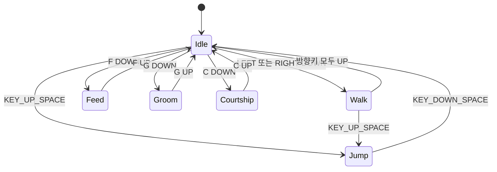
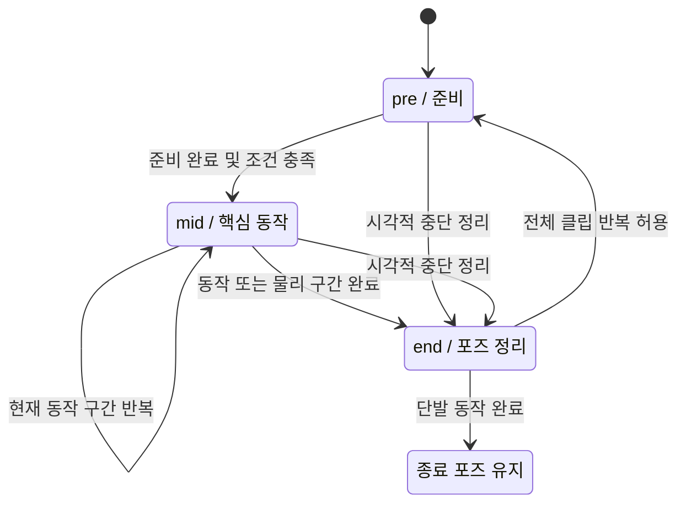
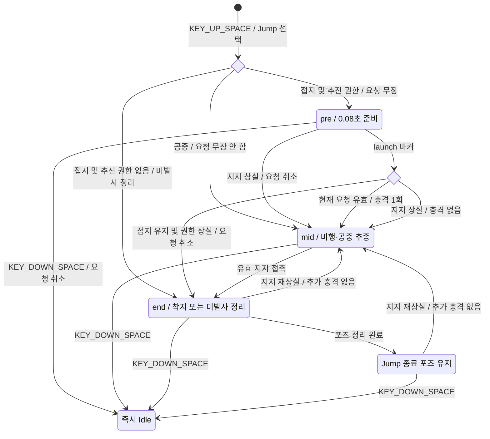
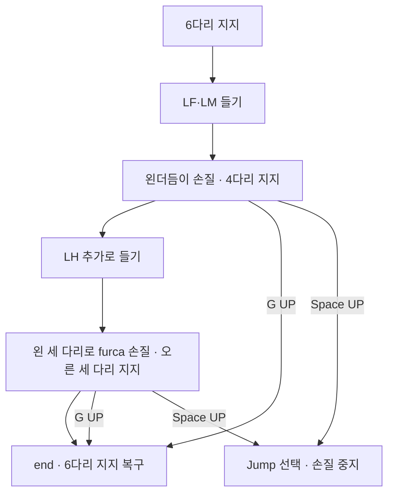

# 톡토기 행동 상태 머신·리깅 단계 명세서

> **문서명:** `toktogi_state_machine.md`  
> **버전:** 3.0 — 2026-11-03  
> **대상:** 물알둥근톡토기 (*Sminthurides aquaticus*)  
> **기준 자료:** 첨부 `toktogi_movement(1).md` v1.0 및 기존 키 입력 명세 v2.0  
> **목적:** 행동 상태, 상태 내부의 `pre / mid / end`, 기관별 리그 동작, 접지·결속 제약, 이벤트와 중단 규칙을 함께 정의한다.  
> **근거 구분:** 행동과 관찰된 지지 다리 구성은 첨부 문서에 따른다. 단계 분할·시간·각도·변위·키 배정은 **게임 제작용 초기 설정**이며 생물의 실측값이 아니다.

## 1. 구조와 입력 규칙

### 1.1 세 영역을 분리한다

| 영역 | 관리할 값 | 책임 |
|---|---|---|
| 행동 상태 | `state` | Idle, Walk, Jump, Feed, Groom, Courtship 중 현재 행동 선택 |
| 리그 재생 | `phase`, `variant`, `phase_u`, `cycle_id` | 선택한 행동의 준비·반복·마무리 포즈 |
| 물리·관계 | 위치·속도·접촉, `linked`, `partner_id`, 추진 권한 | 실제 이동·접지·더듬이 연결 |

**기본 행동은 기존 여섯 상태를 유지한다.** 문서의 31개 장면은 하위 클립·포즈·환경 표현으로 나누고, 장면마다 새로운 조작 상태를 만들지 않는다. 성체 구애와 구별해야 하는 접촉은 선택 확장 `Interact`로 분리한다.

### 1.2 유지하는 키 입력

| 입력 | 동작 |
|---|---|
| **`KEY_UP_SPACE` — Space 뗌** | 모든 상태에서 즉시 `Jump` 선택. 접지·추진 권한이 있으면 도약 요청을 생성한다. |
| **`KEY_DOWN_SPACE` — Space 누름** | 모든 단계에서 즉시 `Idle` 복귀. 미발사 도약 요청은 취소한다. |
| `KEY_DOWN_LEFT / KEY_DOWN_RIGHT` | Idle·Walk에서 보행 시작 또는 방향 변경 |
| `KEY_UP_LEFT / KEY_UP_RIGHT` | Walk에서 방향 갱신. 양쪽 모두 떼면 Idle |
| `KEY_DOWN_F / KEY_UP_F` | Feed 시작 / 현재 Feed일 때 Idle 복귀 |
| `KEY_DOWN_G / KEY_UP_G` | Groom 시작 / 현재 Groom일 때 Idle 복귀 |
| `KEY_DOWN_C / KEY_UP_C` | Courtship 시작 / 현재 Courtship일 때 Idle 복귀 |
| `KEY_DOWN_V` | 결속을 양측에서 해제하고 Idle 선택 |
| `KEY_DOWN_E / KEY_UP_E` — 선택 확장 | Interact 시작 / 현재 Interact일 때 Idle 복귀 |

일반 표면 행동은 접지·대상·활동 권한이 유효할 때만 시작한다. F·G·C와 선택적 E는 Jump 이외의 상태에서 직접 행동을 바꿀 수 있다. 관련 없는 키의 UP 이벤트는 현재 행동을 종료하지 않는다. 좌우 동시 누름은 Walk를 유지한 채 수평 보행을 멈추고, 한쪽을 떼면 남은 방향을 따른다.

**v3의 점프 타이밍 구체화:** v2의 “Space UP 처리 순간 충격량 적용”을 **“Space UP으로 Jump.pre 시작 → 짧은 준비 후 launch 마커에서 충격량 1회”**로 바꾼다. 기본 준비 시간은 **0.08초**다. 키에 따른 상태 선택은 즉시 이루어지고, 추가 입력은 필요 없다.

`KEY_UP_SPACE` 등은 게임 내부 이벤트 이름이다. 실제 입력에서는 `SDL_KEYUP / SDL_KEYDOWN`과 `SDLK_SPACE` 등의 키코드를 조합한다. [입력 자료 1, 2]

## 2. 상태 종류와 하위 클립

| 상태 | 기본 키 | 원문 ID | 내부 구성 |
|---|---|---|---|
| `Idle` | 기본 상태, Space DOWN | 01 rest, 04 anchor | `rest`, 선택적 `anchor`, 공중·결속 상황별 대기 포즈 |
| `Walk` | ← / → | 02 walk | 여섯 다리 보행 주기 |
| `Jump` | Space UP | 03 jump, 21 pair_jump | `solo`, `linked_driver`, `linked_passenger`, `airborne_resume` |
| `Feed` | F | 05 graze | 먹이 접촉과 구기 반복 |
| `Groom` | G | 06 antenna_clean, 07 furca_clean, 08 saliva_clean, 09 bark | 기본 `antenna_then_furca`; 선택 `saliva_clean`, `clear_mouth` |
| `Courtship` | C | 17 approach, 18 clasp, 19 carry, 20 dance | 접근·정렬 → 결속 → 운반 또는 방향 전환 |
| `Interact` — 선택 | E | 12 female_contact, 13 rebuff, 14 juvenile_clasp, 16 male_contact | 성체 암수 구애와 구별되는 접촉·반응·사진 포즈 |

`variant`는 상태 진입 때 선택하고 해당 재생 중에는 고정한다. 그루밍 변형 전체를 매번 필수 순서로 실행하지 않는다. `Interact`는 기본 비활성 확장이며, 사용하려면 상태 목록과 E 입력을 함께 활성화한다.

위 도표는 기본 흐름이다. **Space의 공통 전이는 모든 상태와 모든 리그 단계에 적용**한다. 선택적 Interact는 E DOWN으로 진입하고 E UP으로 Idle에 복귀한다.

## 3. 공통 리그·좌표 정의

### 3.1 리그 제어 채널

실제 본 이름이 다르면 아래 제어 채널에 대응시킨다. 여기서 나누는 제어 채널은 모델 제작용 구조이며, 생물의 실제 관절 수를 확정하는 해부학 명세가 아니다.

| 채널 | 제어 대상 | 소유권·제약 |
|---|---|---|
| `root_world` | 월드 위치·속도·진행 방향 | 이동·물리 또는 결속 추종 제약이 소유. 애니메이션이 직접 덮어쓰지 않음 |
| `body_ctrl` | 몸통의 로컬 높이·기울기 | 중립 자세 대비 시각적 오프셋. 몸통 스케일은 기본 1 유지 |
| `head_ctrl` | 머리 방향·기울기 | 먹이·더듬이·상대 목표를 향한 자세 |
| `leg_LF / LM / LH` | 왼앞·왼중간·왼뒷다리 | 다리별 발끝 목표, 접지 가중치, 작업용 목표 |
| `leg_RF / RM / RH` | 오른앞·오른중간·오른뒷다리 | 동일 |
| `antenna_L / R` | 더듬이 기부·굽힘·자유 끝점 | 포즈 제어용 끝점과 실제 결속 위치를 구별 |
| `antenna_clasp_anchor` | 더듬이의 결속 접촉 앵커 | 수컷의 변형된 집게 구조와 암컷의 대응 접촉 부위를 연결 |
| `furca_ctrl` | 도약기관의 접힘·펼침 | `furca_open=0`: 접힘, `1`: 제작한 최대 펼침 포즈 |
| `collophore_ctrl` | 복관 끝점·접촉 표현 | `tube_contact=0…1`. 실제 수면 도달 여부 확인 |
| `mouth_ctrl` | 구기 동작 | `mouth_open=0…1`의 제작용 가동 범위 |

**좌우는 개체 자신의 좌우다.** 화면 좌우나 카메라 방향으로 LF/RF 등의 의미를 바꾸지 않는다. 좌우 반전 변형을 만들 때도 원래 관찰 자세와 제작용 반전을 구별한다. (움직임 명세 §3)

더듬이의 포즈용 끝점 IK를 결속 위치와 동일시하지 않는다. 수컷의 결속 앵커는 제2·제3마디의 변형된 집게 구조에 맞춰 배치한다. 암컷 측 접촉 위치는 참조와 모델에 맞춰 설정하고, 확인 전에는 미정으로 둔다. 양측 앵커가 설정되지 않으면 실제 결속 생성은 허용하지 않는다. (기존 `toktogi(1).md` §12.2; 움직임 명세 §3, §4.4)

### 3.2 수치와 접지 표기

- `L`: 중립 자세의 주 몸통 길이. 표의 `0.02L` 등은 크기 변화에 대응하기 위한 제작 단위다.
- `body_y`: root와 별도로 적용하는 몸통 시각 높이 오프셋. 음수는 몸통을 낮추는 방향이다.
- `head_pitch`: 중립 머리 자세 기준. 음수는 입을 지지면 쪽으로 숙이는 방향이다.
- `phase_u`: 현재 단계의 정규화 진행도 `0…1`. 시간 단계는 `elapsed / duration`으로 구하고, 사건 대기 단계는 완료 조건을 별도로 검사한다.
- `support_mask`: 지지를 요청하는 다리 집합. **실제 유효한 접촉이 있는 발만** 접지 IK를 적용한다.
- `work_mask`: 더듬이·furca·몸을 손질하는 다리 집합. 이 다리는 동시에 지면에 고정하지 않는다.
- 표의 시간·각도·변위는 모두 **게임 초기 설정**이다. 실제 모델의 가동 범위와 발끝 도달성을 검사해 조정한다.
- 첨부의 “장면당 6초”는 편집 규격이다. 아래 단계 시간의 생물학적 근거로 사용하지 않는다. (움직임 명세 §6)

## 4. pre / mid / end 공통 규약

| 단계 | 역할 | 전환 기준 |
|---|---|---|
| `pre` | 현재 포즈를 받아 지지·목표를 정렬하고 행동 준비 | 준비 시간 및 필수 목표·접촉 조건 충족 |
| `mid` | 핵심 동작, 반복, 실제 동작 마커 | 루프 유지, 물리 사건, 동작 완료 또는 입력 중단 |
| `end` | 사용한 기관을 안전한 다음 자세로 정리 | 현재 행동의 종료 포즈 유지 또는 다음 상태와 블렌드 |

이 도표는 **애니메이션 단계**다. 행동 키가 바뀌면 논리 상태는 즉시 바뀌며, End 완료를 기다리지 않는다.

- F·G·C UP이면 해당 행동에서 **즉시 Idle**이 된다. 이전 행동의 End는 별도 `outgoing_blend`에서 **시각적 정리만** 수행한다.
- 이전 클립의 섭식·새 결속·발사 마커는 상태를 떠나는 순간 무효화한다.
- 새 행동의 Pre와 이전 End를 블렌드하되, 새 행동·접촉·결속 제약이 우선한다. Space 입력은 End 블렌드 도중에도 즉시 처리한다.
- Jump의 자연 착지 End가 끝나도 행동은 Jump다. `state=Jump, phase=end, phase_u=1`로 종료 자세를 유지한다.
- 공중에서는 End가 발을 지면으로 끌어내리거나 물리 속도를 초기화하지 않는다.
- 일반 포즈 보간은 `smoothstep` 같은 완만한 곡선을 사용할 수 있다. 발사·bite·결속 생성은 보간값 자체가 아니라 **별도 이벤트 마커**로 처리한다.

## 5. 상태별 단계 시간 초기값

**아래 수치는 전부 제작·테스트용 시작값이다.**

| 상태·클립 | pre | mid | end |
|---|---:|---|---:|
| Idle.rest | 0.12초 | 1.60초 잔동작 루프 | 0.10초 |
| Walk | 0.10초 | 보행 한 주기 0.48초 | 0.12초 |
| Jump | 0.08초 | 실제 이륙·비행·접촉 사건에 따름 | 착지 정리 0.12초 |
| Feed | 0.16초 | 섭식 한 주기 0.40초 | 0.12초 |
| Groom.antenna_then_furca | 0.20초 | 더듬이 0.80초 → 지지 전환 0.16초 → furca 1.00초 | 0.20초 |
| Courtship | 거리 조건 + 정렬 0.20초 | 결속 블렌드 0.16초 후 유지·구애 구간 | 0.16초 |
| Idle.anchor — 변형 | 0.16초 | 선택된 변형을 유지하는 동안 접촉 표현 | 0.14초 |
| Groom.saliva_clean — 변형 | 0.20초 | 0.90초 표현 루프 | 0.20초 |
| Groom.clear_mouth — 변형 | 0.12초 | 제거 시도 0.60초 루프 | 0.12초 |
| Interact — 선택 | 0.16초 또는 접근 거리 조건 | 0.50초 접촉 표현부터 조정 | 0.14초 |

Idle.anchor와 Groom의 선택 변형은 `variant` 설정이나 게임 상황으로 선택한다. 현재 기본 키 배정을 늘리지 않는다. Courtship 접근과 Jump 비행을 고정 시간 만료만으로 완료 처리하지 않는다.

## 6. Idle — 대기와 복관 접촉

근거: 01 `rest`, 04 `anchor`; 움직임 명세 §4.1.

| 단계 | 몸통·머리·더듬이 | 다리·furca·복관 | 완료·유지 조건 |
|---|---|---|---|
| pre | 현재 포즈에서 몸통·머리의 중립 오프셋으로 0.12초 블렌드 | 접지 시 여섯 발의 유효 접촉을 유지. furca는 접힌 포즈로 정리 | 단순 포즈 정렬 완료 |
| mid | 몸통은 안정적으로 유지. 더듬이 ±3° 정도의 작은 움직임은 제작용 보간으로 선택 가능 | 여섯 다리 지지. 임의의 보행·섭식 마커를 실행하지 않음 | 새 입력까지 유지 |
| end | 현재 포즈를 다음 상태의 시작 포즈로 전달 | 발과 더듬이의 기존 접촉·결속 제약을 새 상태로 전달 | 다음 Pre와 0.10초 블렌드 |

**공중 변형:** `on_ground=false`이면 발 접지 IK를 끄고 공중 대기 포즈를 사용한다. Idle 선택으로 월드 위치·속도·중력을 바꾸지 않는다.

**결속 변형:** 이미 연결된 더듬이는 중립 방향으로 펴지지 않도록 연결 제약을 유지한다. 운반되는 수컷의 발을 임의로 수면에 고정하지 않는다.

### Idle.anchor 변형

| 단계 | 복관 접촉 리그 |
|---|---|
| pre | 여섯 다리의 지지를 유지하며 몸통을 최대 `-0.02L` 낮추고 복관 끝을 실제 수면 목표에 접근시킨다. 도달 불가면 rest로 유지한다. |
| mid | 복관 끝점의 수면 접촉 포즈를 유지한다. 수면 높이가 바뀌면 가동 범위 안에서 끝점만 추종한다. |
| end | 복관 끝점의 접촉 표현을 해제하고 몸통 오프셋을 중립으로 되돌린다. |

이 변형은 **접촉 표현**이다. root 고정·흡착력·물 흡수량·착지 제어 능력을 추가하지 않는다. 선택을 해제하면 Idle.rest로 블렌드하며 행동 상태는 Idle이다.

## 7. Walk — 여섯 다리 보행

근거: 02 `walk`; 움직임 명세 §4.1. 실제 보폭·발 순서·보행 주기는 미확정이므로 아래 리듬은 게임용 프록시다.

| 단계 | 몸통·머리·더듬이 | 다리와 접지 | 처리 |
|---|---|---|---|
| pre | 진행 방향을 정렬하고 몸통 흔들림 진폭을 0에서 늘림 | 현재 접촉에서 보행 주기로 진입 | 0.10초, 접지·이동 권한 확인 |
| mid | 몸통 상하 변화는 최대 ±`0.008L`; 머리·더듬이는 진행 방향을 향함 | 발끝 앞뒤 이동 폭 `0.12L`, 들림 높이 `0.025L`부터 조정 | 주기 0.48초. 실제 root 이동은 이동 제어기가 담당 |
| end | 보행 진폭과 머리 선행 포즈를 줄임 | 스윙 중이던 발을 도달 가능한 유효 접촉점으로 내려놓음 | 0.12초. 공중이면 발 접지 복귀를 생략 |

### 임시 보행 위상 설정

| 한 주기 구간 | 지지 요청 | 스윙 요청 |
|---|---|---|
| 0.00–0.50 | LF·RM·LH | RF·LM·RH |
| 0.50–1.00 | RF·LM·RH | LF·RM·LH |

이 교차 3개 묶음은 **제작용 임시 보행 패턴**이다. 이 종에서 실측된 발 순서라고 표시하지 않는다. 이후 실제 보행 참조가 확보되면 위상표를 교체한다. 그루밍의 **오른쪽 세 다리 지지**와는 별개다.

방향이 바뀌어도 월드에 고정한 발끝을 순간적으로 좌우 반전하지 않는다. 두 방향키가 동시에 눌려 속도가 0이면 발을 정리해 정지 포즈로 유지하고 보행 주기 진행을 멈춘다. 이때 행동은 Walk다.

## 8. Jump — 준비·발사·비행·착지

근거: 03 `jump`, 21 `pair_jump`; 움직임 명세 §4.1, §4.4, §5.2. 단계 시간·궤적·완충량은 게임 설계다.

| 단계 | 리그 설정 | 물리·이벤트 | 다음 단계 |
|---|---|---|---|
| pre | 몸통 `body_y: 0 → -0.035L`, 지지 다리 굽힘. furca는 `open=0`인 준비 포즈 유지 | 새 도약 요청을 무장한다. 아직 충격량은 적용하지 않음 | 0.08초 끝의 `launch` 마커 |
| mid 시작 | furca를 약 0.03초에 `0 → 1`로 펼치는 시각 포즈. 발 접지 IK 해제 | `launch` 가드 재검사 후 충격량 1회, 요청 소비 | 실제 비행 |
| mid 비행 | 물리 root를 따라 몸을 표현. 다리는 공중 정리 포즈. furca는 발사 후 0.12초 동안 접힌 포즈로 복귀하도록 설정 가능 | 애니메이션은 추가 추진·자동 조향·지면 고정을 하지 않음 | 유효한 지지 접촉 |
| end | 검출된 접촉 발부터 IK를 복구. 몸통 완충 오프셋 `-0.02L → 0`, furca 접힘 | 충격량 재적용 없음. 접촉 정리는 물리가 담당 | 0.12초 후 Jump 종료 포즈 유지 |

### 도약 요청과 취소

- `launch`는 **현재 state=Jump, 현재 진입 세대값·단계 인스턴스, 요청 ID, 미취소·미소비 여부, 현재 접지·추진 권한**이 모두 유효할 때만 실행한다. 오래된 마커는 도표의 분기를 실행하지 않고 폐기한다.
- Pre 중 Space DOWN이면 즉시 Idle로 바꾸고 미발사 요청을 취소한다. 이전 클립의 늦은 launch 마커는 무시한다.
- 이미 공중에서 Space UP을 받으면 새 발사 요청을 만들지 않고 `airborne_resume`의 Mid 포즈만 선택한다. 착지 후 자동 발사를 예약하지 않는다.
- Pre 중 지지를 잃으면 요청을 취소하고 낙하·공중 Mid로 옮긴다. 지지는 유지되지만 추진 권한을 잃은 경우에는 충격 없이 Jump 종료 포즈로 정리한다.
- 최초 진입부터 접지 상태에서 추진 권한이 없으면 `end.blocked`로 정리한다. 이 변형은 착지 충격 표현 없이 준비 자세만 중립으로 복귀한 뒤 Jump 종료 포즈를 유지한다.
- 발사 후 Space DOWN이면 상태는 Idle이지만 이미 적용된 속도·중력은 유지한다.
- 실제 접촉 뒤 현재 상태가 Jump이면 End를 재생한다. 이미 Idle로 바뀌었다면 Jump를 재선택하지 않고 Idle 쪽 접촉 복귀 포즈를 사용한다.
- End 또는 종료 포즈 유지 중 접촉이 다시 사라지면 추가 충격 없는 Mid로 복귀한다.
- **착지 End 완료는 Idle 전이가 아니다.** Idle 복귀는 Space DOWN 등의 명시한 입력을 따른다.

### 결속 도약 변형

- `linked_driver`: 암컷의 furca와 발만 발사 포즈·추진 마커를 수행한다.
- `linked_passenger`: 수컷은 두 더듬이의 결속 접촉 앵커를 연결하는 제약을 따라 이동하며 독립 충격량을 발생시키지 않는다.
- 운반되는 수컷의 발 접지 IK를 해제한다. 더듬이 연결은 Pre·Mid·End 동안 유지한다.
- 결속을 실제로 해제하는 V 입력이 들어오면 양측 제약을 정리하고 현재 속도·접촉 상태로 각 개체의 물리를 이어간다.

## 9. Feed — 표면 조류 섭식

근거: 05 `graze`; 움직임 명세 §4.2.

| 단계 | 몸통·머리·구기 | 다리·더듬이 | 이벤트 |
|---|---|---|---|
| pre | 몸통 최대 `-0.01L`, 머리를 먹이 쪽으로 약 `-12°`부터 정렬 | 여섯 다리 지지. 더듬이는 구기 목표와 겹치지 않게 보간 | 0.16초. 먹이 접촉 확인 |
| mid | `mouth_open: 0.15 → 0.65 → 0.15`; 머리 피치 잔동작 ±3° | 발 지지 유지, furca 접힘 | 0.40초 루프의 `u=0.55`에 `bite` 마커 |
| end | 구기 동작 중지, 머리·몸통을 현재 다음 포즈로 복귀 | 발과 외부 접촉 제약 유지 | 0.12초 시각 블렌드만 수행 |

`bite` 효과는 현재 Feed·F 유지·먹이 접촉·지지 유효·같은 진입 세대값을 확인한 경우에만 주기당 한 번 적용한다. 실제 섭취량은 별도 게임 설정이다.

F UP이면 **즉시 Idle**로 전환한다. 이전 Feed.End에서 새 bite 효과를 발생시키지 않는다. 먹이 또는 지지를 잃어도 섭식 효과를 중지하고 Idle로 정리한다.

## 10. Groom — 지지 다리를 명시한 손질

근거: 06–09; 특히 움직임 명세 §5.1의 관찰 순서를 반영한다.

### 10.1 기본 변형: antenna_then_furca

| 구간 | 시간 초기값 | 지지 다리 | 작업 다리·목표 | 몸·기관 리그 |
|---|---:|---|---|---|
| pre | 0.20초 | 시작 6개 → LH·RF·RM·RH 4개 | LF·LM을 왼더듬이 쪽으로 듦 | 몸통 중심을 지지 쪽으로 시각 보정. 작업 다리의 지면 IK 해제 |
| mid-A: antenna_clean | 0.80초 | LH·RF·RM·RH | LF·LM이 왼더듬이와 접촉해 손질 | 왼더듬이를 작업 범위로 굽힘. 더듬이 끝점을 몸에서 분리·늘리지 않음 |
| mid-bridge | 0.16초 | 4개 → RF·RM·RH 3개 | LF·LM은 들고 유지, **LH만 추가로 듦** | 작업 목표를 더듬이에서 배쪽 furca로 옮김 |
| mid-B: furca_clean | 1.00초 | **RF·RM·RH** | **LF·LM·LH**가 furca 주변을 손질 | furca를 손질용 `open=0.25` 포즈로 설정 가능. 발사 이벤트 없음 |
| end | 0.20초 | 유효한 지지면에서 3개 → 6개 복구 | 먼저 LH, 다음 LF·LM을 복귀시키는 제작용 순서 | furca 접힘, 더듬이·몸통 정리. 복귀 순서는 관찰 확정값이 아님 |

**mid-A와 mid-B 사이에 LF·LM을 내려놓지 않는다.** 여기서는 원문의 **6 → 4 → 오른쪽 3다리 지지**를 보존한다. 원문이 밝히지 않은 각 다리의 상세 문지름 궤적·접촉 부위·반복 횟수는 제작용 보간이다.

G를 계속 누르는 경우 전체 손질 클립을 반복하도록 설정할 수 있다. 반복은 End에서 여섯 다리를 복구한 뒤 다음 Pre부터 시작하는 **게임 재생 규칙**이다. 모든 개체가 이 순서를 항상 반복한다는 생물학적 주장은 아니다.

G UP이면 논리 상태는 즉시 Idle이며 End는 퇴장 블렌드만 담당한다. 손질 중 Space UP이면 Jump를 즉시 선택한다. Jump.Pre에서 유효한 발 접촉을 확인하고 준비하되, 이전 손질 End가 발사 이후까지 발을 수면에 붙잡지 않게 한다.

### 10.2 saliva_clean — 선택 변형

| 단계 | 설정 |
|---|---|
| pre | 한쪽 세 다리의 지지를 확보하고 반대쪽 작업 다리를 든다. 기본 제작 설정은 오른쪽 지지로 둘 수 있으나, 원문은 특정 측·세부 경로를 고정하지 않는다. |
| mid | 침방울 표시점을 입 근처·작업 다리·몸 주변으로 옮기는 간단한 보간을 사용한다. 전달 경로와 0.90초 주기는 제작용이다. |
| end | 작업 다리를 유효한 지지면으로 복귀하고 침방울 표시를 정리한다. 별도의 치유·공격 효과를 추가하지 않는다. |

기본 antenna_then_furca에 이 클립을 자동으로 이어 붙이지 않는다.

### 10.3 clear_mouth — bark 장면의 선택 변형

| 단계 | 설정 |
|---|---|
| pre | 여섯 다리 지지와 입의 이물질 위치를 확인한다. 머리를 이물질 쪽으로 정렬한다. |
| mid | 머리 기울임 ±5°와 작은 구기 개폐를 0.60초 주기로 표현하는 제작용 제거 시도를 사용한다. 손질 다리의 추가 사용은 관찰 근거 없이 필수 동작으로 지정하지 않는다. |
| end | 시도를 멈추고 머리를 복귀한다. 클립 완료만으로 이물질을 제거하지 않는다. |

실제 제거 여부는 별도의 게임 사건으로 판정한다. 이 변형에는 Feed의 bite 효과나 Jump의 launch 효과를 연결하지 않는다.

## 11. Courtship — 접근·결속·운반

근거: 17–20; 움직임 명세 §4.4, §5.2. 실제 구애가 항상 같은 시간·회전 순서를 따른다고 고정하지 않는다.

| 단계·구간 | 몸·다리 리그 | 더듬이·결속 | 완료 조건 |
|---|---|---|---|
| pre-A: approach | 수컷이 암컷 머리 쪽으로 이동. Walk의 발 리그를 재사용 | 더듬이를 상대 결속 접촉 앵커 쪽으로 정렬 | 상대 유효, 접근 거리 충족. 시간만으로 통과하지 않음 |
| pre-B: align | 지지 자세를 안정시키고 머리·몸통 정렬 | 더듬이의 결속 접촉 앵커를 가동 범위 안에서 접근 | 정렬 블렌드 초기값 0.20초 + 양측 앵커 설정·접촉 가능 조건 |
| mid-A: clasp | 발의 현재 지지 유지 | 수컷의 변형된 더듬이가 암컷 더듬이와 맞물리는 포즈. 0.16초 블렌드의 접촉 마커에서 결속 생성 | 양측 예약·상대·거리·접촉점 재검사 |
| mid-B: carry 또는 dance | 암컷 주도 이동. 실제로 들린 수컷의 발 IK 해제. 방향 전환 포즈는 상황에 맞게 선택 | 더듬이 연결점 유지, 과도한 길이 늘림 금지 | C 유지 또는 다른 명령 |
| end | 자유로운 몸·다리·머리 채널을 0.16초로 완화 | **연결된 더듬이 제약은 유지** | C UP 즉시 Idle. 시각 블렌드가 상태 전이를 지연하지 않음 |

- 접근·정렬 중 C UP이면 예약과 미완료 결속 요청을 취소한다.
- 결속 완료 뒤 C UP이면 구애 동작만 끝낸다. 연결은 V 입력이나 상대 무효화 사건에서 정리한다.
- 새 결속 마커는 현재 Courtship·C 유지·현재 세대값·현재 상대 ID가 유효할 때 한 번만 적용한다.
- 이미 linked인 상태로 C를 다시 누르면 접근·새 결속을 반복하지 않고 유지·구애 Mid로 진입한다.
- 결속 중 Space UP이면 `Jump.linked_driver/passenger`로 표현한다. Courtship.End가 연결을 해제하지 않는다.
- 22 deposit·23 uptake는 원문에서 전달 **개념도** 수준이다. 기본 조작 클립에는 자동 연결하지 않으며, 제작한다면 별도 개념 연출로 둔다. uptake를 입으로 먹는 Feed 동작으로 표현하지 않는다.

## 12. Interact — 선택 확장

이 상태는 성체 암수 구애가 아닌 접촉을 표현하려는 경우에만 추가한다. 초기값은 `enabled=false`다.

| 단계 | 공통 리그 | 변형 처리 |
|---|---|---|
| pre | 유효한 상대를 향해 머리·더듬이를 정렬하고 발 지지 유지 | 가까워질 때까지 접근 조건 확인 |
| mid | 더듬이·일부 다리의 접촉 포즈를 0.50초 정도부터 제작 | female_contact·juvenile_clasp·rebuff는 서로 다른 클립. male_contact는 사진 자세 중심 |
| end | 접촉에 쓴 기관을 현재 다음 포즈로 복귀 | E UP이면 즉시 Idle. 상호작용용 임시 제약을 정리 |

성별·발육 단계는 선택한 변형과 일치시킨다. 유체 접촉을 성체 번식 성공으로 처리하지 않는다. rebuff의 강도·기울임·복귀 시간은 제작용이며 공격력·학습 능력 등의 의미를 자동으로 붙이지 않는다. 15 wrong_grasp는 기본 동작에서 제외하고 필요할 때만 사진 자세 연출로 관리한다.

## 13. 이벤트·블렌드·제약 우선순위

### 13.1 마커 처리

단계·하위 구간·새 루프를 시작할 때 `phase_instance_id`를 갱신한다. 모든 마커와 완료 콜백은 현재 `state_generation`과 `phase_instance_id`를 먼저 확인하고, 아래의 동작별 ID·조건을 추가 검사한다. **단계 끝 마커는 현재 단계 ID에서 검증·처리한 뒤 다음 단계 ID로 넘어간다.**

| 마커 | 실제 효과 | 유효성 확인 |
|---|---|---|
| `launch` | 물리 충격량 1회 | Jump 진입 세대값 + jump_request_id + 미취소·미소비 + 접지 + 추진 권한 |
| `bite` | 게임상의 섭취 효과 | Feed 세대값 + cycle_id + F 유지 + 먹이·접촉 |
| `clasp_commit` | 양측 더듬이 결속 생성 | Courtship 세대값 + pair_attempt_id + C 유지 + 양측 유효 |
| `foot_plant` | 유효 접촉 발의 IK 가중치 증가 | 실제 접촉 확인. 이 마커만으로 물리 on_ground를 true로 만들지 않음 |
| `phase_done` | 리그의 다음 단계 선택 | 논리 상태를 임의로 Idle로 바꾸지 않음 |

`furca_open` 값이 커졌다는 이유만으로 launch를 발생시키지 않는다. 손질용 furca 펼침과 도약 추진은 서로 다른 동작이다.

### 13.2 중단 처리

1. 새 키 입력과 취소를 먼저 반영한다. 특히 같은 프레임의 Space DOWN은 대기 launch보다 우선한다.
2. 새 행동 진입 시 `state_generation`, 새 단계·하위 구간·루프 시작 시 `phase_instance_id`를 갱신한다. Walk 내부 방향 변경처럼 같은 구간의 매개변수만 바꾸는 경우는 보행 주기를 재시작하지 않는다.
3. 이전 상태·단계 인스턴스의 마커와 완료 콜백을 무효화한다. 이미 실행한 물리 충격량을 되돌리지는 않는다.
4. 이전 End는 현재 포즈 스냅샷에서 시작하는 시각 블렌드로만 남기고, 새 Pre와 혼합한다.
5. 제약은 **실제 물리 위치·유효 접촉·유효 결속 → 현재 행동의 목표 → 퇴장 블렌드** 순서로 우선한다.
6. 공중 또는 운반 중인 개체에는 지면 발 IK를 강제하지 않는다. 새 Jump 발사 전에 발 접지 제약을 해제한다.
7. 이전부터 누른 키를 매 프레임 새 DOWN으로 재해석하지 않는다. 중복 DOWN/UP을 걸러 키 기반 상태 복귀 규칙을 유지한다.
8. 포커스를 잃으면 키 기록·미완료 행동 요청을 정리하고 Idle을 선택한다. 이를 Space UP으로 합성하지 않는다.

### 13.3 최소 실행 데이터

| 필드 | 용도 |
|---|---|
| `state`, `state_generation` | 현재 행동과 오래된 이벤트 구분 |
| `phase`, `phase_instance_id`, `phase_elapsed`, `phase_u`, `cycle_id` | 단계 진행, 오래된 하위 구간·루프 마커와 중복 이벤트 차단 |
| `variant`, `support_mask`, `work_mask` | 손질·결속 등의 포즈 구성 |
| `outgoing_blend` | 효과 없는 이전 포즈의 퇴장 블렌드 |
| `jump_request_id`, `armed`, `impulse_committed` | 준비 중 취소·발사 1회 보장 |
| `held_keys` | 눌림·뗌과 좌우 동시 입력 |
| `on_ground`, `valid_foot_contacts`, 위치·속도 | 물리·접촉 소유 데이터 |
| `linked`, `partner_id`, `propulsion_owner` | 결속 유지와 추진 주체 |
| `target_id`, `pair_attempt_id` | 먹이·상대 유효성 및 결속 시도 구분 |

## 14. 원문 31개 장면의 적용 범위

| 원문 ID | 적용 |
|---|---|
| 01 rest | Idle.rest |
| 02 walk | Walk |
| 03 jump | Jump.solo |
| 04 anchor | Idle.anchor. 복관 접촉 표현 |
| 05 graze | Feed |
| 06 antenna_clean | Groom.mid-A |
| 07 furca_clean | Groom.mid-B |
| 08 saliva_clean | Groom의 선택 변형 |
| 09 bark | Groom.clear_mouth. 제거 시도 |
| 10 aggregate | 여러 개체의 Idle·Walk와 월드 배치 |
| 11 cluster | 수동 접촉·환경 표현. 자발적 군집 명령으로 바꾸지 않음 |
| 12 female_contact | 선택적 Interact |
| 13 rebuff | 선택적 Interact의 반응 클립 |
| 14 juvenile_clasp | 선택적 Interact. 성체 구애 가드와 구별 |
| 15 wrong_grasp | 기본 동작 제외. 사진 자세 연출만 선택 가능 |
| 16 male_contact | 선택적 사진 포즈 또는 Interact의 제한적 접촉 표현 |
| 17 approach | Courtship.pre-A |
| 18 clasp | Courtship.mid-A |
| 19 carry | Courtship.mid-B 및 결속 유지 포즈 |
| 20 dance | Courtship.mid-B의 방향 전환 변형 |
| 21 pair_jump | Jump.linked 변형 |
| 22 deposit, 23 uptake | 별도 개념 연출. 기본 키 동작에는 자동 연결하지 않음 |
| 24 nest, 25 lay, 26 cover, 27 egg_attend | 이전 요청에 따라 제외. 상태·리그 단계·효과를 추가하지 않음 |
| 28 embryo, 29 hatch | 현재 개체 조작 상태의 범위 밖 |
| 30 moult | 현재 기본 상태에 미포함. 정밀 운동 자료 없이 단계별 탈피 동작을 확정하지 않음 |
| 31 disperse | 환경·경로 개념. 개체의 능동 유영 상태로 만들지 않음 |

## 15. 구현 검토 사례

| 상황 | 기대 결과 |
|---|---|
| Space UP → 0.08초 Pre → launch | 현재 요청에서만 충격량 1회 |
| Pre 도중 Space DOWN | 즉시 Idle, 미발사 요청 취소. 늦은 launch 무효 |
| 공중 Space DOWN | Idle 포즈, 기존 속도·중력 유지 |
| 공중 Space UP | Jump.Mid만 선택. 추가 충격·착지 후 예약 발사 없음 |
| Jump.End 도중 접촉 재상실 | 추가 충격 없는 Mid 복귀 |
| Jump.End 완료 | Jump 종료 자세 유지. Idle 자동 전이 없음 |
| F UP 뒤 오래된 bite 수신 | 섭취 효과 없음 |
| 더듬이 손질에서 furca 손질로 진행 | 4다리 지지에서 LH만 추가로 들고 오른 세 다리 지지 |
| Groom에서 furca_open 증가 | 도약 이벤트 없음 |
| Groom.End 도중 Space UP | 즉시 Jump 선택. 이전 발 복귀 제약이 발사를 막지 않음 |
| 결속 상태에서 C UP | Idle로 전환하되 더듬이 제약 유지 |
| 운반 중 수컷 | 지면 발 IK·독립 도약 충격량 없음 |
| clear_mouth End 완료 | 이물질 제거 성공으로 자동 판정하지 않음 |
| 상태 변경 후 이전 phase_done 수신 | 새 행동을 덮어쓰지 않음 |
| 같은 Groom 상태에서 이전 mid-A의 phase_done 수신 | 현재 단계 인스턴스와 달라 폐기. 진행 중인 mid-B를 건너뛰지 않음 |

## 16. 근거와 표기

- **직접 참조 문서:** `toktogi_movement(1).md` §3, §4.1–§4.4, §5.1–§5.2, §6–§7. 본 명세는 제공된 문서의 설명을 기준으로 작성한다.
- **결속 앵커의 보충 근거:** 기존 `toktogi(1).md` §12.2의 수컷 더듬이 제2·제3마디 변형 구조.
- **관찰과 제작값의 구별:** 지지 다리의 구성·기관의 역할·기록된 동작 순서는 문서에서 추출한다. 모든 초·각도·L 비율·보행 위상·보간 경로·마커 시점은 게임 제작값이다.
- **입력 자료 1:** [SDL2 공식 문서 — SDL_KeyboardEvent](https://wiki.libsdl.org/SDL2/SDL_KeyboardEvent).
- **입력 자료 2:** [SDL2 공식 문서 — SDL_KeyCode](https://wiki.libsdl.org/SDL2/SDL_KeyCode).
