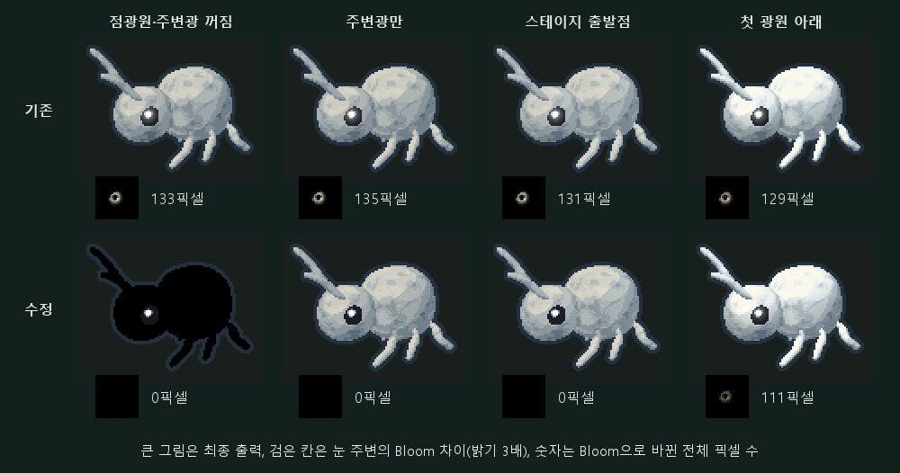

# ToktogiPrototype 2D 스프라이트 셰이더 명세

현재 Pico2D 서식지와 F2는 직접광을 받는 발광 부위에 Bloom을 적용한다. 아래 첫 표는 이전 Pygame 설치본 `framework-r4`의 비교 기준이며, Pico2D 결과는 ‘Pico2D 톡토기 측정’에 기록했다.

## 이전 Pygame 구현과 검증 · 2026-11-17

| 요소 | 플레이 화면 | F2 검수 화면 | 판정 |
| --- | --- | --- | --- |
| 조명 | 캐릭터 추적 점광원과 주변광으로 실시간 CPU 셰이딩 | `L`로 고정·마우스·이동 광원 전환. 강도 버튼 제공 | 구현 |
| Normal | 카메라 좌표 RGB를 디코딩·정규화해 확산과 반사에 적용 | `M`으로 Normal 맵 표시. 최종 조명에서 원본과 평탄 Normal을 교체하는 조작은 없음 | 반응 구현, 비교 조작 미구현 |
| Emissive | 선형 방출 RGB에 번들 강도를 곱해 해당 표면의 밝기에 합산 | Emissive 맵 보기와 `발광` 토글 제공 | 구현 |
| Bloom | 없음 | 없음 | 미구현 |

SDL dummy에서 설치된 렌더러의 `idle/left/0` 128×128 셀을 비교했다. 매번 한 변수만 변경했다.

- 광원을 `(16,30)`에서 `(115,25)`로 이동하자 RGB 2,434픽셀이 달라졌다.
- 같은 광원에서 Normal만 평탄 맵 `(128,128,255)`으로 바꾸자 RGB 2,468픽셀이 달라졌다.
- 같은 광원과 Normal에서 Emissive를 끄자 RGB 87픽셀이 달라졌다. 세 비교 모두 Sprite Alpha가 그대로였다.
- 근거는 `lighting.py`의 `fields`·`shade`, `sprite_renderer.py`의 `render`, `play_view.py`의 `draw`, `motion_viewer.py`의 `material_panel`·`sprite`다.

## 조작과 적용 범위

1. F2의 `실시간 조명` 모드에 `Normal 원본/평탄`과 `Bloom 켜짐/꺼짐`을 추가한다. 같은 포즈를 비교할 때 프레임·뷰·광원·확대율이 바뀌지 않아야 한다.
2. 평탄 모드는 정규화 이후의 Normal을 정확한 `(0,0,1)`로 평가한다. Normal 패스 미리보기는 원본 맵을 계속 표시한다.
3. 초기값은 원본 Normal, 발광 켜짐, Bloom 꺼짐이다. F2에서는 `실시간 조명` 모드의 프리뷰 영역에만 Bloom을 합성한다. 발광을 끄면 Bloom 입력도 0이다.
4. 현재 Pico2D 서식지 플레이는 월드 광원을 공유한다. F2 강도 0.0은 직접광을 끄고 주변광을 유지한다.

## Bloom 처리

- 기존 `Sprite/Base/Normal/RM/Emissive` 번들과 Pillow 계산을 재사용한다. 결과 RGBA는 Pico2D의 동일 SDL renderer에 업로드하며 Pygame Surface는 제거한다. F2 후처리 때문에 에셋을 다시 출력하지 않는다.
- 발광 입력 `E = (Emissive RGB / 255) × emission_scale × (Base A / 255)`를 선형 RGB에서 만든다. Normal·Base·조명 하이라이트는 Bloom 입력에 더하지 않는다. 현재 번들의 `emission_scale`은 1.0이다.
- 현재 Pico2D에서는 블러 전에 각 픽셀의 `E`에 `clamp(점광원 거리 감쇠 × max(N·L, 0), 0, 1)`를 곱한다. 거리 감쇠에는 광원 강도가 포함된다. 주변광·흰 몸통·HUD는 Bloom을 만들지 않는다.
- 이 입력의 휘도 `Y`는 선형 RGB 가중치 0.2126/0.7152/0.0722로 구한다. `clamp((Y − 0.12) / 0.10, 0, 1)`를 곱하므로 0.12 이하는 번지지 않는다.
- 표면 자체 발광은 독립적으로 보인다. 주변광이 0.115 아래면 픽셀별 입사광에 따라 팔레트 보정을 줄이고 실제 재질 밝기를 사용한다. 무광·무발광에서 재질 영역 RGB는 0이며 Alpha와 재질 밖 윤곽은 보존한다.
- 128px 기준 사방에 6px의 0 패딩을 두고 RGB를 가로·세로로 흐린다. 시작값은 반경 6px, σ 2px의 정규화한 가우시안 커널이다. 패딩이 포함된 결과를 피벗 기준으로 보정해 타일 가장자리의 빛이 잘리지 않게 한다.
- 어두운 배경과 조명 스프라이트를 그린 뒤, 실제 겹치는 프리뷰 영역의 화면 RGB를 선형화한다. 흐린 RGB에 강도 0.65를 곱해 가산하고 `[0,1]` 클램프 후 sRGB로 출력한다. Bloom이 0인 픽셀은 기존 바이트를 유지한다.
- 1×/2×/3×에서 스프라이트와 Bloom을 같은 정수 배율의 Nearest로 표시한다. 프리뷰 경계에서 합성을 자르고 접지점·광원 표시·버튼은 후처리 뒤 그린다. Sprite Alpha, 충돌, 피벗·마커는 수정하지 않는다.

## Pico2D 톡토기 측정 · 2026-11-18

동일한 왼쪽 대기 포즈를 배경 RGB (24, 31, 29)에 합성하고 Bloom을 켰을 때 달라진 픽셀을 셌다. 기존 합성기는 발광 맵만 받아 직접광을 꺼도 133픽셀에 번짐이 남았다. 팔레트 보정도 암부의 변화를 채널당 32로 제한해 완전 소등 시 몸통이 밝았다.

| 조명 조건 | 기존 Bloom 픽셀 | 수정 후 Bloom 픽셀 |
| --- | ---: | ---: |
| 직접광·주변광 모두 꺼짐 | 133 | 0 |
| 주변광 0.25만 유지 | 135 | 0 |
| 서식지 출발점 | 131 | 0 |
| 첫 광원 바로 아래 | 129 | 111 |
| F2 왼쪽 / 오른쪽 광원 | 127 / 125 | 120 / 116 |

기준 재질 24건에서 원시 BRDF 최대 채널 오차는 1/255, 표시 팔레트의 RGB 채널 간격 오차와 Alpha 차이는 0이었다. 일반 조도에서는 대기 포즈의 좌우 광원 밝기 차이 19.36/255를 유지했다. 반대 방향 Normal을 넣은 두 발광점, 발광 토글, 색 채널 간 누출, 확대 1·2·3배 및 클립 경계도 검사했다.

## 코드 연결

- `lighting.py`와 `sprite_renderer.py`에 Normal 비교 옵션을 전달한다. 원본/평탄 상태를 조명 캐시 키에 포함한다. 기존 호출은 원본 Normal을 기본값으로 사용한다.
- Bloom 레이어는 `SpriteRenderer`의 기존 맵 제공자에서 구한다. 셀·셀 기준 광원 위치·강도·평탄 Normal 여부로 블러 결과를 24개까지 캐시한다. 광원이 움직이면 발광 맵 영역의 직접광을 갱신한다.
- `motion_viewer.py`에서 토글과 클립 영역을 관리한다. 선형 RGB 프리뷰 합성 결과는 `pico_backend.py`에서 업로드·출력하고 클립 상태를 복원한다. Bloom이 꺼졌거나 발광·밝은 픽셀이 없으면 합성을 건너뛴다.
- 새 `verify_prototype.py`는 Pygame 없이 기존 기준 RGBA와 아래 회귀를 검사한다. 텍스처 업로드·Nearest·합성·Alpha는 실제 SDL 출력에서도 확인한다. DEC-06의 최종 양산 좌표는 계속 보류한다.

## 수락 기준

| 검사 | 통과 조건 |
| --- | --- |
| 조명 | 동일 셀에서 광원 이동 전후 RGB가 달라지고 Sprite Alpha는 일치한다. |
| Normal | 고정 광원·동일 셀에서 원본/평탄 RGB가 달라진다. 원본으로 돌아오면 처음 결과와 바이트가 일치한다. |
| Emissive | Bloom을 끈 상태에서 발광 토글은 표면 RGB에만 영향을 준다. |
| Bloom | 직접광이 충분하고 Emissive가 있는 고정 셀에서 Bloom을 켜면 발광 픽셀 밖의 이웃 RGB가 증가한다. Bloom을 끄면 기존 프리뷰 픽셀과 일치한다. |
| 음성 대조 | 직접광이 없거나, 발광면이 광원 반대쪽이거나, Emissive가 검은 맵이거나 발광이 꺼진 경우 Bloom을 켜도 픽셀 차이 0이다. 밝은 흰 몸통이나 UI만으로 번짐이 생기지 않는다. |
| 경계 | 128px 가장자리의 테스트 발광점은 타일 밖으로 번지되 프리뷰 밖으로 새지 않는다. 1×/2×/3×에서 기준 위치와 윤곽선이 유지된다. |
| 성능 | 같은 클립의 F2 이동 광원에서 Bloom 켜짐/꺼짐의 120프레임 p95·최댓값을 기록한다. 60fps 목표 예산은 16.7ms다. 최초 합성과 캐시 재사용 비용을 구분한다. |

검증 자료는 동일 프레임의 조명·Normal·발광·Bloom 비교 이미지와 바뀐 픽셀 수다. Bloom 합격 기준에는 Sprite Alpha를 넘는 번짐과 프리뷰 경계 검사 결과를 포함한다.
