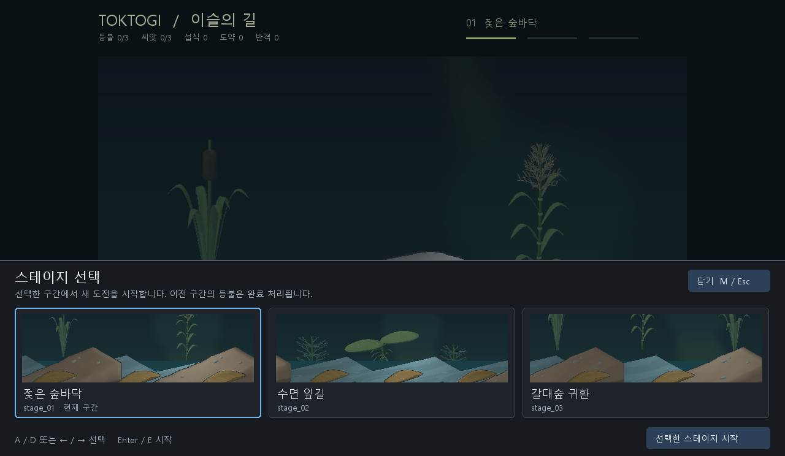

# Toktogi seamless stage·level 전환 명세

2026-11-17 · v1.1 · **신규 제작 요구 / 구현 전**. 개구리밥 발판 구간에서 연꽃잎 위 구간으로 플레이를 끊지 않고 이어 간다. [Rebuild](Rebuild.md)의 차기 범위다.
기존 한 코스는 회귀용 프로필로 보존한다. 이 문서는 진행 구간·월드 연결·전환을 소유하며 조작은 [Control](Control.md), 에셋은 [AssetPipeLine](AssetPipeLine.md)을 따른다.

## 1. 용어·범위

- **World**는 연속된 논리 좌표·시간·물리 공간, **Stage**는 목표·진행 상태를 묶는 구간, **Level**은 배치·충돌·표시 데이터를 묶는 단위다. 한 Stage는 한 개 이상의 Level을 포함할 수 있다.
- Level 경계를 통과할 때 소속 stage_id가 다르면 stage 문맥도 전환한다. App 장면은 계속 플레이이며 Game·입력 세대·시뮬레이션 시계를 다시 만들지 않는다.
- seamless의 합격 조건은 경계에서 로딩 화면·페이드·위치 이동·속도 초기화·모션 재시작·광원/배율 튐이 없는 것이다. Level 이름 표시는 디버그/F2에서만 제공한다.
- 개구리밥·연꽃잎은 수면 위 고체 발판 환경으로 구성한다. 물 표면은 배치 문맥이며 수영·부력·수면 도약·산란 동작을 새로 요구하지 않는다. 플레이의 임의 장식 배경·HUD는 추가하지 않는다.
- 첫 구현은 두 Level을 시작 전에 모두 로드하는 방식이다. 스트리밍 작업자·청크 파일 포맷·새 엔진을 필수로 만들지 않는다. 큰 월드가 실제 메모리 예산을 넘을 때만 후속 단계로 확장한다.
- 초기 연결의 출구 조건은 정상 경계 통과이며 추가 키나 중간 클리어 화면을 요구하지 않는다. 이후 조건부 출구를 만들면 보이는 지형/대상 단서와 통과 조건을 함께 정의한다.

## 2. 예시 구성과 데이터

| 항목 | 초기 제작 계약 |
| --- | --- |
| stage_01 / pond_duckweed | 개구리밥 발판에서 보행·일반 도약·작업을 익힌다. 경계 접근 전에 다음 연꽃잎과 연결 경로가 보인다. |
| stage_02 / lotus_leaf | 연꽃잎 위의 상승·착지·탄성/위험 구간으로 연결한다. 최종 목표는 이 Stage에 둔다. |
| 연결부 | 넓은 겹침/연결 발판과 양쪽 이동 통로를 배치한다. 구간 이름 변경 자체로 점프·회전·작업을 중단하지 않는다. |
| 배치 수치 | 세계 offset·연결 높이/폭·발판·목표·체크포인트는 제작 데이터에서 확정한다. 예시 이름을 생물학적 행동 근거나 검증된 코스 치수로 취급하지 않는다. |

- 프로젝트 A/B 에셋 폴더와 텍스트 자료 대조에서는 연꽃 제작물·manifest를 확인하지 못했다. `lotus_leaf`는 제작 식별자이며 종·asset_id·모델/이미지·크기·충돌·게임 바인딩을 새로 확정한다. 임시 도형으로 검증한 도달성과 최종 에셋 검수를 구분한다.
- Stage 데이터: stage_id, 소속 level_id, 목표 조건, 출구 조건, 최종 여부, 체크포인트/재도전 정책. 중간 Stage 완료와 전체 게임 Cleared를 구분한다.
- Level 데이터: level_id, stage_id, world_offset_px, local_bounds, 플랫폼·대상·위험·체크포인트·진입/이탈 영역, 필요한 asset/revision 목록을 갖는다.
- 객체 키는 `(world_revision, level_id, local_entity_id)`로 고정한다. 문서 ID·폴더 ID와 런타임 객체 키를 분리하고 같은 에셋을 여러 Level에서 배치할 수 있게 한다.
- 포털/경계 데이터는 portal_id, from/to level_id, 양방향 여부, 통과 방향, 진입·복귀 영역과 필요한 진행 조건을 갖는다. 모호하게 겹친 분기에는 명시 우선순위를 둔다.
- 기존 Course를 단일 Stage/Level World로 변환하는 호환 경로를 둔다. 기존 발판·목표·체크포인트·실패 경계 수치를 유지해 이전 입력 리플레이를 그대로 비교한다.
- 식물 발판의 그림·충돌 형상·표시 크기는 별도 데이터다. 톡토기 128px 셀에 큰 잎을 억지로 맞추지 않으며 환경 에셋의 톤·윤곽·픽셀 밀도는 제작 파이프라인과 대조한다.

## 3. 배치 검증

- Stage/Level/포털/객체 ID의 유일성, 유한한 offset·범위·크기, 존재하는 참조를 검사한다. 선언한 양방향 연결은 실제 복귀 포털과 이어져야 한다.
- 시작/체크포인트는 명시한 support_id·방향·포즈로 검증한다. 정렬된 월드 플랫폼의 첫 항목이나 Level 로드 순서를 시작 지지면으로 사용하지 않는다.
- 기존 Course의 “목표 발판 한 개” 검사를 모든 Level에 강제하지 않는다. 최종 Stage 목표의 유효성은 Stage/World에서, 각 Level의 지형·대상은 Level 검증에서 확인한다.
- 공유 연결 발판의 소유 Level과 참조 Level을 구분한다. 같은 키에 서로 다른 geometry를 정의하거나 같은 geometry를 중복 지지면으로 등록하면 오류다.
- 연결 영역과 목적 발판·실패 영역·Camera 허용 범위의 모순을 검사한다. 도달성은 단순 bounds 인접 여부와 별도로 현재 물리 입력 리플레이로 확인한다.
- 필요한 에셋 revision·셀/패스·배치 규모가 로더와 메모리 예산에 맞는지 검증한다. 누락 Level이나 에셋을 빈 맵으로 대체해 시작하지 않는다.
- 새 World 구성은 별도 프로필로 저장한다. 레거시 Course 변환 결과의 플랫폼 값·목표/실패/체크포인트 조건은 기존 프로필과 일치해야 한다.

## 4. 좌표·물리·연결부

- 내부 단위는 논리 px, +x 오른쪽·+y 아래다. `world_point=level_offset+local_point`로 배치를 한 번 변환하고 플레이어의 x/y/vx/vy는 월드 좌표에 계속 유지한다.
- 경계 양쪽의 충돌·지지 후보를 동시에 조회한다. 현재 Level의 bounds를 벗어났다는 이유로 낙하 실패를 판정하거나 옛 Course의 fail_bounds를 새 Level마다 반복 적용하지 않는다.
- 실패 영역·외곽은 World/명시 위험 데이터로 정의한다. 플레이 가능한 인접 Level과 연결 통로를 모두 포함하고, 수면 배경을 자동 위험 또는 부력 표면으로 판정하지 않는다.
- 현행 코드는 support와 도약 준비의 플랫폼을 객체 동일성으로 비교한다. 플랫폼 객체를 매 조회/전환마다 재생성하지 않거나, 관련 비교 전체를 안정적인 platform_id로 함께 이식한다.
- 같은 연결 발판은 하나의 월드 플랫폼 키를 공유한다. 중복 충돌체로 두 번 착지시키지 않으며 서로 다른 발판 사이 틈·상면 단차·Capsule 머리 여유를 검증한다.
- 시작점·모든 체크포인트·양방향 연결의 대기/보행·Q/Z 지지발을 검사한다. 공중 통과도 허용하므로 도약·착지·회전 극단 자세와 128px 여백을 함께 확인한다.
- 연결부 도달성은 현재 일반/탄성 발사·기존 속도 합산·회복 재도약·제동으로 검증한다. 카메라 밖 발판을 착지 가능한 것처럼 가정하거나 경계에서 자동 추진을 추가하지 않는다.
- 충돌 후보는 틱 전후 이동 구간과 Capsule 범위를 모두 포함한다. 작업·타격·지지발 조회 역시 현재 level_id만으로 잘라 인접 Level의 대상/발판을 놓치지 않는다.

## 5. 전환 시점과 상태 보존

- 120Hz 틱에서 충돌·위험·입력·효과를 기존 순서로 처리한 뒤 이전/현재 발 기준점의 이동 구간으로 경계 통과를 판정한다. 큰 이동도 경계를 건너뛴 사실을 검출해야 한다.
- 목적 Level 데이터가 준비되고 출구 조건이 만족되면 현재 level_id/stage_id만 원자적으로 변경한다. 실패·재시작이 확정된 틱은 일반 진행 전환보다 우선한다.
- 위치·속도·논리 방향·조준·지지·착지 회복·도약 준비/탄성 창·진행 중 Action·Track 경과 시각·물성·입력 유지 상태를 보존한다. 경계 통과는 close_input/reset의 사유가 아니다.
- 전환 직전 시작한 공격·섭식·손질과 대상 참조는 해당 객체의 월드 키로 유지한다. 접촉/지지 상실 등 원래 취소 조건만 효과를 닫고, 출입 이벤트가 작업 효과를 재실행하지 않는다.
- 진입·복귀 영역과 마지막 경계 측면으로 왕복 진동을 억제한다. 경계 위 정지·Q/Z 회전·카메라 이동만으로 재진입을 발생시키지 않는다. 실제 역방향 통과는 정상 이동이다.
- R/체크포인트의 명시적 재배치는 일반 경계 통과가 아니며 출입 보상을 재실행하지 않는다.
- 출입 이벤트는 run_epoch·portal_id·통과 순번으로 중복을 제거한다. 같은 틱의 겹친 포털은 우선순위로 하나를 고르고, 이미 통과한 이벤트를 F2/HTML seek로 재실행하지 않는다.
- Stage 목표 달성 플래그와 현재 위치 문맥을 분리한다. 이전 구간으로 돌아가도 달성은 유지하며 중간 Stage의 완료가 Game.run=Cleared를 만들지 않는다.
- 리플레이는 World 프로필·revision·객체/포털 키를 포함한다. 레거시 기록은 단일 Course로, 새 기록은 두 Level로 재생해 배치가 다른데도 같은 검증으로 집계하지 않는다.

## 6. 카메라·표시·조명

- `screen=FIELD_origin+round(world−camera_world)`를 Sprite·지형·대상·마커·그림자·광원에 공통 적용한다. 피벗은 화면 변환 뒤 기존 값으로 차감한다. 물리·타격 계산에 카메라 좌표를 사용하지 않는다.
- 기존 한 코스 회귀에서는 camera_world=(0,0)으로 기존 화면을 유지한다. 두 Level 프로필은 플레이어 주변의 가시 안전 영역을 벗어날 때 추적하고 연결부 양쪽을 미리 보여 준다.
- 카메라는 시뮬레이션 시간 기준의 제한된 이동과 정수 표시를 사용한다. Level별 clamp로 경계에서 스냅하지 않으며 인접 구간의 합친 표시 범위를 기준으로 제한한다.
- 줌·카메라 회전 없이 128px 셀 1×를 유지한다. 정점·착지·연꽃잎 진입에 따른 화면 변위가 모션 진폭이나 개체 크기를 바꿔 보이게 하지 않는다.
- 조명은 같은 월드 위치에서 계산한 뒤 동일 카메라 변환을 쓴다. 추적 광원·주변광·거칠기·눈 발광을 level_id 변경으로 초기화하거나 위치를 modulo 처리하지 않는다.
- 경계 비교는 고정 월드 포즈·고정 월드 광원의 전후 RGB/Alpha와 피벗을 대조한다. 카메라 이동에 따른 화면 위치 변화와 실제 명암 튐을 구분한다.
- Pause/F2에서는 플레이 Camera도 고정하고 복귀 시 이전 시점부터 이어 간다. R의 체크포인트 재배치는 명시적 시점 초기화이며 정상 경계 이동의 부드러운 추적과 구별한다.

## 7. 로딩·수명·실패 처리

- 두 Level의 배치·에셋·충돌·글꼴·필수 텍스처를 플레이 시작 전에 검증/준비한다. 경계 통과 시 디스크 읽기·압축 해제·새 셰이딩 워밍업 때문에 프레임이 멈추지 않게 한다.
- 선행 준비는 모든 애니메이션 셀의 전량 디코딩을 뜻하지 않는다. 연결부 예상 모션과 대상의 가시 데이터부터 기존 캐시 상한 안에서 준비하고 최초 통과와 재통과 비용을 구분한다.
- 같은 asset/revision의 맵·텍스처는 공유하고 Level별 배치/진행 상태만 분리한다. Assets를 Level마다 새로 만들지 않는다. [백엔드](Pico2DBackend.md)의 자원 소유권·캐시 상한을 따른다.
- 추후 스트리밍은 카메라 범위·최대 도달 구간·되돌아갈 영역을 선행 로드한다. support·준비·작업/공격 대상·체크포인트가 참조하는 객체는 해제하지 않는다.
- 목적 데이터 누락/손상은 시작 전 실패시키는 것이 기본이다. 실행 중 실패가 발생하면 마지막 일관 상태를 보존해 오류를 표시하며 미완성 Level로 순간 이동하거나 허공으로 진행시키지 않는다.
- 준비 지연으로 입력을 버리거나 합성 UP을 만들지 않는다. 비동기 구현을 추가할 경우 SDL 텍스처 생성·업로드는 주 스레드에서 완료한 뒤 전환 가능으로 표시한다.

## 8. 체크포인트·대상·재도전

- 체크포인트는 checkpoint_id·stage_id·level_id·world_position·방향·support_id와 명시된 진행 플래그를 저장한다. 레벨 경계 통과 자체는 체크포인트 활성 이벤트가 아니다.
- 등불·먹이·씨앗·가시는 객체 키별 상태로 관리한다. 현재 Game의 단일 전역 bool/개수만 복제하면 다른 Level의 대상을 덮어쓰므로 대상 조회·효과·표시를 함께 변경한다.
- 기본 R 정책은 활성 체크포인트 위치와 그 지점에 필요한 선행 목표만 복원하고 소모 먹이·씨앗·가시 등 가변 도전 상태는 초기 배치로 되돌리는 것이다. 레벨별 예외는 Stage 데이터에 명시한다.
- R은 새 run_epoch를 만들고 키·예약·진행 Action·타이머를 정리한다. 복귀 Level을 준비한 뒤 유효 지지 자세로 배치하며 카메라도 해당 위치로 초기화한다. 일반 seamless 전환과 구별한다.
- 전체 Cleared는 최종 Stage의 목표·접지·정지 조건에서만 발생한다. 중간 출입·목표 스침·카메라 도달은 완료 조건이 아니다. 정확한 중간 저장/복원은 계속 보류다.

## F1 하단 스테이지 메뉴

- M으로 현재 World의 스테이지 목록을 화면 하단에서 180ms 동안 올린다. habitat는 젖은 숲바닥·수면 잎길·갈대숲 귀환과 스토리보드 #1 임시 테스트를 표시하며 모두 선택 가능하다. 기존 월드 아트로 미리보기를 만들고 현재 구간을 표시한다.
- 메뉴·닫힘 애니메이션 중 게임·카메라·위험 타이머를 정지한다. 취소는 진행을 보존하고, 선택 후 시작은 새 run_epoch에서 도전 상태를 초기화한다.
- 목적 Level의 첫 소유 발판에서 왼쪽 끝 +80px(폭이 짧으면 중앙)에 오른쪽 대기 자세로 시작한다. 처음 구간은 원래 spawn을 사용한다. 시작 지지·발 공간·다른 고체 및 적 접촉과의 겹침은 Game 초기화 때 검증한다.
- 앞 구간의 등불·Stage 완료만 선행 처리한다. 선택 구간의 먹이·씨앗·등불·가시·물고기는 초기 상태이며, 새 체크포인트를 활성화하기 전 R은 선택 구간의 시작점으로 돌아간다.
- 닫기·Esc/M은 취소, A/D·좌우 화살표는 선택, Enter/E·시작 버튼은 실행한다. 포커스 상실과 F2 전환은 Control의 입력 정리를 따른다.

스토리보드 항목은 기존 서식지 코스를 재사용하는 임시 연출 변형이다. 기본 실행은 이 항목을 시작한다. M에서 기존 세 항목 중 하나를 고르면 일반 서식지로 복귀한다. 연출·버섯·환경음의 수치와 한계는 [StoryBoardTest](StoryBoardTest.md)를 따른다.

## 9. 구현 책임·검증

- course.py는 기존 Course와 새 Stage/Level 배치·검증을 소유한다. 신규 world.py는 월드 객체/진행·경계·조회 수명을 관리하며 App의 scene 전환을 대체하지 않는다.
- Game은 World의 충돌/대상 조회와 사건을 사용한다. physics는 통합 월드 후보를 받고, MotionSet은 기존 동작을 유지한다. PlayView의 Camera만 월드에서 화면으로 투영한다.
- S-01: 기존 단일 Course 변환 뒤 같은 입력의 13.75초 기준 완주·효과·좌표·픽셀 회귀가 유지된다. 기존 PASS를 복사하지 않고 재실행한다.
- S-02: 개구리밥↔연꽃잎을 보행·일반/탄성 도약·공중제비·착지 중 통과한다. 경계 틱에서 x/y/vx/vy·Track 시각·support가 정상 물리 진행 외에는 불연속하지 않아야 한다.
- S-03: 경계 위 정지·Q/Z·빠른 왕복·동시 포털·긴 dt에서 출입 중복·무한 전환·이중 착지가 없어야 한다. 이전 구간의 달성·소모 상태도 유지한다.
- S-04: 경계 전후 작업/공격·F2·Pause·포커스 상실·R·실패를 검사한다. 효과 중복 0, 이전 세대 예약 0, 체크포인트 복귀 지지 유효를 확인한다.
- S-05: 128px·10/15/20/30/60fps에서 다음 발판·정점·착지·눈 하이라이트·그림자·광원·피벗을 확인한다. 카메라에 의한 1px 어긋남과 레벨별 밝기 튐이 없어야 한다.
- S-06: 누락 이웃·중복 객체 ID·순환 연결·불가능한 도달·잘못된 체크포인트·데이터 준비 실패를 검사한다. 경계 통과 구간의 프레임 p95/최대·메모리·추가 I/O를 기록한다.
- 증거에는 world/level/stage revision, 포털·객체 키, 틱 전후 상태·카메라·로드 상태·128px 프레임·효과 로그를 남긴다. 두 Level 연속 플레이가 검증되기 전 seamless 완료로 표시하지 않는다.
