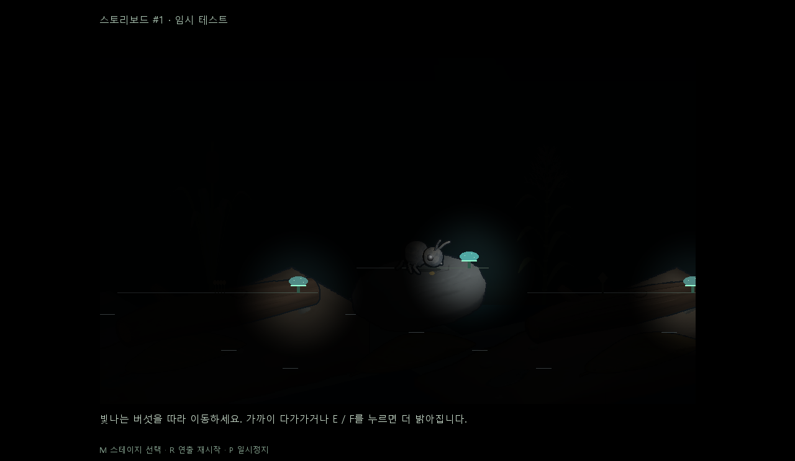

# 스토리보드 #1 임시 테스트

2026-11-18 · [StoryBoard.txt](../StoryBoard.txt)의 다섯 장면을 시험하는 Pico2D 실행 프로필이다.

## 실행과 복귀

- 기본 Start-Toktogi.cmd 또는 main.py 실행은 storyboard 프로필을 연다.
- M 메뉴의 ‘스토리보드 #1 · 임시’와 기존 세 서식지 구간을 자유롭게 선택한다.
- 기존 스테이지를 선택하면 일반 조명·HUD·상호작용으로 돌아간다. --profile habitat로 직접 시작할 수도 있다.
- 테스트는 기존 서식지의 충돌·카메라·경로를 사용한다. 톡토기는 두 번째 숲 발판 중앙에서 오른쪽을 보고 시작한다.
- R은 도입과 버섯 강화 상태를 처음으로 되돌린다. 임시 테스트에서는 체크포인트보다 도입 재생을 우선한다.

## 장면 시간표

| 시간 | 화면과 동작 |
| --- | --- |
| 0~1.2초 | 화면 전체 암전, 낮은 음량의 환경음 재생. |
| 1.2~4.2초 | 화면 오른쪽에서 반딧불이가 상하로 움직이며 중앙의 톡토기로 접근. |
| 4.2초 | 톡토기와 접촉하는 위치에서 밝은 섬광. 반딧불이는 왼쪽 위로 튕긴다. |
| 4.9~6.6초 | 톡토기의 눈꺼풀이 점차 열린다. 반딧불이는 옆에서 떠 있다. |
| 6.6~8.3초 | 눈이 완전히 열린 뒤 반딧불이가 오른쪽으로 퇴장. |
| 8.3초 이후 | 이동·도약·상호작용을 허용하고 발광 버섯이 다음 발판 경로를 안내한다. |

시간과 반딧불이 위치는 고정 틱의 장면 시각에서 계산한다. 도입 중 게임 물리·위험 타이머를 진행시키지 않고 이동·도약·작업 입력을 소비한다. P/Esc·M·F1/F2·Tab·R은 사용할 수 있다.

## 버섯과 조명

- 각 기존 발판의 오른쪽 끝에서 35px 앞에 임시 버섯을 둔다. 충돌체와 진행 목표는 원래 서식지 데이터를 사용한다.
- 135px 안에서는 가까울수록 발광이 커진다. 85px 안에서 새로운 E/F DOWN을 받으면 1.2초 동안 더 밝아진다.
- 근처 버섯의 E는 발광 상호작용으로 소비한다. F는 버섯 강화와 기존 단발 공격을 함께 실행한다. 유지·repeat는 재발동하지 않는다.
- 반딧불이와 가까운 버섯의 위치·세기를 톡토기의 기존 Normal/RM 조명과 Bloom에 전달한다.
- 준비된 숲 배경에는 작은 범위의 밝기 마스크를 적용한다. 반딧불이와 버섯은 자체 발광 도형이며, 톡토기의 Bloom은 직접광 조건을 따른다.
- 눈뜨기는 idle 스프라이트의 Emissive 눈 영역에 임시 눈꺼풀을 합성한다. 원본 번들·모션을 다시 출력하지 않는다.
- 버섯 도형은 톡토기 Alpha를 사용해 뒤에 합성하므로 몸통·눈을 덮지 않는다.

## 환경음과 수명

- 전용 사운드 파일이 없어 Python 표준 라이브러리로 낮은 바람·곤충음의 4초 PCM 루프를 만든다.
- 기존 Pico2D SDL_mixer의 실제 출력 주파수·signed 16-bit·1/2채널 형식을 확인하고 해당 형식으로 재생한다.
- F2·M 메뉴·일시정지·포커스 상실·기존 스테이지 복귀 중에는 환경음을 정지한다.
- 장치나 형식을 사용할 수 없으면 화면에 환경음 상태를 표시하고 게임을 계속한다.
- 종료 시 채널을 멈춘 뒤 chunk와 PCM 버퍼를 해제한다. 무영상 검사는 오디오 장치를 열지 않는다.

## 집중 검사와 임시 범위

- verify_storyboard.py에서 암전·접근·충돌·반동·눈뜨기·퇴장, 도입 입력 차단, 근접/E/F, M 왕복, P/F2 정지, R 재생 및 PCM 범위를 검사한다.
- 기존 스테이지 메뉴와 입력 검사를 함께 확인한다. 전체 main.py --verify에도 스토리보드 검사를 연결한다.
- 반딧불이·버섯은 임시 픽셀 도형이며 환경음은 합성 루프다. 전용 제작 에셋, 실제 스피커 청취 및 장시간 FPS 인수는 남아 있다.
