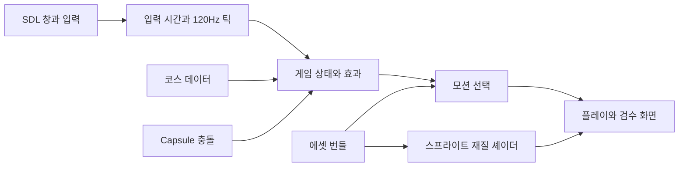

# 톡토기 프레임워크 — Pico2D 재구현 계획

2026-11-17. 차기 구현 기준은 [Rebuild.md](../Rebuild.md)다. 아래 framework-r4와 이전 버전은 현재 Pygame 구현·검증 이력이며 새 구현의 완료 증거가 아니다.

| 책임 | 차기 구현 계약 |
| --- | --- |
| 앱·출력 | Pico2D가 창·Image/Font·최종 출력을 맡고 `pico_backend.py`가 같은 SDL renderer의 업로드·좌표·해제를 담당한다. |
| 입력·시간 | `input_clock.py`가 SDL 시각·포커스·텍스트를 보존한다. 기본 get_events와 큐를 중복 소비하지 않으며 120Hz 순서·누적 시간·키 계약을 유지한다. |
| 게임·모션 | Game·Course·physics·Timeline·Track·MotionSet·리플레이를 재사용한다. 게임 규칙은 렌더러에 의존하지 않는다. |
| 에셋·재질 | Assets는 검증된 Pillow 맵을 제공하고 SpriteRenderer는 CPU 조명 RGBA를 반환한다. Pygame Surface 의존을 제거하고 F2 Normal 비교·Bloom을 구현한다. |
| 도구·검증 | 시작·설치·verify·패커·HTML·배포까지 이식한다. 동일 입력·기준 픽셀·128px 동작·실기 성능 관문 통과 후 현행 실행본을 교체한다. |

# 톡토기 프레임워크 — framework-r4

2026-11-17. Q·방향키 반전 지지 검사, 섭식 전환, 시작/체크포인트 Capsule 여유를 보완했다. Q의 두 지지 자세에 각각 100ms를 배정하며 기본 반전은 480ms다. 실제 표시 시간은 MotionSet을 사용한다. 모션 HTML의 리플레이에는 120Hz 위치·속도·지지·행동·셀 기록이 포함된다. 명세 수락 시험의 추적은 [시험별 검증](../../../toktogi/prototype/REQUIREMENT_VERIFICATION.md)을 참조한다.

## 현행 호출 순서와 객체 관계

### 실행과 초기화

| 파일 | 심볼 | 동작 |
| --- | --- | --- |
| app.py | App.__init__ | main.py에서 시작한다. 창을 열고 Assets·Game·PlayView·Viewer·입력 객체를 생성한다. |
| materials.py | Assets.load | 원본·보조 ZIP의 해시, 호환 서명, 프레임을 검사한다. Track을 만들고 SpriteRenderer에 맵 제공 함수를 넘긴다. |
| game.py | Game.__init__ | 플레이에 필요한 에셋을 검사한다. MotionSet을 만들고 Course의 시작점·체크포인트를 검증한다. |
| app.py | App.run | 표시 루프를 60fps 목표로 돌린다. 종료 시 Assets를 닫고 Pygame을 종료한다. |

### 이벤트와 120Hz 시뮬레이션

| 파일 | 심볼 | 동작 |
| --- | --- | --- |
| input_clock.py | EventClock.events | SDL2 큐 시각을 Pygame 이벤트에 대응시킨다. App이 이를 시작 시각 기준으로 바꿔 틱 큐에 넣는다. |
| timeline.py | FixedStepTimeline.advance | 큐를 시각·입력 순번으로 처리한다. 누적 시간만큼 1/120초 틱을 실행하고 남은 시간을 보존한다. |
| game.py | Game.step | 전환·이동·충돌·위험을 먼저 갱신한다. 활성 플레이에서는 입력 콜백을 실행한 뒤 발사·작업 효과·목표 조건을 판정한다. |
| app.py | App._event | 게임 키를 Game.edge에 전달한다. 틱 이후 처리되는 장면 전환과 포커스·중복 키 처리도 맡는다. |

### 플레이 렌더링

| 파일 | 심볼 | 동작 |
| --- | --- | --- |
| play_view.py | PlayView.draw | 코스와 캐릭터 위치를 읽고 추적 광원을 잡는다. Game.visual()로 현재 셀을 요청한다. |
| motion.py | MotionSet.cell | 상태·방향·경과 시간으로 Track의 (clip, view, sample) 키를 고른다. |
| sprite_renderer.py | SpriteRenderer.render | Assets의 5패스 맵을 사용한다. 조명 모드에서는 스프라이트에 대한 상대 광원 위치로 계산하거나 캐시에서 가져온다. |
| lighting.py | shade | Normal·RM·Emissive를 CPU에서 평가해 Sprite Alpha를 유지한 Surface의 픽셀을 만든다. App.draw에서 창을 갱신한다. |

### F2 검수와 기록 재생

| 파일 | 심볼 | 동작 |
| --- | --- | --- |
| app.py | App.switch | 입력 상태를 정리하고 장면을 바꾼다. F2에서는 FixedStepTimeline이 Viewer.step을 호출한다. |
| motion_viewer.py | Viewer.draw | 같은 Assets를 사용해 선택한 모션과 맵·조명·마커를 표시한다. |
| replays.py | game_replays | 독립 Game에 기록 입력을 넣어 셀과 사건 시각을 계산한다. HTML 생성 시에는 매 틱의 위치·속도·지지면도 기록한다. |
| build_motion_preview.py |  | 모션·실제 게임 시간표·리플레이를 스프라이트와 함께 단일 HTML로 내보낸다. |

### 주요 객체의 관계

| 파일 | 객체 | 연결되는 객체 | 관계 |
| --- | --- | --- | --- |
| app.py | App | Assets · Game · PlayView · Viewer · EventClock · FixedStepTimeline | 실행 시 생성하고 장면별로 갱신합니다. Game과 두 화면에 같은 Assets를 전달합니다. |
| game.py | Game | Course · MotionSet | Course를 전달받아 물리·행동·진행 상태를 관리합니다. 자체 MotionSet으로 현재 자세를 해석합니다. |
| course.py | Course | Platform | 발판의 좌표와 종류를 튜플로 보관합니다. Game의 현재 지지면도 같은 Platform 객체를 가리킵니다. |
| materials.py | Assets | Track · SpriteRenderer | 번들 표본으로 Track을 구성합니다. 셀의 맵을 읽는 함수와 발광 강도를 렌더러에 주입합니다. |
| motion.py | MotionSet | Track | 제작 Track을 읽고 게임에 쓰는 Q·Z·공중제비 시간표와 전환 Track을 만듭니다. |

---

# 톡토기 프레임워크 — framework-r3

2026-11-17 · framework-r2 검토 보완

| 계약 | 보완 |
|---|---|
| 전환 및 효과 | F 복귀의 자동 균형 지연, 이동 즉시 수락, 공격 준비 중 직전 자세 연결. 기존 bite 취소와 단일 타격 처리 유지. |
| 검수 | `replays.py`의 입력을 Game의 120Hz 틱에 넣어 셀과 사건 시각을 얻는다. F2·HTML의 `replay_` 네 항목이 같은 시간표를 사용한다. 카메라와 코스 배치는 플레이에서 확인한다. |
| 에셋 | `Assets`가 번들 형식과 PNG 헤더를, `motion.py`가 플레이 필수 모션을 검사한다. 보조 ZIP을 따로 지정할 수 있다. |
| 발판과 리그 | 시작·체크포인트는 지지할 수 있는 자세여야 한다. Z의 발 지지는 Blender 사이 자세도 검사한다. 출력은 128px 5패스다. |

저장 Action의 좌우 1,954자세를 2.5ms 간격으로 재검사했다. 왼쪽에서 다른 다리끼리 교차하는 삼각형 쌍은 r2 대비 출력 키 1,883→308, 5ms 사이 자세 11,060→2004이었다. 연속 평가의 지지발 높이 최대값은 0.265px다. 세부 결과는 `spin_interkey_validation.json`에 있다.

---

# 톡토기 게임 프레임워크 — framework-r2

2026-11-17 · framework-r1 정밀 검토 보완

| 모듈 | r2 계약 |
|---|---|
| Game | 입력 시각에 작업 적격성을 검사한다. 작업 가능색은 동일한 수락 판정을 사용한다. 섭식 복귀는 E/F/G/X와 방향 입력으로 중단할 수 있다. 회전 중 예약과 취소는 회전 경계를 따른다. |
| Course · physics · Timeline · Track | 유효한 발판과 체크포인트, 가까운 충돌 후보, 유한한 양수 틱과 개별 셀 시간을 검증한다. |
| Assets | 번들 잠금 및 서명, 필수 모션과 참조를 검증하고 제작 시간표를 읽는다. 카탈로그 항목 수는 검증 기록에서 확인한다. |
| MotionSet | 실제 재생 시간표를 소유한다. Game·F2·HTML은 같은 표본 시간으로 Z, 공중제비, 일반·탄성 전개 구간을 사용한다. |
| 리그·재질 | 좌우 Z 각각 12번의 125ms 지지 구간을 만든다. 각 지지발은 월드 좌표에 머물고 스윙발은 다음 위치로 옮겨간다. 128px 5패스와 앵커를 함께 출력한다. |

F2는 `game_` 검색, HTML은 게임 재생 시간 섹션으로 실제 게임 시간표를 확인한다. 원본 검수에는 제작 타이밍을 사용한다. 전개 프리뷰는 다음 단계와 공유하는 마지막 셀의 중복 시간을 제외한다. 공중제비는 330ms 중 뒤집힌 자세 105ms를 사용한다. 위치·발사·착지 판정은 고정 물리 틱이 관리한다.

기존 62그룹과 추가 5그룹, 좌우 10/15/20/30/60fps, 지지발 높이·이동, 출력 Alpha, Q 및 F 전환을 다시 검사한다. 실제 게임 시간과 제작 시간은 별도 프리뷰로 표시한다.

---

# 톡토기 게임 프레임워크 구조 개선 명세서

2026-11-16 · framework-r1 · 기준 gameplay-r4와 플레이 명세 v2.1

## 목표와 기준

120Hz 게임 규칙과 60Hz 표시를 독립 운영한다. 입력 기록만으로 같은 코스를 재생한다. 새 레벨, 모션 연결 또는 라이팅을 수정할 때 서로의 코드 수정 범위를 줄인다. 현재 Windows Pygame 진입점, 128px 픽셀 렌더링, UI 없는 플레이 화면, 수면·산란 제외를 계약으로 둔다.

gameplay-r4의 Game에는 충돌 수식, 작업과 진행, 에셋 선택이 모여 있다. App은 창, 입력 시간, 검수, 플레이 렌더링을 함께 관리한다. Assets에는 타임라인과 해시 검증, PNG 읽기, 셰이딩 캐시가 결합돼 있다. 각 책임을 아래 단위로 옮긴 뒤 기존 회귀를 다시 실행하고 확장 동작을 추가한다.

## 모듈 계약

| 위치 | 소유하는 책임 | 호출 계약 |
|---|---|---|
| main.py · input_clock.py · timeline.py | SDL 창·이벤트 수집과 시간 정규화, 고정 틱 전달 | EventClock이 원시 시각을 수집한다. FixedStepTimeline은 시각과 순번으로 정렬하고 scene tick의 입력 지점에 전달한다. |
| game.py · course.py · physics.py | 행동 상태, 작업 효과와 진행, 레벨 배치와 충돌 | Game.step은 위치·속도·유효 지지를 갱신한다. 순수 Capsule 함수는 다음 좌표와 접촉 후보를 돌려준다. Course는 테스트나 다른 정적 발판 코스로 교체할 수 있다. |
| motion.py | 표본 시간, 보행 정지·회전·공중·복귀 자세, 트랙 결합 | Track은 시간으로 셀을 찾는다. MotionSet은 에셋 메타데이터를 사용하며 물리나 효과를 수정하지 않는다. Game은 모션 완료 시점에 방향과 입력을 확정한다. |
| materials.py · sprite_renderer.py · lighting.py | 번들 인증, 모션 카탈로그와 맵 읽기, 재질 표시, CPU BRDF | Assets는 Sprite/Base/Normal/RM/Emissive 셀과 마커를 제공한다. SpriteRenderer는 맵과 화면 좌표 광원으로 Surface를 만든다. |
| play_view.py · motion_viewer.py | 코스 표시, 모션·머티리얼 검수 | 플레이와 검수는 같은 SpriteRenderer를 사용한다. 시각화에는 게임 모델을 읽기만 한다. |

입력 적용 순서는 접촉, 게임 입력, 효과와 발사, Pause·모드 전환이다. 같은 시각의 입력은 수집 순서로 처리한다. 틱 처리 상한을 넘으면 경과 시간을 다음 호출에 넘긴다. 시각 재생이나 검수 화면이 발사·타격·섭식 효과를 발생시키지 않는다.

## 플레이에 드러나는 기능

### 지상 360°와 연결

- `Q`는 기존 방향 반전, `Z`는 바라보는 쪽을 유지하는 지상 360° 회전이다. `Z`는 접지된 대기·보행에서 시작하고, 보행 중에는 현재 위상의 제동 포즈를 먼저 사용한다.
- 바닥에서 지지 가능한 자세에만 수락한다. 모서리·공중·피격·진행 정지에서는 거절한다. 회전 중 자력 수평 이동은 멈춘다. 방향키 유지 시 회전이 끝난 뒤 보행을 재평가한다.
- 왼쪽 시작은 기존 360° Action을 사용한다. 오른쪽 시작은 같은 원본 리그에 오른쪽 기준 yaw를 더해 5패스로 다시 출력한다. 각 방향의 회전 시작과 끝은 해당 방향의 중립 자세를 공유한다. 대기 중 다른 표본에 있으면 짧은 진입을 붙이고, 보행 시작 애니메이션 중에는 수락 조건을 다시 확인한다.
- 링처럼 이어지는 중간 자세의 표시 시간은 약 1.55초를 목표로 한다. 회전 슬롯에는 효과가 없다. 회전 중 작업·점프는 기존 순서 및 취소 규칙에 따라 종료 경계에서 실행한다. Space DOWN, 지지 상실, 포커스 상실 정책을 검증한다.
- 보행 위상별 제동, 착지별 재도약, 공중제비·정점·착지, 06·07 손질 연결과 표본별 중단을 하나의 모션 선택 모듈에서 사용한다. 관찰 장면과 연출용 모션은 기존 카탈로그에서 검수한다.

### 재질 조명

Base의 sRGB와 카메라 좌표 Normal, 선형 Roughness/Metallic·Emissive를 128px 단위로 읽는다. 기존 CPU BRDF로 조명에 반응시키고 윤곽선·Alpha·Nearest를 보존한다. 게임의 상단 키라이트 보정은 발판 좌표에 따라 부드럽게 변한다. 주변광과 강도 하한은 기존 밝기 검증 예산을 기준으로 조정한다. 검수 화면은 일곱 패스와 고정·마우스·이동 광원으로 같은 재질을 확인할 수 있다. 해시·뷰·피벗·카메라 좌표 문맥은 배포 번들의 계약을 따른다.

## 구현 순서와 인수 기준

1. 기존 55그룹, 기본 코스 완주, 배포 파일 SHA256을 기준으로 확보한다. 구조 변경 뒤 같은 회귀를 실행한다.
2. 좌우 `Z`의 한 바퀴, 보행 제동 경계, 회전 끝 방향, 대기 공격·점프, 모서리와 공중 거절, Pause에 각 재현 입력을 둔다. Blender Action과 5패스 셀의 정점 해시, 128px 타일 경계, 저표시율 표본을 확인한다.
3. 기존 섭식·손질·탄성·공중제비·착지 동작과 완료 경계를 다시 시험한다. 코스 주행은 밝고 화면 안에 남아야 하며 조명 벡터가 바뀌면 같은 표본의 픽셀도 달라져야 한다.
4. 패스 Alpha와 기존 셰이더 기준 출력, 새 에셋 전체, 프리뷰와 휴대 ZIP의 동일성을 확인한다. 설치 후 실제 진입점으로 부팅한다. 재사용 예시는 README에 기록한다.

실기기 입력 지연·실시간 GPU 경로·동적 경사 발판은 별도 검증 범위다. 최종 에셋 생산의 DEC-06은 기존 명세와 같은 보류 상태다.

## 구현 검증 결과

- 구조 변경 전후 기존 55그룹 통과. 기능 추가 후 62그룹 통과. 기본 코스 13.75초, 도약 4회, 탄성 1회.
- 양쪽 62자세의 360° 및 10·15·30·60fps 전 표시 시작 위상. 오른쪽 새 60셀의 저장된 Action 정점 해시 일치. 810개 기존 보조 PNG와 원본 번들의 바이트 유지.
- 동일 스프라이트와 서로 다른 코스 좌표의 빛에서 RGB가 달라진 픽셀 2,243개, Alpha 차이 0개. 다섯 발판 몸통 평균 밝기 189.6–192.2/255.
- 검수 카탈로그 244개, 재질 셀 2,314개. 확인 방법은 ToktogiPrototype의 README와 verification.json을 참조한다.
