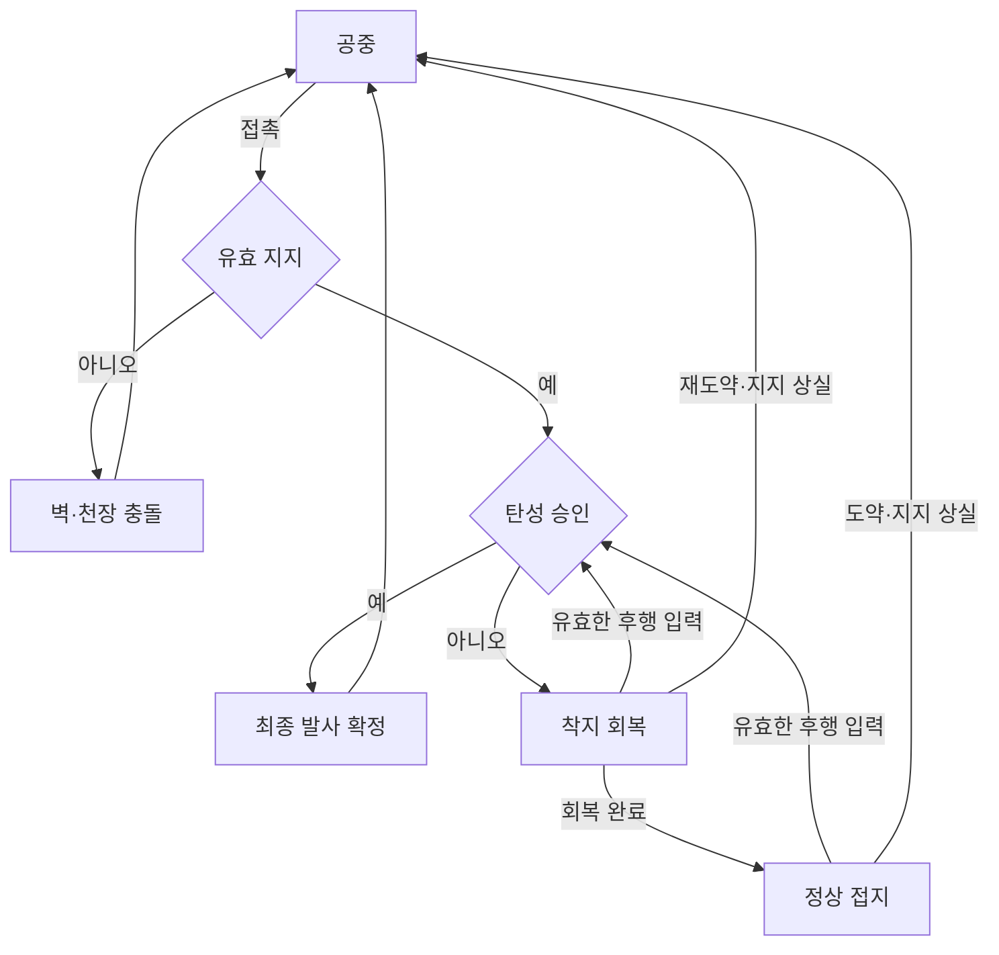

# toktogi 플랫포머 플레이어·상호작용·3D/2D 애니메이션 명세서

> **파일명:** `022_toktogi_playable_action_animation_spec.md`  
> **버전:** 2.1 — 정밀 검토·경계 계약 보완  
> **개정일:** 2026-11-11  
> **대상:** 물알둥근톡토기(*Sminthurides aquaticus*)를 모티프로 한 플랫포머 playable character `toktogi`  
> **입력 자료:** 이전 Markdown 7종, `01_2DGP_1차_기획서.pdf` 60쪽, v1.1의 비관계 기술 검토, 확인한 공식 기술 자료  
> **최신 조건:** ① 톡토기는 플랫포머의 플레이어 캐릭터다. ② 지속적인 개체 관계 요소를 제거하고 상호작용으로 보완한다.  
> **문서 상태:** 구현을 위한 설계·제작·검증 계약. 실제 게임 코드·리그·스프라이트·영상·성능 시험의 완료를 뜻하지 않는다.

> **2026-11-17 런타임 선택 갱신:** 차기 구현은 [Pico2D 재구현 명세](../Rebuild.md)를 따른다. Pico2D 출력과 같은 SDL 계층의 입력·업로드 보완을 채택한다. 본문의 행동·리그·에셋·효과 계약은 승계하며 기존 구현·미구현·보류 범위는 재구현 명세와 현행 상세 기획을 함께 읽는다.

## 0. 재구성 결과와 읽는 순서

플레이의 중심은 **발판에서 이동·제동·조준 → 기존 속도를 이어받아 도약 → 낙하와 접촉 판정 → 축소된 이동·재도약 또는 탄성 타이밍 도약 → 다음 발판과 목표 도달**이다. 새 PDF도 이 상승 흐름을 중심 경험으로 설명한다. [D8 p.5, 28–34]

행동 상태는 `Idle / Walk / Jump / Interact / Combat`으로 구성한다. `Interact`는 먹이·수집물·환경 장치·자기 몸 등 **한 작업의 대상**을 다루며, 작업이 끝나면 실행 문맥을 해제한다. 공격·피격·넉백, 물리 접촉, 스테이지 성공·실패는 각자의 판정 책임을 가진다. 애니메이션은 이 결과를 보여 주며 세계 위치나 효과를 임의로 결정하지 않는다.

| 표시 | 의미 |
|---|---|
| **[현재 조건]** | 이번 사용자 메시지로 확정된 플랫포머 playable 및 지속 관계 제외 |
| **[확정]** | D7의 기존 사용자 결정 중 현재 조건과 양립하는 내용 |
| **[승계]** | D1–D8 및 v1.1에서 현재 범위에 맞게 유지하는 규칙 |
| **[v2 설계안]** | 새 상태 구성·상호작용·실패/재시작·데이터 구조를 위한 구체적 제안 |
| **[선택]** | 채택한 기능 프로필에서만 활성화하는 표현 또는 확장 |
| **[보류]** | 수치·환경·방식이 아직 결정되지 않은 항목. 빈 값을 엔진 기본값으로 숨기지 않음 |

별도 표시가 없는 신규 ID·필드·처리 순서·단계별 제작 계획은 **[v2 설계안]**이다. v2.1의 경계·수명·검증 보완도 같은 설계안 범위이며 D7의 사용자 결정을 새로 확정하지 않는다. 기능 채택, 실행 가능한 프로필, 실제 시험 통과를 구분한다. 예시 JSON은 실행 코드나 정식 JSON Schema가 아니다. 이번 정밀 검토의 반례·중요도·보완 위치·수락 시험은 부록 E에서 추적한다.

### 문서 구성

- §1–3: 요구 우선순위, 게임 흐름, 플레이어 행동 카탈로그
- §4–6: 상태·입력·동작 수명, 이동·점프·낙하·착지·탄성
- §7–10: 상호작용·전투, 공통 시간과 저장, 발판·목표·실패·재시작
- §11–14: 리그, 단계·가중치 제작, 2D 출력·재생, 실제 재질과 성능
- §15–18: 데이터 예시, 제작 순서, 움직이는 검증 자료·시험, 남은 결정
- 부록 A–E: 원본 31개 장면 처리, 구버전 이관, 8개 자료와 외부 출처, 변경 이력, v2.1 정밀 검토 기록

## 1. 요구 우선순위와 적용 범위

### 1.1 충돌 해결

같은 사항이 충돌하면 **현재 사용자 조건 → D7의 양립 가능한 확정 결정 → D8이 요약한 프로젝트 방향 및 양립 가능한 D1–D6 → v1.1의 비관계 정합성 보완 → v2 신규 설계안** 순으로 적용한다. PDF는 실제 TOKTOGI 프로젝트 자료이며, 새 조건 이전의 상태·구애·결속 내용도 포함한다. 따라서 PDF에 실려 있다는 사실만으로 모든 구버전 기능을 승계하지 않는다. [D8 p.3, 15, 18–26, 53, 56, 58–60]

이번 버전은 기존 여섯 상태 유지보다 최신 조건을 우선한다. 구애·번식·지속 결속·개체 운반·공동 도약·성별별 추진 역할·협동 의존 경로를 현역 플레이 시스템에서 제외한다. 이 제외는 더 이상 미정 질문이 아니다. 옛 자료의 정확한 처리와 폐기 식별자는 부록 B에만 기록한다.

### 1.2 계속 유효한 결정

| 결정 | v2에서 유지할 내용 | 아직 정하지 않은 내용 |
|---|---|---|
| DEC-01 | 주요 동적 자산의 실제 재질 반응, 일부 배경·정적 성분 베이크 허용 | 자산별 적용 목록·광원·그림자 책임 |
| DEC-02 | 기존 선택 허용 중 차기 경로는 Pico2D 창·출력 + CPU 재질 + 동일 SDL renderer 업로드로 채택. [재구현 명세](../Rebuild.md) | 실제 환경·DLL 잠금과 성능·실기 검증. 별도 최종 렌더러는 이번 범위 밖 |
| DEC-03 | 픽셀풍, 고정 카메라 기본과 캐릭터 회전, 향후 카메라 회전 고려 | 고정의 범위·추적/줌·논리 해상도·view 수·각도 |
| DEC-04 | 기존 속도 합산, 제동, 회복 중 축소된 이동과 재도약, 탄성 타이밍 성공 시 범위 증가 | 속도 샘플·회복식·공중 조향/제동·탄성 입력 창과 합성식 |
| DEC-05 | Capsule 충돌, 현재 지지 다리 끝과 바닥의 시각 정합 | Capsule 축·치수·offset·법선·가장자리·오차 |
| DEC-06 | **좌표·view·Normal·Depth·피벗·마커 변환의 최종 계약 보류** | 작업 소켓도 해당 변환을 따라야 함. 삭제한 관계용 앵커는 생산 요구에서 제외 |
| DEC-07 | Normal/Roughness/Metallic에 따른 실시간 반응 | BRDF·광원·감쇠·거칠기 하한·색 출력 |

근거: [D7 §1, §3–8][D8 p.6–8, 36–43, 49–50]. 640×360, 8방향, 촬영 35°/45°, PDF의 도약거리 계산값, 24 MiB 예시는 최종 규격이 아니다. [D8 p.29, 41–42]

### 1.3 포함·제외·확장

| 범위 | 내용 |
|---|---|
| 기본 이동 기능 | 대기·보행·제동·방향/조준·접지 도약·물리 비행·지지 이탈 낙하·착지·회복 이동/재도약·탄성 도약 |
| 상호작용 계약 | 유효 대상 선택·접촉/도달 검사·한 번 효과 확정·종료/취소. 구체 종류는 §7 |
| 전투 계약 | 이전 요청에 포함된 공격·피격·넉백·실패를 게임 기능으로 정의. 채택한 프로필만 활성 |
| 진행 계약 | 목표 도달·실패 감지·재시작·선택 체크포인트·일시정지. 조건과 저장 정책은 명시 |
| 선택 표현 | 자기 손질·복관 접촉·짧은 탐색/접촉 표현. 자동 치유·흡착·공격 능력을 부여하지 않음 |
| 현재 제외 | 지속 개체 관계, 번식/산란 조작, 성장·유전·사회성 시뮬레이션, 동료 운반·공동 추진, 관련 전용 제작 자산 |
| 별도 확장 필요 | 이중 점프·벽 타기/벽 점프·매달리기·대시·비행·수영·일반 공중 입력 버퍼·코요테 타임·정밀 런타임 발 IK |

최소 검증 장면은 플레이어 1개체로 구성한다. 이는 최종 제품의 인원·네트워크 모드를 새로 확정하는 규칙이 아니다. 현재 명세에는 다른 개체의 도움을 필수로 요구하는 진행 조건이 없다. [D8 p.46; v2 설계안]

## 2. 플랫포머 플레이 흐름

### 2.1 한 번의 도전

| 단계 | 플레이어가 판단할 것 | 게임 시스템이 판정할 것 |
|---|---|---|
| 발판 준비 | 위치·진입 속도·진행/조준 방향·제동 여부 | 실제 접지·가속/감속·지원 방향 |
| 도약 | 다음 발판까지의 거리·높이·장애물 | 현재 요청·현재 지지·제어 조건과 속도 합산 |
| 비행 | 착지 예상 지점·위험·다음 입력 | 중력·충돌·지원되는 공중 조작만 적용 |
| 착지 | 정상 회복 또는 탄성 타이밍 | 유효 지지·충격·회복·시간 창·단일 발사 |
| 경로 작업 | 먹이/장치/수집물에 접근할 필요 | 선택된 상호작용의 적격성·효과 |
| 진행/재도전 | 다음 발판·목표·실패 후 재시작 | 안정 목표 도달 또는 명시적 실패 조건 |

낙하 자체는 실패가 아니다. 아래 발판으로 정상적으로 내려갈 수 있다. 화면 최고점 도달이나 목표 그림과의 겹침도 곧바로 클리어가 아니다. 목표의 지지·영역·안정 조건은 §10에서 정의한다. [D7 §7.4, §10][D8 p.34, 48]

### 2.2 장면의 기능 구분

**이동 충돌**, **자동 세계 사건**, **입력으로 실행하는 Interact**, **전투 판정**을 구분한다. 탄성 잎을 밟는 것은 이동 물리이며 E를 눌러 시작하는 작업이 아니다. 위험 구역 진입, 선택된 자동 수집, 체크포인트/목표 트리거도 세계 사건으로 처리할 수 있고, 그 때문에 현재 행동을 무조건 Interact로 바꾸지 않는다.

자동 작동과 수동 작동을 모두 제공하는 물체는 하나의 효과 소유권·소비 기록을 사용한다. 같은 먹이·수집물·체크포인트가 두 경로에서 중복 지급되지 않게 한다. 활성화 방식은 물체 프로필에서 하나로 선택하거나, 두 경로를 지원한다면 명시적으로 합친다.

## 3. 플레이어 행동 카탈로그

`PLY-*`는 v2의 게임 행동·발생 결과 식별자다. 전부 키 하나씩을 갖는 상태라는 뜻이 아니다. 원본 생물 장면의 ID와 분리하며, 원본 31개는 부록 A에서 추적한다.

### 3.1 이동·공중·접촉

| ID | 행동·발생 조건 | 표현과 종료 조건 | 지위 |
|---|---|---|---|
| PLY-01 | 대기 | 중립 정렬→작은 기관 움직임→다음 행동. 공중 Idle도 물리 속도 유지 | 기본 |
| PLY-02 | 보행 | 첫 발→주기→발 정리. 실제 자력 이동과 보행 위상 대응 | 기본 |
| PLY-03 | 제동·정지 | 승인된 감속 자세. 정지점을 지나 역방향 속도를 만들지 않는 제동 정책 | 확정 기능 |
| PLY-04 | 방향 전환·조준 | facing/aim을 갱신하고 해당 표본 선택. 이동 벡터·view 선택과 구분 | 기본, 세부 입력 보류 |
| PLY-05 | 일반 접지 도약 | 준비→launch 1회→물리 비행→실제 착지 | 기본 |
| PLY-06 | 상승·정점·하강 | 실제 속도와 지지에 따라 공중 표현 변경. 새 추진 사건 없음 | 물리 결과 |
| PLY-07 | 가장자리·발판 소멸로 낙하 | 준비/launch 생략, 기존 속도로 비행 | 물리 결과 |
| PLY-08 | 착지 | 유효 지지 획득→충격 표현→회복. 벽·천장 접촉과 구분 | 물리 결과 |
| PLY-09 | 회복 중 이동 | 이동 가능, 정상보다 성능 축소 | 확정 기능 |
| PLY-10 | 회복 중 일반 재도약 | end 시각 정리를 기다리지 않고 현재 요청 처리, 정상보다 범위 축소 | 확정 기능 |
| PLY-11 | 탄성 타이밍 도약 | 지정 표면·유효 입력 창·단일 최종 발사, 성공 범위 증가 | 확정 기능, 프로필 보류 |

### 3.2 대상 작업과 자동 접촉

| ID | 행동·발생 조건 | 적용 방법 | 지위 |
|---|---|---|---|
| PLY-12 | 환경 장치 사용 | Interact.activate: 정렬→작동 확정→정리 | v2 기능 제안 |
| PLY-13 | 수집 | Interact.collect 또는 선택된 자동 세계 사건. 수집 항목 1회 반영 | v2 기능 제안 |
| PLY-14 | 섭식 | Interact.feed: 현재 먹이 접촉에서 주기별 bite. 먹이 소비와 보상은 별도 정책 | 동작 승계, 효과값 보류 |
| PLY-15 | 조사·짧은 대상 접촉 | Interact.inspect: 대상으로 향한 표현·정보/반응. 효과 없음도 유효 | 선택 상호작용 |
| PLY-16 | 자기 손질 | Interact.self_groom: 자기 몸을 대상으로 지정, 지지 마스크 검증 | 선택 연출 |
| PLY-17 | 자동 접촉·표면/위험/기점 트리거 | 세계/물리 컴포넌트가 처리. Interact 상태 강제 진입 없음 | 기반 계약 |

### 3.3 전투·진행

| ID | 행동·발생 조건 | 적용 방법 | 지위 |
|---|---|---|---|
| PLY-18 | 기본 공격 시도 | Combat의 startup→active→recovery, 공격 프로필·현재 대상 검사 | 게임 설계안 |
| PLY-19 | 피격 반응 | 피해/제어 정책에 맞는 반응. 착지 회복과 별도 필드 | 게임 설계안 |
| PLY-20 | 넉백·강제 이동 | 물리 제어기의 외력/속도 변경, 실제 궤적 표시 | 게임 설계안 |
| PLY-21 | 패배·실패 | 실패 조건 확정 후 새 효과 차단, 현재 위치/상태 기록 | 진행 계약 |
| PLY-22 | 재시도·재배치 | 시작점 또는 활성 체크포인트의 명시적 초기화 정책 | 진행 계약 |
| PLY-23 | 목표 도달·클리어 | 목표 영역·유효 지지·안정 조건을 충족한 1회 완료 사건 | 진행 계약 |
| PLY-24 | 일시정지·재개 | 시뮬레이션 시간 정지·입력 재동기화 | 진행 계약 |

PLY-12·13·15의 구체 장치·수집물·보상은 신규 게임 설계다. 관찰된 톡토기가 스위치를 사용하거나 수집품을 저장한다는 주장이 아니다. PLY-16은 기본 이동 숙련을 위해 매번 수행해야 하는 의무 행동으로 두지 않는다. [D1–D5; v2 설계안]

## 4. 상태·입력 계약

### 4.1 독립적으로 관리할 영역

| 영역 | 값의 예 | 소유권 |
|---|---|---|
| 게임 진행 | `run_state = Playing / Paused / Failed / Cleared / Respawning` | 장면·진행 제어기 |
| 행동 | `action_state = Idle / Walk / Jump / Interact / Combat` | 입력 수락·행동 전이 |
| 물리 | 지지/공중, Capsule, 위치·속도·접촉·표면 | 물리 제어기 |
| 반응·능력 | `landing_recovery`, `hit_react`, `control_status` | 회복/전투 정책 |
| 실행 문맥 | 점프 요청, interaction instance, attack instance | 각 실행의 수명·취소·소비 |
| 표현 | action/visual phase, clip·variant·gait phase, outgoing 표시 | 시각 해석기 |

`action_state=Idle`인데 공중인 상태가 가능하다. 착지 애니메이션이 재생된다는 이유로 실제 지지를 생성하지 않는다. 모든 자력 도약은 현재 플레이어 자신의 유효 요청을 통해서만 물리 제어기에 전달한다.

### 4.2 기본 입력과 v2 변경

기존 Space 의미는 관계 제거와 무관하므로 **D4의 UP 발사 프로필을 승계**한다. 일반적인 다른 플랫포머의 키 의미를 자동 적용하지 않는다. 키를 바꾸려면 별도 입력 프로필로 정의하고 시험한다. [D4 §1][D8 p.19, 22]

아래 행동 입력은 `run_state=Playing`이며 현재 제어 정책이 허용할 때 처리한다. Pause·retry 같은 진행 요청은 별도 입력 경로다. Failed/Cleared/Respawning에서 Space나 E/F/G가 행동만 바꿔 진행 제한을 우회하지 않는다.

| 입력 | v2 동작 | 조건·취소 |
|---|---|---|
| Space DOWN | 즉시 Idle 선택, 취소 대상인 미발사 요청·현재 작업/공격 정리 | 이미 적용된 운동·피해·자원 효과는 되돌리지 않음 |
| Space UP | 즉시 Jump 선택, 현재 지지와 제어 조건이 허용하면 요청 생성 | 준비 후 launch 직전 재검사. 공중은 새 추진·일반 착지 예약 없음 |
| LEFT/RIGHT DOWN/UP | 허용된 상태에서 Walk/방향 의도 갱신 | 양쪽 유지 시 Walk 의도 0, 한쪽 해제 후 나머지 방향 사용 |
| `brake_intent` | 제동 의도 | 실제 키·허용 상태·감속식 보류 |
| `aim_intent` | 승인된 진행/도약 조준 | 축·마우스/키·회전 범위 보류. 공중 자유 조향을 자동 허용하지 않음 |
| E DOWN | 적격 외부 대상의 Interact 요청 | v2 환경 상호작용 기본 키 제안. 대상 종류별 activation 정책 적용 |
| E UP | E로 시작한 hold형 Interact만 종료 | press_once의 수락된 단발을 무조건 취소하지 않음 |
| F DOWN/UP | Interact.feed 직접 시작/해당 F 유지형 작업 종료 | 기존 섭식 키 승계. 현재 먹이·지지·도달 조건 필요 |
| G DOWN/UP | 활성화한 Interact.self_groom 시작/해당 G 작업 종료 | 선택 손질의 기존 키 승계. 외부 대상 탐색 없음 |
| C/V | 기본 미할당 | 새 공격·상호작용 키로 자동 재사용하지 않음 |
| `attack_pressed` | 설정된 Combat 요청 | 실제 키·허용 상태·공중 공격 여부는 전투 프로필 |
| `pause` / `retry` | 진행 제어기에 요청 | 기본 조작 맵의 실제 키는 별도 설정 |
| 포커스 상실 | raw 유지 키 정리, 미실행 입력 작업 취소, Idle | 가짜 Space UP 금지. 진행 상태가 Playing이 아니면 그 상태 유지 |

**[v2 설계안 — 명시적 입력 변경]** E/F/G의 새 작업은 `Idle`, `Walk`, 그리고 **접지한 `Jump.end`**에서 허용한다. 기존 D4의 모든 Jump 제외를 이 좁은 경우에만 바꿔, 착지한 플레이어가 대상에 바로 작업할 수 있게 한다. Jump.pre·공중에서는 거절하며, 이미 Interact 중인 경우 유효한 다른 작업으로 교체할 수 있다. Combat 중 작업 전환은 해당 취소 프로필이 허용할 때만 가능하다.

회복 중에도 조건에 맞는 이동·일반 재도약은 가능해야 한다. Jump.end에서 유지 중인 방향 의도도 평가하며 새 DOWN을 합성하지 않는다. 입력이 없는 Jump.end는 기존 종료 포즈를 유지한다. 직접 Space DOWN으로 선택한 Idle을 같은 시각의 유지 방향이 즉시 덮어쓰지 않고, 다음 제어 갱신부터 보행 의도를 다시 평가하는 프로필을 제안한다.

### 4.3 원시 입력과 실행 인스턴스

모든 유효 DOWN/UP은 행동과 무관하게 `held_keys`를 갱신한다. 같은 시각 입력은 `(effective_at, input_sequence)` 순서를 유지한다. 실제 상태 진입·명시적 재진입에서만 `state_generation`을 증가시키며, 거절 입력·무관 UP·방향·view 변경은 세대를 바꾸지 않는다.

Interact에는 `interaction_kind`, `initiating_binding`, `gesture_id`, `interaction_instance_id`를 둔다. 예를 들어 **F DOWN→G DOWN→F UP**에서 마지막 F UP은 현재 자기 손질을 종료하지 않는다. E로 시작한 feed와 F로 시작한 feed도 해당 인스턴스를 시작한 유지 입력만 종료시킨다. 같은 시각의 F/G/E 입력은 전부 순서대로 해석한 뒤 살아 있는 인스턴스의 효과만 실행한다. 앞선 인스턴스의 time=0 효과를 입력 처리 중간에 먼저 확정하지 않는다.

취소는 해당 시점의 요청/인스턴스에만 적용한다. **Space의 경우** 같은 시각의 DOWN→UP은 앞선 요청을 취소한 뒤 새 Jump 요청을 만들 수 있고, UP→DOWN은 앞서 만든 미발사 요청을 취소한다. F/G 및 E는 각 binding의 activation·유지·종료 정책을 적용하며, 이 Space 전용 순서를 일반화하지 않는다. 오래된 취소 콜백이 나중의 다른 인스턴스를 취소하지 않도록 ID를 검사한다.

포커스·장치 재연결·라이브 복원에는 새 `input_epoch`를 만든다. 이전 epoch의 DOWN과 이후 UP을 하나의 제스처로 합치지 않는다. 이미 수락된 요청의 복원은 raw 입력 재생과 구분하며 §9.4를 따른다.

입력 어댑터는 **순서 있는 실제 edge 기록**과 **현재 유지 상태 snapshot**을 분리한다. 짧게 눌렀다 놓은 입력을 프레임 끝의 held 값 비교만으로 복원하지 않는다. 자동 반복 DOWN·중복 전달은 새 gesture/요청을 만들지 않으며, 정상 해제 뒤 실제 재누름은 새 gesture다. Space UP의 새 도약 적격성은 같은 epoch·게임 입력 문맥에서 원시 전이로 관측·정규화한 실제 DOWN에 대응해야 한다. 이 DOWN의 기록은 행동 전이 수락과 별개이므로 제어 제한 때문에 Idle 전이가 거절되었다는 이유만으로 raw 기록을 지우지 않는다. 이미 수락된 Jump.pre의 복원과 유지형 작업 계속 토큰은 이 새 gesture 조건을 우회하지 않는다. SDL2의 키 상태 조회는 이벤트 처리 사이에 눌렀다 놓은 구간을 유지 snapshot에서 놓칠 수 있고, 키 이벤트에는 repeat·timestamp 정보가 있으므로 채택 어댑터에서 이 역할을 구분해 기록한다. SDL2 채택 자체를 확정하는 규칙은 아니다. [T17]

UI가 입력을 소비하거나 Pause·포커스 전환으로 게임 입력 문맥이 닫혀도 raw UP/장치 정리는 수행한다. 닫힌 문맥의 입력은 새 행동으로 전달하지 않는다. 재개 시의 유지형 작업 계속 여부는 §9.4–9.5를 따르며, 메뉴를 닫는 키 해제나 재연결 snapshot을 새 Space UP으로 전달하지 않는다. 키 재배정·복수 장치를 지원하는 어댑터는 gesture 시작 당시의 물리 입력 식별과 binding revision도 보존해 이후 UP을 올바른 작업에 연결한다. 이러한 추가 장치 지원은 선택 범위다.

### 4.4 방향 의도·행동 전이·운동 적용

방향 키를 읽는 것, `Walk`를 선택하는 것, 물리 가속을 적용하는 것은 서로 다른 가드다. 아래 기본안은 Playing·현재 제어 허용을 공통 조건으로 사용한다. raw 의도는 행동 전이가 거절되어도 갱신한다. [D4 §1.2; v2.1 정합 보완]

| 현재 문맥 | 방향 입력의 처리 | 행동·운동 결과 |
|---|---|---|
| 지지된 Idle/Walk | 유지 의도 평가 | Walk 선택·방향 갱신, 채택한 이동 프로필 적용 |
| 지지된 Jump.pre | 의도만 기록 | 방향 키만으로 준비 취소·Walk 전이 없음 |
| 지지된 Jump.end/종료 유지 | 유지 의도 평가 | 회복 이동 가능. 직접 행동 요청의 같은 시각 우선권은 §4.2 적용 |
| 공중 Idle/Walk/Jump | 의도만 기록 | 공중 제어 프로필이 없으면 방향 입력에 의한 속도 변경 0. 기존 속도·중력·충돌 유지 |
| Interact/Combat | 해당 movement/cancel 프로필로만 사용 | 공통 held 처리기가 Walk로 덮어쓰지 않음. 종료 후 다음 허용 갱신에서 보행 평가 |

좌우 동시 유지의 **의도 0**은 현재 물리 속도 0을 뜻하지 않는다. 제동·마찰·넉백·발판 운동은 각자의 정책을 따른다. 지지를 다시 얻으면 현재 held 의도를 새 DOWN 합성 없이 평가한다. 공중 조향·작업 중 보행을 채택한 프로필만 위 기본안의 해당 운동 범위를 확장할 수 있다.

### 4.5 진행 상태의 허용 전이

진행 입력도 별도 수락 가드와 실행 ID를 가진다. Failed/Cleared 결과는 해당 도전에서 확정된 뒤 일반 입력·pause/resume로 Playing으로 되돌릴 수 없다.

| 현재 상태 | 요청·사건 | 허용 전이·검사 |
|---|---|---|
| Playing | pause | 현재 도전·pause 실행 ID와 pending pause 기록. 해당 경계 처리 뒤 terminal 결과가 없으면 Paused |
| Paused | 대응 resume | 같은 pause 실행과 도전이 유효할 때 Playing. 입력·clock 정합 완료 필요 |
| Failed | retry | 유효한 재시작 프로필에서 1회 수락하여 Respawning |
| Cleared 또는 Playing | retry/다음 레벨 요청 | 해당 진행 프로필이 명시적으로 지원할 때만 새 도전 준비. 기본 자동 전이 없음 |
| Respawning | 준비 완료 | 현재 respawn 실행의 세계 초기화·안전 배치·참조·입력/clock·활성 기능 준비 검사가 끝난 경우에만 Playing |
| Failed/Cleared/Respawning | pause/resume | 기본 프로필에서는 진행 상태 변경 없음. 메뉴 표시는 별도 UI 문맥 |

중복 retry는 새 actor life를 여러 번 만들지 않고, 오래된 pause/respawn 완료 콜백은 새 도전을 변경하지 않는다. Pause 입력과 같은 시각에 이미 발생한 접촉·효과·종료 후보의 처리는 §9.3의 경계 정책을 따르며, pause 토글로 확정된 결과를 소급 삭제하지 않는다. 재시작 준비 실패는 명시적 차단/오류 결과로 남기고 준비되지 않은 Playing을 발행하지 않는다.

Playing에서 수락한 pause는 현재 경계의 **pending 진행 요청**이다. 그 경계에 이미 도래한 접촉·타임라인 효과·파생 outcome을 먼저 해결·확정한 뒤 terminal 결과가 없을 때 Paused를 적용한다. Failed/Cleared가 확정되면 pending pause는 그 결과를 덮어쓰지 않는다. 기본 입력 문맥은 pause 수락 이후 같은 입력열의 새 행동 요청을 차단하되 raw 전이·기존 작업의 해제/정리는 반영한다. 이미 도래한 효과를 먼저 Paused로 바꾸어 가드에서 소거하지 않는다. 효과보다 이른 시각의 pause는 이후 시뮬레이션 시간을 정상적으로 멈춘다.

## 5. 행동 완료와 애니메이션 수명

### 5.1 논리 단계와 표시 단계를 분리

`action_phase/subphase`는 시뮬레이션의 진행·효과를, `visual_phase/subphase`는 표시 포즈를 관리한다. Idle로 선택된 채 낙하하면 `action_phase=Idle.mid`, `visual_subphase=air_fall`이 가능하다. 시각 seek·view 변경·fade 종료가 새 행동이나 효과를 생성하지 않는다.

| 행동 | 자연 완료 | 중단 |
|---|---|---|
| Idle | 반복 대기 | 수락된 새 행동으로 전환 |
| Walk | 실제 이동 성분에 따른 주기/정리 | 방향 해제 시 Idle. 지지 소실은 물리 비행, 관성 유지 |
| Jump | 실제 착지 end 또는 미발사 blocked 정리 후 hold. 유효한 이동/상호작용은 §4 경로 | 미발사 요청 종료 시 §6.2의 논리 단계도 정리. 이미 발생한 비행 계속 |
| Interact | 완료 정책대로 end 정리 후 Idle. 필요한 hold 반복은 명시된 cycle 경계에서만 | 작업 목표·임시 점유·미실행 사건 정리, 현재 물리에 맞는 표현 |
| Combat | recovery 끝에서 공격 닫기→Idle | active 즉시 닫기, 이미 발생한 결과는 유지 |

새 입력을 수락하면 이전 end의 완료를 기다리지 않는다. 이전 end는 게임 효과 없는 `outgoing_visual`로만 유지한다. 동시에 활성화할 outgoing 슬롯은 기본 1개로 제한한다. 빠른 재전환은 현재 표시 결과 또는 검수된 즉시 전환을 출발점으로 사용하며 오래된 시각 꼬리를 무한히 쌓지 않는다.

### 5.2 단계의 의미

| 단계 | 목적 | 완료 근거 |
|---|---|---|
| pre | 현재 포즈에서 준비·지지·목표 정렬 | 유효 조건 + 선언한 준비 시간/완료 사건 |
| mid | 핵심 동작·반복·실행 마커 | 물리 접촉, 실제 작업 완료, 유효 루프 또는 중단 |
| end | 사용한 기관 정리·다음 포즈 연결 | 해당 완료 정책. 입력 잠금과 같은 뜻이 아님 |

하나의 state 내부에서 세 구간을 분리해도 되고 별도 제작 클립으로 저장해도 된다. 보행·대기·한 번의 버튼 접촉에 억지로 같은 길이의 세 구간을 강제하지 않는다. 비행 길이는 고정 이미지 시퀀스의 끝으로 결정하지 않는다. [D4 §4][D8 p.21–22]

### 5.3 수치 초기값의 지위

| 동작 | 제작 시작점 | 해석 |
|---|---|---|
| Idle | pre 0.12s / 잔동작 1.60s / end 0.10s | 시각 정렬용 |
| Walk | pre 0.10s / 주기 0.48s / end 0.12s | 실제 속도·보폭에 맞춰 조정 |
| Jump | pre 0.08s / mid는 물리 / 착지 정리 0.12s | 준비 시간과 비행/회복 시간 구분 |
| Interact.feed | pre 0.16s / 주기 0.40s, bite u=0.55 / end 0.12s | 현재 먹이 접촉에서 cycle별 효과 |
| Interact.self_groom | pre 0.20s / 더듬이 0.80s→전환 0.16s→furca 1.00s / end 0.20s | 선택 연출의 기존 제작 시작점 |
| 일반 Interact | pre 0.16s / 접촉 0.50s / end 0.14s부터 검수 | 기존 선택 Interact의 시각 참고. 장치 효과 시각을 자동 확정하지 않음 |
| Combat | 공격별 프로필 | 임의 피해·범위·프레임 수를 기본값으로 채우지 않음 |

모든 수치는 D4·PDF의 제작 초기값 또는 새 프로필 자리다. 생물 실측값·최종 밸런스가 아니며, 프레임 수에 맞춰 임의 반올림하지 않는다. [D4 §5][D8 p.54]

## 6. 이동·점프·낙하·착지·탄성

### 6.1 이동 제어와 충돌

플랫포머 이동은 채택한 플레이 평면과 중력 방향에서 계산한다. 정확한 축·단위·화면 변환은 DEC-06의 이름 있는 프로필로 정한다. 캐릭터의 외형 회전이 자유 3D 이동이나 새 공중 조향을 뜻하지 않는다.

Walk는 이동 의도를 받아 물리 제어기가 가속·감속·충돌을 계산한다. 실제 자력 이동이 거의 없는데 최고속 걷기 그림을 재생하지 않는다. 제동 입력은 채택한 허용 상태·표면에서 적용하고, 정지를 지나 의도하지 않은 역방향 속도를 만들지 않도록 한다. 공중 제동·조향·마찰·최대 속도는 설정 전까지 비활성/보류로 표시한다.

표면의 이동 속도, 자력 이동, 충돌 후 미끄러짐을 구분한다. 움직이는 발판의 이동은 현재 지지면의 물리 효과이며, 개체 운반 기능과 무관하게 유지한다.

### 6.2 일반 도약

1. Space UP으로 Jump 선택 및 요청 적격성을 검사한다.
2. 접지·현재 제어·run_state가 허용하면 새 `jump_request_id`와 준비 타임라인을 만든다.
3. launch 시점에 현재 세대·요청·단계·지지·제어·미소비를 다시 확인한다.
4. 물리 제어기가 최종 속도를 한 번 적용하고 요청 소비를 같은 commit으로 기록한다.
5. 표현기는 그 발사 사건을 받아 furca 전개·상승 자세를 표시한다.

```text
v_takeoff = v_inherited + delta_v_jump + delta_v_elastic
```

`v_inherited`는 기존 명세의 `v_carry`에 대응하는 **이동 속도 승계 성분**이다. 이 속도 합산 요구는 유지한다. 샘플 시점, 보존할 성분, 접촉 전 하강 속도의 처리, 발판 속도 상속을 프로필에서 정하고 `v_incoming / v_after_contact / v_takeoff`를 따로 기록한다. 같은 발판 성분을 두 번 더하지 않는다. [D7 DEC-04, §5][D8 p.28–29]

공중의 일반 Space UP은 표현 재선택이며 추가 충격량·일반 착지 예약이 아니다. 준비 중 취소·지지 상실·제어 제한으로 무효화된 요청은 나중에 자동 발사하지 않는다. `cancelled/rejected/consumed` 요청은 다시 실행할 수 없는 종료 상태다.

**미발사 분기 복구:** Space UP으로 Jump 선택 자체는 허용되었지만 접지 상태에서 발사 요청을 만들 수 없거나, 준비 중 현재 요청이 취소되면 같은 Jump 실행의 논리 단계도 닫는다. 현재 지지가 없으면 충격 없는 `Jump.mid` 공중 추종으로, 지지를 유지하면 `Jump.end.blocked`로 이동해 준비 자세를 정리하고 종료 자세를 유지한다. blocked는 별도 action이 아니며 실제 landing event·착지 충격·새 회복·탄성 기회를 만들지 않는다. 제어 제한이 풀리면 접지 Jump.end의 이동/작업 경로를 그대로 사용할 수 있다. 이미 다른 행동 또는 terminal 상태로 전환된 옛 실행의 콜백은 Jump를 되살리지 않는다. Space UP 행동 선택 자체가 거절된 경우에는 기존 행동을 유지한다. 이 분기는 D4에 있던 비관계 실패 경로를 승계한 것이다. [D4 §8]

### 6.3 지지 이탈과 비행 표현

걷다가 가장자리에서 떨어지거나 발판이 사라지면 launch 없이 기존 속도·중력으로 비행한다. 실제 상승/정점/하강에 맞춰 `air_rise/apex/fall`을 선택한다. 피격으로 공중에 뜬 경우도 기존 물리 결과를 사용한다. 공중 Space DOWN은 Idle 선택만 바꾸고 속도나 중력을 지우지 않는다.

지지가 필수인 Interact와 지상 전용 Combat은 지지 상실 시 실행을 취소한다. 준비 단계에서 지지가 사라진 Jump도 미발사 요청을 취소한다. 공중 작업/공격은 별도 활성 프로필이 있는 경우에만 허용한다.

### 6.4 접촉·지지·착지 사건

| 데이터 | 의미 |
|---|---|
| contact | 물리 접촉 보고. 벽·천장·센서도 포함할 수 있음 |
| support | 현재 Capsule이 유효하게 지지되는가 |
| support handle | 표면 ID와 생명주기 세대. 파괴/재사용된 표면과 구분 |
| support episode | 연속 지지 구간. 콜라이더 파트나 재질 경계마다 새로 생성하지 않음 |
| landing event/context | 인정된 공중→지지 획득, 접촉 시각·입사/충돌 후 속도·회복·탄성 기회 |
| spawn_supported | 처음부터 지면 위에 배치. 가짜 충격·회복·탄성 보너스 생성 없음 |

지지 판정에는 표면 허용 플래그, Capsule 접촉점·법선·분리 상태·허용 오차를 사용한다. 현재 지지 다리의 시각 마커나 `foot_plant` 사건은 물리 지지를 만드는 근거가 아니다.

미세 들뜸에 대한 착지 재무장 기준과 실제 지지 유무는 분리한다. 중복 착지를 막는다는 이유로 지지가 사라진 상태에 공중 발사를 허용하지 않는다. 초기 지면 배치에서도 새로운 일반 점프 요청은 가능하다.

landing context는 최초 착지를 승인한 **논리 표면 handle/life·접촉 출처·물리/탄성 프로필 revision**을 기록한다. 여러 지지 후보가 있으면 선언한 선택 규칙으로 접촉 시각·법선·접촉점 속도·탄성 조건의 출처를 일관되게 정하며, 서로 다른 발판의 유리한 값만 조합하지 않는다. 동일 논리 표면의 collider 파트와 다른 논리 표면을 구분하는 규칙도 표면 프로필에 둔다.

### 6.5 충격과 회복

움직이는 표면의 접촉점 속도를 뺀 상대 속도와 표면 법선을 사용해 충격을 평가한다. 회전하는 표면은 중심의 평행 이동만으로 접촉점 속도를 대신하지 않는다. 정확한 기준 축·감쇠·임계값은 물리 프로필에 둔다.

`landing_recovery`는 애니메이션 end 및 공격 recovery와 별도다. 일반 회복에서는 **이동과 일반 재도약이 각각 가능하면서 정상보다 성능이 축소**되어야 한다. 회복만을 이유로 둘 중 하나를 전면 금지하는 프로필은 DEC-04를 만족하지 않는다. 피격·실패 등의 독립 제어 제한은 해당 가드를 따른다.

시작 조건·크기·정상 복귀·공중 재진입 시 계속/동결/초기화·재착지 갱신 방식을 반드시 기록한다. 정상/회복/탄성 비교는 같은 위치·진입 속도·표면 운동·조준에서 실제 거리/높이로 측정한다. 도약 추가 성분만 줄였다고 실제 범위 축소를 입증한 것은 아니다.

### 6.6 탄성 타이밍

탄성 여부는 표면의 물리 프로필이다. 외형이 잎이거나 Roughness/Metallic이 특정 값이라는 이유로 자동 탄성이 되지 않는다. [D7 §6][D8 p.31–32]

```text
time_error = origin_input_time - landing_contact_time
창의 예시 형태: -pre_window <= time_error <= post_window
```

창의 폭·경계 포함·DOWN/UP 의미·선행 예약·유지 입력·TTL·발사 지연·보너스/회복 적용 순서·거리/높이 증가 지표는 보류다. 탄성 전용 예약을 선택해도 일반 공중 입력 버퍼로 확대하지 않는다. 원래 입력 시각을 수락/착지/발사 시각으로 덮어쓰지 않는다.

후행 창이 있으면 착지 순간만 검사하지 않는다. **착지 회복이 먼저 끝나도** 동일한 착지 문맥·현재 지지·미소비·창이 유효하면 후행 입력을 평가한다. 창 만료·지지 상실·실제 발사·제어 조건 불허는 기회를 닫는다. 입력 창 안의 요청을 무기한 저장했다가 발사하지 않도록 수명과 최대 지연을 선언한다.

탄성 수락·발사에서는 최초 표면과 현재 지지의 연결성 및 기록한 프로필 revision을 재검사한다. 기본안에서는 최초 논리 표면의 유효 지지가 끊기거나 탄성 조건/선택 출처가 달라지면 그 기회를 닫는다. 탄성 A에서 비탄성 B로 연속 보행해도 A의 보너스를 B로 가져가지 않으며, 비탄성→탄성 프로필 변경만으로 과거 착지에 새 기회를 만들지 않는다. 이 처리를 위해 support episode·회복을 새 착지처럼 재시작하지 않는다. 같은 논리 표면의 파트 교체는 선언한 동일성 규칙에 따른다.



후행 재검사 간선은 새 적격 입력이 있을 때만 실행한다. 다이어그램이 창의 폭이나 회복 합성 방식을 확정하지 않는다.

### 6.7 단일 발사와 재시도

중복 방지를 네 부분으로 나눈다: **원래 입력/예약 자격의 소비**, **요청당 충격량 소비**, **같은 경계에서 경쟁하는 최종 발사의 단일 commit**, **착지별 탄성 보너스 소비**. 일반 도약·반발·탄성 보너스는 한 결과에서 합성하며 각각 독립 충격량으로 실행하지 않는다.

선행 탄성 예약을 채택하면 원래 input event/gesture에 `input_eligibility_id` 또는 동등한 동일성을 연결한다. 단발 입력 하나의 자격은 다른 landing event·새 요청 ID로 바뀌어도 한 번만 발사에 소비할 수 있다. 요청에 결합한 자격을 다른 살아 있는 요청에 동시에 결합하지 않는다. 최종 발사 시 입력 자격·요청·착지 보너스의 필요한 소비를 같은 commit에 기록하고 후보 버퍼에서 제외한다. 요청이 취소된 뒤 같은 자격을 새 착지에서 자동으로 다시 무장하지 않는다. 아직 요청에 결합되지 않은 자격의 TTL·만료·거절 처리는 채택한 예약 프로필을 따른다. 일반 도약 fallback도 원래 자격을 공유해 이후 착지에서 다시 소비하지 않는다. hold 재작동을 명시적으로 채택한 프로필만 선언한 재무장 조건으로 새 활성 자격을 만들며, 매 tick 유지 상태를 단발 입력으로 재사용하지 않는다.

실제 일반/탄성 발사는 해당 착지의 탄성 기회를 닫는다. 준비 취소는 실제 충격량 소비가 아니지만 취소된 요청 자체는 종료된다. 탄성 후보가 취소됐다고 자동 일반 발사로 바꾸지 않는다. 보너스 조건만 실패한 경우의 일반 도약 fallback에는 현재 유효한 일반 요청과 선언된 정책이 필요하다.

낮은 천장에 막혀 새 착지가 인정되지 않은 상황의 새 일반 요청은 `blocked_takeoff_retry_policy`를 따른다. 일반 요청을 영구 잠그지 않으며 기존 탄성 보너스도 재무장하지 않는다. 이 정책은 탄성을 끈 일반 도약 시제품에서도 필요하다.

### 6.8 고속 이동·표면 변형

연속 속도 합산·탄성·긴 낙하·넉백을 포함한 지원 속도에서 가장 얇은 지원 표면을 검증한다. 선택한 CCD/shape cast/substep 경로와 접촉 시각 정밀도를 선언한다. 끝점 겹침만 검사하면 지원 속도·두께 범위를 제한해야 한다. 센서가 모든 빠른 상대 운동을 자동 검출한다고 가정하지 않는다. [T10]

잎의 그림만 눌리는 시제품은 실제 접촉면과의 오차를 제한한다. 실제 지지면이 이동/변형되는 경우 위치·속도·발 마커·캐릭터 배치를 일관되게 갱신한다. Capsule이 지지되더라도 선택 자세의 필수 발 지지를 만들 수 없으면 다른 적격 자세를 쓰거나 해당 작업을 거절한다.

실제 이동/변형 발판의 활성 프로필은 상승 발판과 천장 사이처럼 플레이어·세계 비관통을 동시에 만족할 수 없는 경우의 `blocked_motion_policy`를 선언한다. 지원 코스에서 그 배치를 금지하여 검증하거나, 실제 이동 제한/정지·지지 해제·명시적 실패 조건 중 채택한 결과를 처리한다. 압착을 자동 즉사·임의 teleport·무한 침투 해소로 대체하지 않는다. **물리 해결 후 실제 발판 transform·접촉점 속도·지지 결과**를 운동과 표시의 공통 입력으로 사용하며 명목 경로 애니메이션이 이를 덮어쓰지 않는다. 해당 표면을 사용하지 않는 시제품에는 이 고유 정책을 필수로 요구하지 않는다.

## 7. 상호작용 시스템

### 7.1 정의와 범위

상호작용은 **한 실행 동안 목표를 검사하고 정해진 효과를 수행한 뒤 끝나는 작업**이다. 대상 선택·임시 자원 점유·작업 소켓은 실행 문맥에만 속한다. 성공해 바뀐 장치 상태나 수집 기록은 세계/진행 데이터에 남을 수 있지만, 종료 후 플레이어가 대상에 붙거나 대상의 이동을 따라가지는 않는다.

| 종류 | 대상 | 실행/효과 | 종료 |
|---|---|---|---|
| activate | 승인된 환경 장치·안전 지점 | 지정 flag/장치 동작을 한 번 확정 | 단발 end→Idle |
| collect | 수집 가능 항목 | 항목 소비와 획득 기록을 원자적으로 확정 | 항목당 정책에 맞게 완료 |
| feed | 현재 닿는 먹이 | 유효한 hold 동안 cycle별 bite. 먹이량·회복/점수 효과는 프로필 | 해제·고갈·접촉 상실·취소 |
| inspect | 조사 가능 물체·허용한 짧은 접촉 대상 | 정보/국소 반응 또는 `effect=none` | 단발 완료/취소 |
| self_groom | 자기 몸 | 지지/작업 마스크를 갖는 손질 표현. 기본 효과 없음 | 전 절차 완료 또는 중단 |

activate/collect/inspect의 구체 대상과 효능은 v2 제안이다. 필요한 종류만 켠다. 물체 운반·당기기·끌기·잡고 매달리기·대상과 공동 이동은 이 기본 계약에 포함하지 않는다.

### 7.2 요청·대상 선택

외부 대상은 활성 컴포넌트·허용 종류·현재 도달 범위·필요 시 시선/차폐 조건을 통과한 후보에서 선택한다. 여러 후보는 선언한 우선순위→거리→안정된 handle 순서 등 결정적인 규칙을 사용한다. 화면 강조 대상과 실제 요청 대상을 일치시킨다. 후보가 없으면 `no_target`으로 거절하며 효과나 임의 접근을 만들지 않는다.

대상은 요청 수락 때 잠그고, 실행 도중 매 프레임 최근접 대상으로 바꾸지 않는다. 교체 요청의 적격성은 **현재 인스턴스를 유지한 채 먼저 검사**한다. 새 요청을 accepted로 결정한 경계에서 기존 실행의 취소·자기 소유 문맥 해제와 새 인스턴스 진입을 함께 확정한다. rejected 요청은 raw 입력과 거절 기록만 갱신하고 기존 행동·세대·경과 시간·유효 예약을 바꾸지 않는다. 수락 후 pre/commit에서 조건을 잃으면 새 인스턴스만 정상 취소하며 이전 작업을 자동 부활시키지 않는다. 명시적 종료 입력과 Space 취소는 이 거절 규칙과 구분한다. self_groom은 명시적 self 대상이므로 외부 후보 탐색에 포함하지 않는다.

기본 프로필은 **현재 도달 가능한 위치에서 요청**하며 자동 접근을 하지 않는다. pre의 정렬은 허용 범위의 로컬 포즈 정렬이다. auto-approach를 추가할 경우 충돌 가능한 실제 이동·timeout·중단을 별도로 정의하며, 애니메이션 루트 이동이나 화면 snap으로 거리를 무시하지 않는다.

### 7.3 실행 수명과 효과 확정

| 단계 | 필수 검사·동작 |
|---|---|
| 요청 | run_state·현재 행동·제어·대상 종류·도달·지지 자세 확인 |
| 수락 | 사전 적격성 통과 뒤 기존 실행 정리와 새 instance 진입을 함께 확정. 고정 target handle/life generation, profile revision, 시작 binding/gesture 기록 |
| pre | 목표/도달 범위·표면 적합성·허용 상대 속도 재검사. 필요한 짧은 자원 점유만 획득 |
| mid/commit | 현재 세대·instance·대상 revision·거리/접촉·필요 유지 입력·미소비 검증 후 효과와 소비 기록을 함께 확정 |
| end | 기관/작업 포즈 정리. 이미 확정한 효과는 되돌리지 않음 |
| 완료/취소 | 작업 소켓·임시 점유·대상 참조·미실행 마커 해제. 현재 물리에 맞는 Idle 또는 새 행동 |

기본 단발은 `(actor life, interaction_instance_id, commit_slot)`로 1회 처리한다. 반복 feed는 명시한 `cycle_id`를 추가한다. 한 cycle에서 렌더 프레임이 반복되거나 큰 Δt로 마커를 지나도 효과는 1회다. 즉시 효과도 동일 시각 입력 해결 후 현재 유효 인스턴스에서만 실행한다.

목표가 있는 것과 닿아 있는 것은 다르다. 물체가 살아 있더라도 range/접촉/차폐·지지 조건이 사라지면 정책대로 취소한다. 삭제 후 같은 숫자 ID를 받은 물체에는 오래된 작업을 적용하지 않는다.

### 7.4 자원 경합과 실패

먹이·수집물·단발 장치는 현재 잔량/사용 상태 확인, 변경, 효과 지급, 소비 기록을 하나의 commit으로 처리한다. 동시에 요청하는 개체가 있어도 마지막 자원 하나를 중복 지급하지 않는다. 임시 점유가 필요하면 해당 instance 소유권·짧은 유효기간·해제 규칙을 두고, 실패한 옛 시도가 새 시도의 점유를 해제하지 않게 한다.

대상의 내용 revision이 바뀌면 현재 상태를 다시 읽고 조건을 재검사한 뒤 원자적으로 확정한다. 자신의 직전 bite가 잔량을 바꾼 경우에도 다음 cycle은 새 revision으로 시작한다. 대상 transform의 이동은 별도로 검사하며, 단순 위치 변경과 자원/장치 상태 변경을 같은 뜻으로 취급하지 않는다. 원자적 비교가 실패하면 효과를 지급하지 않고 선언한 제한 재시도 또는 취소 경로로 처리한다.

| 상황 | 처리 |
|---|---|
| 대상·범위·지지·입력 조건 상실 | 미실행 효과 취소, 자기 문맥만 정리 |
| Space·허용된 새 행동 입력 | 즉시 전이, outgoing은 표현만 수행 |
| 피격·실패·장면 전환 | 채택한 제어 정책에 따라 작업 종료. 패배/장면 종료는 잔여 효과 금지 |
| commit 전 자원 소진 | `target_exhausted` 등 실패 사유, 획득 없음 |
| commit 후 취소 | 이미 발생한 효과 유지, 동일 효과 재실행 없음 |
| 작업 end 후 | Idle에서 유지 이동을 다음 제어 갱신에 평가. 대상 참조·부모화·외부 추진 흔적 없음 |

일시적인 대상 참조는 저장 시에도 영구 진행 정보와 분리한다. 정확한 저장 복원은 §9.4, 체크포인트 재시작은 §10.3을 따른다.

### 7.5 feed와 자기 손질의 구체 동작

**Feed:** 기존 0.40초 주기와 u=0.55 bite는 제작 시작점이다. 현재 먹이 접촉/도달 범위·지지·유지 입력·대상 잔량을 매 bite에 검사한다. 섭식과 전투 피해를 같은 이벤트로 처리하지 않는다. 채택하지 않은 HP·스태미나·치유량을 자동 부여하지 않는다. [D4 §9][D8 p.25–26, 54]

**Self-groom:** 기본 절차의 지지 발은 다음과 같다. Capsule 지지만으로 이 자세가 가능하다고 판단하지 않는다. 좁은 모서리에서 필수 지지 발이 닿지 않으면 진입/전개를 거절하거나 적격한 대기 자세로 종료한다.

| 구간 | 지지 | 작업 |
|---|---|---|
| 시작 | 6개 다리 | 준비 |
| 더듬이 손질 | LH·RF·RM·RH, 4개 | LF·LM이 왼쪽 더듬이 작업 |
| 연결 | 오른쪽 3개로 전환 | LF·LM을 내리지 않은 채 LH 추가 상승 |
| furca 손질 | RF·RM·RH, 3개 | LF·LM·LH가 작업 |
| 종료 | 유효 접촉을 확인하며 복귀 | 기관·작업 목표 정리 |

furca 전개는 이 동작에서 포즈값이며 launch가 아니다. 침방울·구기 이물 제거는 별도 선택 변형이고, 근거 없는 앞다리 사용이나 제거 성공을 강제하지 않는다. 전체 반복을 선택한 경우에만 지지 복귀 후 같은 선택 변형을 다음 cycle로 반복한다. 선택하지 않으면 한 절차 완료 후 종료하며 G 유지 자체가 새 실행을 만들지 않는다. [D3 §5.1][D4 §10][D8 p.23]

### 7.6 3D와 2D에서 대상에 맞추는 방법

3D 제작은 실제 채택한 작업 부위의 socket과 대상 도달 영역을 기준으로 pose/IK를 검수한다. 일반 작업 socket은 새로운 생물 기관이 아니며, 모든 상호작용을 위해 입·더듬이·다리를 모두 사용할 필요는 없다.

통짜 2D 표본은 대상의 임의 위치에 맞춰 관절을 다시 계산할 수 없다. 지원 높이/방향/거리 구간에 맞는 검수 표본, 제한된 시각 오프셋, 적격성 검사로 처리한다. 지원 범위 밖이면 거절/검수된 대체 표현을 사용한다. 작업 socket의 화면 정합은 효과 판정 자체가 아니라 표현 검사이며, 정확한 변환은 DEC-06에서 결정한다.

## 8. 전투·피격·넉백

### 8.1 기능의 지위

전투는 이전 사용자 요청에 포함된 게임 설계 범위다. PDF와 생물 파일이 공격 키·기술·피해·적 체력까지 확정하지는 않는다. 포식 관찰은 위협의 미술 참고로 사용할 수 있지만 동일 수역의 모든 생물을 적으로 지정하거나 개체 접촉을 공격 기술의 증거로 쓰지 않는다. [D5][D8 p.14–16]

기본 검증은 설정된 지상 공격 1종으로 시작한다. Jump.end 지원·공중 공격·콤보·가드·무적·스태미나·체력은 각각 별도 프로필을 갖는 선택 기능이다. 장치 Interact나 먹이 bite로 적 피해를 대신 발생시키지 않는다.

### 8.2 공격 수명과 판정

| 구간 | 표현 | 판정 |
|---|---|---|
| startup | 공격 예고·준비 | 타격창 닫힘 |
| active | 공격 접촉·전개 | 선언한 hit volume과 대상 필터로 검사 |
| recovery | 자세 정리·후속 제어 | 타격창 닫힘, 완료 후 Idle |

공격에는 `attack_instance_id`, 시간·소켓/볼륨·대상 필터·피해/반응·재타격·취소·허용 상태·이동·지지 상실·동시 결과·자연 완료 정책이 필요하다. 값이 없는 프로필은 비활성이다. 실제 키를 기존 C/V 등에 자동 배정하지 않는다.

active는 `[active_start, active_end)`로 정의하고 실제 검사 범위는 아래와 같다.

```text
simulation_interval ∩ active_interval ∩ attack_valid_interval
```

attack_valid_interval은 생성 후 취소/패배/종료 시각 직전까지다. 틱 전체 이동 경로를 검사해 startup·recovery·취소 이후를 명중에 포함하지 않는다. 회전 궤적은 끝점 직선만으로 충분하다고 가정하지 않고 선택한 sweep/substep의 검출 오차를 검증한다.

타격 검사는 공격자 hit volume과 대상 hurt volume **양쪽의 같은 시뮬레이션 시간 궤적**을 사용한다. 공격자가 정지한 동안 대상이 통과하는 경우도 지원 속도 안에서 검출해야 하며, 대상의 틱 끝 위치만 고정하고 공격자만 sweep하지 않는다. 후보 broad phase도 양쪽의 유효 구간·운동 범위를 포함한다. active 시작에 이미 겹친 대상과 상대 변위 0인 경우는 명시적 overlap 검사로 처리하고, active 끝에 처음 닿은 접촉은 반열린 구간 밖이다. 대상 생성·삭제·피해 자격 변경의 수명도 교집합에 포함한다. 지원하지 않는 상대 속도·회전·형상은 공격 프로필의 지원 범위와 검증 관문에서 드러내며, 임의 누락을 정상 명중 정책으로 취급하지 않는다.

### 8.3 볼륨·대상·효과

이동 Capsule, hurt volume, hit volume, interaction query는 별개다. 공격 영역의 바닥 접촉으로 착지하지 않으며 스프라이트 alpha를 매 프레임의 충돌체로 자동 전용하지 않는다. 출력 소켓을 쓰더라도 충돌용 궤적에는 시뮬레이션 시간·좌표 계약이 있어야 한다.

시뮬레이션용 소켓/볼륨 궤적과 표시용 투영 마커를 구분한다. view 양자화·패킹 회전·화면 반전·픽셀 스냅·표시 배율이 암묵적으로 타격 궤적을 바꾸지 않게 한다. 게임 자체의 방향 양자화를 채택하면 공격/조준 프로필에 명시하고 표시 자산 선택과 독립적으로 적용한다.

안정된 entity handle로 후보를 모으고 자기 자신·무효 세대·비활성/피해 불가 대상을 걸러낸다. 같은 대상의 여러 hurt volume은 entity 단위로 정리한다. 다단 공격만 창별 재타격 규칙을 명시한다. 효과와 명중 소비 기록을 한 번에 확정하고, 동시 타격은 선언한 trade/priority 정책으로 해결한다.

### 8.4 반응·취소

Space는 정상 시제품에서 기존 의미에 따라 공격을 취소하고 Idle/Jump를 선택하는 호환 프로필을 제안한다. 피격 경직·패배의 입력 제한은 별도 `control_status`다. 패배 상태를 Space만으로 해제하지 않는다.

피격·넉백은 물리 위치·속도·지지를 실제로 갱신한다. 시각적으로만 밀린 뒤 루트가 원래 위치에 남거나, 공중 피격 포즈의 발을 바닥에 고정하지 않는다. `attack_recovery`, `landing_recovery`, `hit_react`의 수명을 분리하며 한 종료가 다른 제한을 지우지 않는다. 공격 자연 종료는 창을 닫고 Idle로 돌아가되 기존 운동과 착지 회복을 보존한다.

### 8.5 겹치는 반응과 제어 제한

피격·hazard 반응 등 제어 제한을 채택하면 제한마다 `source_event_id`, 소유 actor life, `reaction_instance_id` 또는 동등한 토큰, 시작/만료 시각, 막는 능력 집합을 둔다. 이동·방향·도약·작업·공격의 허용 여부는 현재 진행 상태와 **살아 있는 모든 제한**에서 계산한다. 한 반응의 종료 콜백은 자신이 소유한 제한만 제거하고 다른 피격·착지 회복·Failed/Cleared를 해제하지 않는다. 같은 종류의 반응을 교체할 때도 이전 인스턴스의 만료가 새 반응을 끝내지 않게 한다.

동시에 들어온 반응의 무시·교체·시간 갱신·누적 여부와 넉백의 합산/선택/현재 속도와의 합성은 활성 반응 프로필에 선언한다. 개체 순회 순서나 마지막 렌더 콜백을 정책으로 사용하지 않는다. 여러 반응을 한 포즈로 표시하더라도 실제 제한의 수명·피해 소비는 합쳐 지우지 않는다. 무적·경직·HP가 없는 프로필에는 해당 기능을 자동 추가하지 않으며, 채택한 기능의 계약이 없을 때만 그 반응을 비활성/차단한다. [v2.1 설계 보완]

## 9. 공통 시간·이벤트·저장

### 9.1 입력 시각과 시뮬레이션

행동·회복·공격창·탄성 창은 공통 시뮬레이션 시간을 사용한다. `origin_input_time`, `accepted_at`, `effective_at`, `launch_at/commit_at`을 구분하고 렌더 완료 시각으로 대체하지 않는다. clock 프로필에 tick 길이, sub-tick/TOI 지원, 입력 변환, 지연 입력 정책을 선언한다. [T07]

지연 입력은 다음 허용 경계 적용 또는 거절 중 선택한 정책으로 처리한다. 과거의 착지/피해를 몰래 다시 계산하지 않는다. 정확한 TOI가 없는 경우 입력·접촉·마커를 같은 tick_quantized 규칙으로 정렬하고 그 정밀도 한계를 기록한다.

clock 프로필은 외부 장치 시각의 단위·clock domain·양자화 규칙과 시뮬레이션 시간으로의 기준점/변환 세대를 기록한다. 새 게임·정확 복원·Pause 재개에서는 **이후 새 장치 입력**을 현재 시뮬레이션 시간에 대응하도록 매핑을 재기준화한다. 과거 게임 시점으로 복원했는데 새 입력이 복원 전 미래 시각까지 대기해서는 안 된다. 저장된 수락 요청·탄성 예약의 시각은 저장된 게임 시간축에 보존하며 새 장치 시계로 다시 변환하지 않는다. 이전 입력 매핑 세대의 미처리 raw 입력은 재동기화 정책으로 폐기/재검증하고 다른 시간축의 값을 직접 비교하지 않는다. replay는 기록된 시뮬레이션 시각을 사용한다.

### 9.2 한 번만 발생하는 효과

| 사건 | 필수 가드 | 중복 방지 단위 |
|---|---|---|
| launch | 현재 Jump 요청·세대·준비 경계·지지·제어·미소비 | actor life + 요청 + 최종 발사 commit |
| elastic bonus | 현재 착지 문맥·타이밍·유효 요청·미소비 | landing event의 보너스 소비 |
| 탄성 예약 입력 | 현재 원입력/예약 자격·결합 요청·유효 수명·미소비 | 착지 ID와 독립된 input eligibility의 소비 |
| interaction_commit | 현재 Interact instance·binding 정책·대상/접촉·profile·미소비 | instance + commit slot, 반복만 cycle 추가 |
| bite | interaction_commit의 feed 전용 검사 | 현재 feed cycle 1회 |
| hit | 유효 공격 시간·대상·damage/re-hit 정책 | attack instance + target, 다단이면 window 추가 |
| goal/failure/checkpoint | 해당 진행 상태·세계 조건·미처리 사건 | run/level scope의 사건 ID |
| foot_plant | 현재 지지 마커에 맞는 시각·소리 | 물리 접지 생성 권한 없음 |

일반 시간 마커는 `previous_time < marker_time <= current_time`에 걸친 것을 처리하며, 시간 0 마커는 명시적 진입 사건이다. 종료 경계 마커는 이전 phase ID로 검사·소비한 뒤 새 phase ID를 만든다. 표시 프레임 반복·건너뜀·view/가중치 변화는 효과를 재생하지 않는다. 엔진 Animation Event만으로 취소·복원·중복 방지가 완성된다고 가정하지 않는다. [T06]

### 9.3 공통 경계 처리

```text
for each world simulation interval:
    다음 입력/타임라인/충돌의 공통 경계 시각 결정
    관련 물리와 개체를 그 시각까지 함께 진행
    접촉·지지·대상 유효성 snapshot 갱신
    같은 시각 입력을 capture sequence대로 처리해 요청·취소 확정
    선언한 사전 강제 종료 조건과 현재 효과 적격성 검사
    같은 시각의 타격·발사·상호작용을 충돌/합성 정책으로 resolve
    승인할 효과의 provisional 결과 상태 계산
    결과 상태에 의존하는 목표/실패 조건 파생 및 단일 outcome 선택
    승인 효과·소비 기록·진행 결과를 원자적으로 commit
    현재 epoch/life 가드로 기존 batch의 phase/cycle 후처리
    terminal 결과가 없으면 pending pause 적용
    지연된 객체 생성/삭제·장면 교체를 안전하게 적용
    완성된 snapshot 및 확정 사건 알림 게시
    세계/진행 전환을 확인하고 유효한 다음 경계만 처리
```

각 개체를 틱 끝까지 먼저 갱신하는 방식으로 더 이른 다른 개체의 타격을 놓치지 않는다. 같은 시각의 착지+Space UP은 **새 support snapshot**에서 수락 여부를 판단한다. 지지 상실+Space UP은 허공의 일반 발사를 만들지 않는다. 같은 시각 취소는 취소 대상인 미실행 요청을 막으며, 이후 입력 순서에서 만든 다른 요청을 소급 취소하지 않는다.

동시 타격·효과·실패/클리어의 우선순위는 명시적 프로필을 필요로 한다. 입력 순서와 효과 commit을 분리해 같은 경계의 F→G 전환 전에 F의 time=0 효과가 먼저 발생하지 않게 한다. 상태가 바뀌면 수집해 둔 옛 마커 목록을 다시 검증한다. 큰 Δt의 여러 단계·루프를 처리하고, 0초 전이 순환을 로더에서 거절한다.

**효과와 결과 조건의 의존 순서:** `boundary_resolution_profile`은 효과 조건을 읽는 기준 상태, 충돌하는 효과의 승인/합성 순서, goal/fail 조건을 읽는 결과 상태를 선언한다. 기본 설계안은 입력·접촉을 반영한 기준 상태에서 효과 후보를 만들고, 승인할 효과의 provisional 결과에서 objective flag·자원/피해 등 종속 조건을 평가한다. 다른 목표 조건까지 충족되어 있다면 같은 경계 collect/activate가 켠 마지막 flag를 goal 판정이 놓치지 않는다. 같은 카운터에 쓰는 여러 효과도 선언한 순서 또는 합성으로 해결한다.

파생된 terminal outcome은 그 결과를 만든 승인 효과를 소급 제거하지 않으며, 최종 효과·단일 outcome·소비 기록을 함께 확정한다. 효과 전의 강제 실패가 모든 후보보다 우선하는 게임 규칙은 **사전 종료 단계와 억제할 효과**를 별도로 선언한다. 이 경우 억제한 효과가 만든 flag를 이후 goal 근거로 사용하지 않는다. 순서·평가 상태 없이 우선순위 이름만 지정하거나, 결과가 자기 원인 효과를 제거하는 순환 의존은 실행 가능한 프로필로 인정하지 않는다. 태어난 효과의 후속 이벤트를 같은 경계에서 무한 재귀 실행하지 않으며 유한한 선언 단계 또는 다음 허용 경계로 전달한다.

provisional 계산 중 실제 세계 객체의 변경 콜백·씬 전환을 재진입시키지 않는다. 삭제·생성·재시작·장면 교체는 현재 batch의 논리 결과를 먼저 확정하고 안전한 경계에서 적용한다. 뒤 후보가 읽을 대상의 생명주기·권한·형상이 변경되는 경우 선언한 순서에서 재검사한다. 효과 알림은 확정된 사건 ID를 전달하며 콜백 재전달이 새 효과를 만들지 않는다. 같은 시각의 Pause도 이 경계의 이미 확정된 사건을 지우지 않고 §4.5의 진행 가드를 적용한다. [v2.1 설계 보완]

phase/cycle 후처리도 현재 논리 결과를 따라야 하며 삭제 예정 개체·닫힌 실행에 새 효과를 예약하지 않는다. 실제 세계 교체로 epoch가 바뀌면 이전 batch의 객체·사건 목록을 더 사용하지 않는다. 남은 시간은 전환 clock 정책으로 새 경계에서 판단하고 구세계의 실행 목록·잔여 Δt를 새 도전에 그대로 적용하지 않는다. Paused라면 다음 양의 시뮬레이션 구간은 재개까지 진행하지 않는다. 외부 알림에서 되돌아온 요청도 유효한 새 경계로 전달하며 현재 batch를 재진입하지 않는다.

### 9.4 정확한 저장·복원

snapshot은 효과·소비 기록과 phase 후처리·지연 객체 변경까지 끝난 일관된 경계에서 만든다. 아직 미래에 실행할 변경/예약 큐가 있다면 그 논리 수명과 시각도 저장한다. 효과 flag만 저장하고 대응하는 미적용 삭제·변경을 잃지 않는다. 위치·속도·지지/착지 문맥, 행동·세대·phase/cycle/변형, 회복·요청/소비, 진행 상태·세계 자원·설정 revision을 저장한다. 상호작용의 완료 효과를 세계 상태와 따로 저장해 중복 지급 가능 상태를 만들지 않는다. 활성 hazard가 있으면 hazard handle/life·현재 contact episode·소비한 최초 피해·다음 주기·재접촉/무적 타이머 등 채택한 정책의 상태도 저장한다. 정확한 복원 직후 재구축된 같은 접촉을 새 최초 피해로 처리하지 않는다. 체크포인트 재시작은 새 actor life의 별도 초기화 정책을 따른다.

snapshot에는 **공통 sim time/tick·필요 sub-tick·clock profile**, 수락된 원입력/예약 자격과 소비, 논리 ID 발급 상태 또는 동등한 충돌 방지 수단을 포함한다. 기본 복원은 저장한 게임 시간축을 이어간다. 다른 기준 시각을 쓰는 어댑터는 원래 입력·접촉·마커·hazard 주기·점유 만료·회복·목표 안정 타이머의 모든 절대 시각을 하나의 일관된 변환으로 옮긴다. 각 필드는 절대 시각인지 잔여 시간인지 구분한다. 새 장치 입력의 clock mapping은 §9.1에서 별도로 재기준화한다.

미래 결과에 영향을 주는 세계 상태도 포함한다. 활성 이동 발판의 경로 위상·실제 해결 위치·작동 상태, 세계 예약/타이머, 진행 중인 목표 안정 문맥, 반응 제한 토큰, 선택적 lease, 무작위 선택의 계속 상태를 저장하거나 같은 저장 시간축에서 동일하게 재구성한다. 위치·속도만 복구한 뒤 새 시각의 경로 함수로 덮어쓰지 않는다. 물리 어댑터는 필요한 접촉/제약·내부 상태와 재구성 방법, 지원 저장 경계와 복원 허용값을 선언한다. 재구성할 수 없는 상태를 단순 초기화하고 정확한 이어 실행으로 보고하지 않는다. 요구 충실도를 지원하지 못하면 해당 저장 범위를 제한하거나 호환 불가로 처리한다.

복원에는 새 `runtime_epoch`를 발급해 옛 비동기 콜백·물리 보고를 거절한다. entity/target/support에는 생명주기 세대를 포함한다. 변경된 build/프로필/자산 revision은 명시적 migration 또는 호환 불가 처리하며, 로딩 벽시계 시간을 회복·탄성 창에 더하지 않는다.

복원은 **비활성 구성 → 참조/시간 정합 → 활성화**의 세계 단위 경계를 갖는다. 구성 중에는 새 epoch에서 발생한 초기 접촉을 포함해 플레이 입력·자동 트리거·게임 효과를 확정하지 않는다. clock과 객체의 논리 handle/life, 세계 자원·진행·소비 기록, 실행 인스턴스를 구성한 뒤 모든 참조를 연결한다. 이어 예약·lease·제한 토큰·접촉 episode를 대응시키고 물리와 정합한다. 대상들이 준비된 뒤 현재 입력·작업 유효성을 검사하고 취소된 인스턴스의 자기 점유를 정리한다. 완성한 snapshot 하나를 게시한 뒤 시뮬레이션을 재개한다. 객체 생성 순서가 취소·소비 결과를 바꾸어서는 안 된다.

lease가 있는 프로필은 대상·소유 instance·논리 수명·잔여 유효기간을 함께 복구한다. 새 전달 토큰에 대응하되 새 획득 효과·작업·cycle을 만들지 않는다. 만료·주인 없는 점유·배타 점유의 중복 소유는 선언한 오류/정리 경로로 처리하며 먼저 로드된 쪽을 임의 승자로 택하지 않는다. 논리 ID와 소비 이력은 정확 복원에서 보존하고 새 ID 발급이 기존 ID와 충돌하지 않게 한다.

**논리 효과 ID와 전달 epoch는 다르다.** 정확 복원은 actor life·instance·cycle·commit slot 등으로 식별한 기존 효과 ID와 소비 기록을 유지한다. 재구성한 콜백에 새 runtime_epoch를 붙여 옛 전달을 거절하되, 그 새 epoch 때문에 이미 소비한 효과가 새 효과로 보이게 소비 키를 바꾸지 않는다. 새 도전·새 인스턴스는 실제 새 논리 수명으로 구분한다. 필수 객체·참조·시간을 복구할 수 없으면 부분 세계를 Playing으로 공개하지 않고 명시적 복원 실패를 반환한다. 활성 세계 교체 전 준비 검증을 마치며 실패를 임의 체크포인트 재시작으로 전용하지 않는다.

| 복원 종류 | 처리 |
|---|---|
| 라이브 복원 | 새 input epoch로 현재 장치 상태 동기화. 유지형 feed/self_groom 등의 입력이 없으면 첫 효과 전에 정상 취소 |
| 수락된 Jump.pre | 저장된 요청/소비 상태를 복원하고 현재 조건 재검사. 새 UP 합성 없이 최대 1회 |
| 단발 Interact | 저장한 instance와 commit 여부·대상 유효성 검사. 완료 효과는 재실행하지 않음 |
| 반복/예약 | 해당 profile의 저장 수명·유지 입력·대상/지지 조건을 만족할 때만 재구성 |
| 결정적 replay | 저장된 입력열 사용. 현재 키 상태를 혼합하지 않음 |
| 구버전 상태 | 부록 B의 migration을 적용하거나 명시적으로 거절. 제거된 기능의 문맥을 새 작업으로 자동 전용하지 않음 |

유지형 작업을 라이브 복원하여 계속할 때는 현재 장치에서 **그 작업을 시작한 binding이 유지되는지** 확인하고 현재 대상·지지 조건을 다시 검사한다. 유효하면 현재 interaction instance의 종료 입력을 새 input epoch의 **작업 계속 토큰**에 대응시킨다. 원래 시작 gesture는 출처로 보존하되, 다음 실제 해당 binding UP은 이 대응을 통해 복원된 작업을 즉시 종료한다. 새 DOWN·새 작업·새 cycle·시간 초기화·추가 commit·state_generation 변경을 만들지 않는다. 특히 이 대응은 복원 전 Space DOWN과 복원 후 Space UP을 연결하거나 새로운 도약 적격성을 만들지 않는다. 입력 유지를 확인할 수 없거나 종료 입력 대응을 지원하지 않는 복원 정책은 첫 추가 효과 전에 유지형 작업을 취소한다. `restore_policy`는 작업 계속 여부와 종료 입력 소유권을 함께 선언한다. 결정적 replay에는 현재 장치 상태를 섞지 않는다.

spawn·teleport·복원은 연속 운동과 구분해 보간 이력을 다시 맞춘다. 이동 경로를 실제로 지나간 것처럼 가짜 swept hit·착지·수집을 만들지 않는다. Godot도 불연속 배치 뒤 물리 보간 초기화를 안내한다. [T11]

### 9.5 일시정지와 결정성 범위

Pause는 §4.5의 유효 전이에서만 시뮬레이션 시간과 관련 타이머를 함께 멈춘다. 재개 때 정지 중 입력을 공격·도약으로 일괄 재생하지 않고 장치와 유지형 작업을 정합하며 §9.1의 새 입력 시계 매핑을 갱신한다. 이미 수락된 단발 요청은 raw 키와 구분해 현재 조건을 확인한다. 재동기화로 input epoch가 바뀌고 기존 유지형 작업을 계속할 때는 §9.4의 작업 계속·종료 입력 대응을 적용한다. 포커스 상실 등으로 이미 취소된 작업을 다시 시작하는 근거로 사용하지 않는다.

같은 build·프로필·초기 상태·입력 기록에서 렌더 30/60/120 FPS만 바꿔도 사건과 소비 결과가 같아야 한다. 이를 다른 CPU·물리 엔진·버전까지의 bit 동일성으로 확대하지 않는다. 과부하 때 시간을 조용히 버려 보너스 창을 바꾸지 않으며, 지원 부하·지연·처리 한도를 엔진 프로필로 기록한다.

## 10. 발판·목표·실패·재시작

### 10.1 레벨이 제공할 계약

| 요소 | 필수 정보 | 유의점 |
|---|---|---|
| 일반 발판 | 충돌 형상·지지 가능 면·마찰/운동 정책 | 시각 재질과 물리값 분리 |
| 탄성 표면 | 일반 정보 + elastic profile | 모든 잎을 자동 탄성으로 지정하지 않음 |
| 움직이는 발판 | 경로 위상·실제 해결 형상/변환·접촉점 속도·소멸·blocked_motion 정책 | 플레이어 위치를 그림만 따라가게 하지 않음. 압착 지원 범위 명시 |
| 경사·모서리 | support 기준·지원 자세/오차 | 통짜 스프라이트가 임의 경사에 발별 적응한다고 가정하지 않음 |
| 장치·자원 | interaction component·효과·사용/고갈 상태 | 물리 접촉과 작업 요청을 구분 |
| 위험·실패 영역 | 사건 종류·적용 대상·피해/실패 정책 | 일반 하강과 구분 |
| 목표 | goal 영역·목표면·안정 조건·필요 objective flag | 최고 고도/화면 겹침만으로 성공하지 않음 |
| 선택 체크포인트 | 안전 배치·활성 방식·복원 정책·지원 profile revision | 정확한 실행 snapshot과 별개 |

단방향 발판·아래로 통과·이동 발판에서 내리는 동작은 별도 표면 정책이 있을 때만 지원한다. 기본 Capsule을 선택했다는 사실만으로 그 기능이 완성되지는 않는다.

### 10.2 성공과 실패

**목표 기본안:** 지정 goal 영역 안에서 지정/허용 목표면의 유효 지지를 얻고, 선언한 상대 속도·안정 시간·필요 flag를 만족하면 clear 사건을 1회 확정한다. 구체 수치와 최종 장소는 보류다. 단순 통과형 목표를 채택하려면 별도 goal profile로 표시하고 안정 착지 목표와 같은 시험 결과로 보고하지 않는다. [D7 REV-GOAL-01][D8 p.34, 48]

**실패 기본안:** 코스의 명시적 실패 영역·복구 불가 이탈 또는 채택한 전투/위험 조건이 fail 사건을 생성한다. 아래 발판으로의 정상 낙하, 수면에 닿음, 높은 속도 자체를 자동 즉사 조건으로 확정하지 않는다. HP·낙하 피해·목숨·시간 제한·패널티는 채택 시 별도 프로필을 필요로 한다.

환경 hazard는 같은 물체의 여러 collider/반복 콜백을 피해 횟수로 사용하지 않는다. `(actor life, hazard handle, contact episode)`를 기준으로 최초 접촉·주기 피해·완전 이탈 후 재무장 중 선택한 정책을 적용한다. 일부 collider에서만 이탈한 것을 전체 hazard 이탈로 처리하지 않는다. 주기·무적·재접촉 기준은 해당 profile의 필수 값이며 정확한 저장·복원은 §9.4를 따른다. 공격의 명중 이력과 hazard의 접촉 수명을 구분한다.

같은 경계에서 clear/fail이 겹치면 `outcome_resolution_policy`로 한 결과를 확정한다. 미정이면 그 조합의 완료 시험은 차단 상태다. 확정 후 새 공격·도약·작업 효과와 새 hazard 피해·자동 수집·체크포인트 활성 같은 플레이 세계 효과를 차단하고 현재 인스턴스의 미실행 효과를 정리한다. 명시적 진행 결과 확정·표시·재시작 처리는 별도 진행 권한으로 수행한다. 이미 확정한 자원/피해는 선언한 진행 정책 없이 되돌리지 않는다.

goal/fail이 어느 단계의 상태를 읽는지는 §9.3의 boundary resolution 계약에 따른다. 진행 결과는 현재 도전의 논리 ID에 연결하며 메뉴·Pause·늦은 콜백으로 초기화하지 않는다. 목표 안정 시간의 시작·갱신·조건 상실과 원래 목표 handle/life도 같은 진행 문맥에 속하고, 정확 복원에서는 남은 진행을 보존한다.

Failed/Cleared 뒤의 물리·타이머·카메라를 정지할지, 효과 없는 잔여 동작을 허용할지는 `terminal_motion_policy`로 정한다. 어느 쪽도 닫힌 실행 인스턴스의 효과를 다시 활성화하지 않는다. 재시도는 명시적 retry 요청과 §10.3의 초기화 경로를 사용한다.

### 10.3 체크포인트와 재시작

체크포인트는 선택 기능이다. 기본 재시작 위치는 레벨 시작점이며, 체크포인트를 채택하면 명시적으로 활성화한 안전 지점을 사용한다. 활성 방식은 자동 영역 또는 Interact.activate 중 해당 장치의 프로필에서 정한다. 신규 기능 제안이며 PDF의 확정 사항으로 표현하지 않는다.

재시작에는 배치 위치·방향·초기 속도, 플레이어 상태 초기화, 자원/장치/적/수집 진행의 유지·초기화 범위, 안전 지지 확인, 카메라 배치, checkpoint 유효성 검사가 필요하다. 유효하지 않은 체크포인트의 fallback 위치도 선언한다. 원칙만 정한 상태에서 속도를 무조건 0으로 하거나 모든 자원을 자동 복구했다고 가정하지 않는다.

새 플레이 생명주기·runtime epoch를 만들고 미실행 공격/작업/도약을 정리한다. 안전 배치는 `spawn_supported`로 처리해 가짜 착지 보너스를 발생시키지 않는다. 정확한 저장 복원은 기존 동작·타이머를 이어가는 §9.4의 기능이고, 체크포인트 재시작은 **정해진 초기화 정책으로 새 도전을 시작하는 기능**이다.

재시작은 §4.5의 현재 respawn 실행 ID에 묶는다. 초기화 중 접촉 콜백·입력은 준비되지 않은 세계에 효과를 내지 못하며, 준비 완료를 한 번 게시한 뒤 정상 사건 처리를 시작한다. 늦은 이전 배치 완료가 새 배치·현재 진행 상태를 덮어쓰지 않는다. 배치 후 실제 유효 접촉은 정상 물리로 처리하되 준비 중 생성된 가짜 이동 경로·착지·자동 소비는 재생하지 않는다.

### 10.4 경로 가독성과 도달 시험

카메라 고정의 범위·추적/줌은 보류지만, 지원하는 속도에서 다음 착지면·탄성 여부·위험·작업 대상이 읽히는지 검사한다. 물리적 물성이 다른 표면은 색뿐 아니라 모양·패턴·반응 등 채택한 단서를 제공한다. UI에는 사용할 수 없는 작업의 사유와 현재 대상이 일치하도록 한다.

코스 간격은 정지·진입 속도·회복·탄성·제동별 실제 도달 영역으로 검수한다. D8 p.29의 조건부 거리 계산을 최종 발판 간격으로 직접 복사하지 않는다. 시작점부터 목표까지 새 조건에서 독립적으로 통과 가능한 경로가 있어야 하며, 선택 장치/전투를 필수로 둔 경로에는 그 정책과 시험을 함께 제공한다.

## 11. 3D 모델·리그

### 11.1 외형과 제작 단위

둥근 몸통과 구분되는 머리, 여섯 다리, 머리보다 긴 한 쌍의 더듬이, 배쪽 furca와 별도의 collophore를 표현한다. 날개는 없다. 더듬이의 기본 4마디 외형과 제어용 본 수는 별개다. 기관 치수·관절 각도·가동 범위·미세 무늬는 원문에 없는 값을 생물 사실로 고정하지 않는다. [D2 §1–6]

암수의 크기·더듬이 외형 차이는 모델 참고이며 플레이 역할을 부여하는 규칙이 아니다. 암컷 최대 약 1.0 mm와 수컷 약 0.3–0.4 mm를 나누어 고정 배율을 만들지 않는다. 색만으로 성별을 구별하지 않으며, 표시 가독성을 위한 미술 배율과 실제 관찰값을 구분한다. 표면 광택·거칠기·투명도는 미정이다. [D2 §2·4·6]

`L`은 중립 자세의 주 몸통 길이를 기준으로 한 제작 정규화 단위다. 물리적 mm와 같지 않다. 좌·우는 동물 자신의 좌우이며, 월드축·화면축·피벗 변환은 DEC-06에 따른다.

### 11.2 계층과 소켓의 책임

아래 이름은 프로젝트 인터페이스 제안이다. 제작 제어기와 런타임 권한을 같은 객체로 구현할 필요는 없다.

| 제어기·데이터 | 역할 | 필수 규칙 |
|---|---|---|
| `export_root` | 출력 원점 | 프레임별 자동 재중심화 금지 |
| `physics_root` | 게임 위치·Capsule 기준 | 시뮬레이션이 변경 |
| `visual_root` | 피벗·로컬 표시 보정 | 물리 위치와 분리, 지원 범위 내 보정 |
| `body_ctrl / head_ctrl` | 몸통 기울기·머리 정렬 | 몸통 기본 scale=1, 과장된 변형은 미술 프로필 |
| `leg_LF/LM/LH/RF/RM/RH` | 여섯 다리의 변형 체인 | 의도치 않게 몸통까지 IK 체인이 이어지지 않게 제한 |
| `foot_target_* / pole_*` | 발 목표·굽힘 방향 | IK/FK·접촉 영향도, Stretch 허용 범위 선언 |
| `foot_marker_*` | 최종 발끝 위치 | 목표값 대신 평가된 포즈에서 추출 |
| `antenna_L/R` | 더듬이 방향·굽힘 | 외형 마디와 제어 본을 구분 |
| `antenna_tip_marker_*` | 선택한 접촉 표현의 말단 | 해당 상호작용이 필요로 할 때만 사용 |
| `furca_ctrl` | 접힘·전개·회수·손질 | `furca_open`은 포즈값, 추진 사건이 아님 |
| `collophore_ctrl` | 복관 접촉 자세 | 실제 도달하는 범위에서 표현 |
| `mouth_ctrl / mouth_marker` | 섭식·구기 표현 | 구체 형태·가동값의 근거 수준 유지 |
| `interaction_work_socket` | 채택한 작업 부위의 기준 | 기존 입·더듬이·작업 다리 등을 참조, 새 생물 기관이 아님 |
| `interaction_target_socket` | 대상에서 허용한 작업 위치 | 대상 데이터의 기준점, 물리 부착 장치가 아님 |
| `attack_socket_*` | 승인된 게임 공격의 기준 | 실제 기관의 무기 기능을 주장하지 않음 |
| `support_mask / work_mask` | 현재 지지·작업 다리 | 한 다리에 상충하는 목표를 동시에 강제하지 않음 |

산란·배설 등 현재 playable 범위 밖의 행동을 위해 소켓을 필수로 추가하지 않는다. 채택하지 않은 상호작용의 소켓·맵·클립도 필수 자산이 아니다. [D4의 제외 범위]

### 11.3 IK·지지·작업 도달 범위

IK는 목표에 맞춰 연결된 본을 조정한다. Chain Length·Pole Target·Stretch·Influence를 선택해 다리마다 검수한다. Blender IK는 영향을 받는 본의 다른 제약 이후 평가되는 특수성이 있으므로 목록 순서만 보고 후처리를 가정하지 않는다. 내보내기는 최종 평가 포즈를 기준으로 한다. [T04]

지지 발은 유효한 표면 목표, 작업 발은 몸의 기관이나 승인된 대상 목표를 사용한다. 도약·지지 상실·작업 취소 때 해당 제약을 해제한다. 발 마커와 작업 소켓은 물리 지지·피해·소비를 생성하는 콜라이더가 아니다.

`Interact.feed`는 입과 현재 유효한 먹이 접촉을 맞춘다. `Interact.self_groom`의 기본 표현은 6개 지지에서 LF·LM 작업/4개 지지로, 이어 LF·LM을 내리지 않고 LH를 들어 오른쪽 3개 지지로 전환한다. 종료의 다리 복귀 순서는 제작값이다. 구기 이물 제거 자료에 없는 작업 다리나 제거 성공을 자동 추가하지 않는다. [D3][D4][D8 p.52–54]

작업 프로필은 허용 대상 종류·도달 범위·필요한 소켓·방향·표면·지지 마스크를 선언한다. 진입, 하위 단계 진입, 대상·표면 변화에서 검사하며, 범위 밖이면 §7의 거부·종료·대체 규칙을 따른다. 소켓을 맞추려고 물리 루트를 순간 이동시키거나 없는 바닥을 만들지 않는다.

이 IK는 **오프라인 3D 제작 또는 별도 채택한 실시간 리그**의 기능이다. 기본 2D 경로는 완성 스프라이트의 관절을 다시 풀지 않는다. 지원하는 도달 표본·클립·표시 보정만 사용하며, 임의 대상 위치에 대한 정밀 적응은 별도 기술 선택이다.

### 11.4 Root motion과 내보내기 전 검사

플레이 이동은 `motion_authority = simulation`이다. 제작 Action의 이동 경로는 로컬 동작과 분리해 in-place로 출력하거나 참고 곡선으로 추출한다. 게임 이동에 baked root displacement를 다시 더하지 않는다. 작업 접근·공격 전진은 충돌 가능한 시뮬레이션 이동 요청으로 전달하며, cutscene 전용 이동은 별도로 선언한다.

내보내기 프로필에 rest/bind pose, 메시·리그 scale, 변형 본/제어 본, 관절 제한·IK 범위·정점 가중치 조건을 기록한다. 의도적인 rigid 부위는 별도 선언하고 지원하지 않는 음수·비균일 scale은 거부하거나 검증된 경로로 정규화한다.

중립·최대 보폭·furca 전개·착지 압축·손질 4개/3개 지지·작업 도달 극값·공격에서 관절 뒤집힘, 비의도 본 길이 변화, 심한 기관 관통, IK/FK 불연속, 프레임 밖 잘림을 검사한다. 검사 기준은 제작 품질이며 종의 실제 가동 범위를 새로 확정하지 않는다.

## 12. 단계·가중치를 3D 제작에 적용

### 12.1 다섯 상태와 단계의 대응

상위 상태는 `Idle / Walk / Jump / Interact / Combat`이며, 섭식·자기 손질은 `Interact.feed / Interact.self_groom` 하위 프로필이다. 제작 클립 수를 상태 수와 같게 만들 필요는 없다.

| 단계 | 제작 역할 | 종료·중단 |
|---|---|---|
| `pre` | 현재 포즈에서 준비·대상 정렬·유효성 확인 | 선언한 시간·정렬 조건 또는 취소 |
| `mid` | 핵심 동작·반복 작업·실제 공중 상태 표현 | 단발 사건·반복 정책·물리 조건 |
| `end` | 작업 제약 해제·지지 정리·다음 포즈 연결 | 시각 완료 또는 새 행동으로 교체 |

세 단계는 동일 길이의 세 토막이 아니다. `Jump.mid`는 release/rise/apex/fall, `Interact.self_groom`은 antenna/bridge/furca처럼 세분화할 수 있다. `phase_u`는 해당 구간의 진행도이며 미래 착지 시간을 예측하는 값이 아니다.

`action_phase`와 `visual_phase`는 역할을 구분한다. §9에서 새 행동이 수락·진입하면 이전 표현은 효과 없는 `outgoing_visual`로만 남을 수 있다. 과거 launch·소비·공격 사건은 시각 전환 때문에 살아남지 않는다. 착지·전투 회복의 실제 시간도 클립 길이에 종속시키지 않는다. [D4][D7]

### 12.2 가중치의 다섯 의미

| 필드 | 의미·적용 위치 | 분리할 권한 |
|---|---|---|
| `selection_weight` | 적격 변형 중 하나를 선택하는 확률 비중 | 렌더 프레임마다 재추첨하지 않음 |
| `pose_blend_weight` | 같은 위상 포즈의 기여도, 3D 제작/별도 리그 | 피해·접지 확률이 아님 |
| `layer_weight` | 선택 채널·기관의 보정 영향 | 루트·지지 제약을 임의 덮지 않음 |
| `contact_weight` | 유효 접촉 목표의 IK 영향 | 물리 지지를 참으로 만드는 값이 아님 |
| `sprite_transition_weight` | 완성 이미지의 선택적 전환 | 관절 포즈 혼합과 별개 |

변형 선택은 §12.5의 허용 재생 문맥·모델 호환·지지·대상·도달 조건으로 먼저 필터한다. 제작용 action 분류의 이름만 같아야 한다는 필터로 대체하지 않는다. 비중은 유한한 비음수 값이며 정규화 후 선택한 결과를 행동 인스턴스 동안 유지한다. 비중 합이 0이면 적격 집합 안의 선언된 기본값만 사용하고, 적격 후보가 없으면 진입 적격성 실패 또는 현재 물리에 맞는 대체 표현으로 처리한다. 이미 확정한 게임 효과를 표시 누락 때문에 취소하지 않는다. 기본값도 필터를 우회하지 않는다.

PRNG·후보 순서·선택 결과를 재현 가능하게 관리한다. `seed`만 저장해 모든 조건의 재현을 보장했다고 보지 않는다. 영향도의 허용 범위와 정규화 여부는 혼합 종류별 프로필에 선언한다.

정확 복원에 포함하는 선택기는 **알고리즘/정책 revision·stream·현재 내부 상태 또는 동등한 복원 가능한 counter/안정된 선택 키**를 저장한다. 후보 순서·비중·선택 경계도 같은 revision으로 해석한다. 최초 seed와 마지막 variant만으로 이후 선택열을 복원하지 않는다. 이미 선택한 실행은 복원 시 재추첨하지 않고 새 runtime_epoch로 논리 선택 순서를 바꾸지 않는다. 렌더·view·seek·비동기 도착은 이 stream을 소비하지 않는다. 가변 개수의 난수 추출을 사용하는 알고리즘에 단순 선택 횟수만 저장해 충분하다고 가정하지 않는다. 정확 복원에서 제외하는 장식적 난수는 별도 범위를 명시한다. Python의 seed와 getstate/setstate 구분은 초기화와 진행 상태 복원이 다름을 보여 주는 공식 예시이며 Python 런타임 채택을 뜻하지 않는다. [T18]

### 12.3 제작 클립과 평가 순서

| 상태·목적 | 제작 클립 역할 예시 |
|---|---|
| Idle | 정지 루프, 허용된 복관 접촉 변형 |
| Walk | 보행 주기·제동·회전·회복 중 보행 |
| Jump | 준비·furca 전개·상승·하강·실제 착지·정리 |
| Interact | 접근/준비·작업·정리, 섭식 주기, 더듬이/연결/배쪽 기관 손질 |
| Combat | startup·active·recovery, 지지/공중 피격, 채택한 패배 표현 |

Action 또는 동등한 클립으로 관리하되 한 Action의 구간 마커로도 나눌 수 있다. 이름보다 상태·하위 동작·평가 시간·반복·효과 소유권을 식별하는 것이 중요하다.

각 출력 job은 선언한 `evaluation_baseline_profile`에서 시작한다. 본/객체 변환, 키가 없을 수 있는 사용자 제어값, IK/FK·접촉 영향도, Action/NLA strip의 활성·mute·influence 등 출력에 영향을 주는 소유 채널의 초기값을 정한다. 부분 Action의 비키 채널은 이 baseline 또는 명시적으로 연결한 base Action에서 평가하며 직전 job·에디터 상태를 상속하지 않는다. rest/bind pose, 가산 기준 포즈, 평가 기본값은 같을 수 있지만 역할을 구분한다. 모든 Action에 모든 키를 중복 작성할 의무는 없다.

1. 중립 자세·출력 원점·발 기준·작업 도달 범위를 설정한다.
2. 전신 Action의 핵심 포즈에서 여섯 다리·배쪽 기관·작업 부위를 검수한다.
3. 혼합할 보행의 접지·이륙 landmark를 같은 의미의 위상에 맞춘다.
4. 머리·더듬이·기울기 보정에는 필요한 채널만 키를 넣고 가산 기준 포즈를 기록한다.
5. NLA 등으로 합성한 뒤 IK·작업 목표를 평가한다.
6. 최종 평가된 발·작업점·공격 소켓을 추출하고 필요한 전이만 출력한다.
7. 이름 있는 실험 좌표·픽셀·맵 프로필로 검사한 후 생산 관문을 적용한다.

Blender NLA의 Replace·Combine·Add 등은 합성 의미가 다르다. Animated Influence는 기여도, Animated Strip Time은 원본 Action의 평가 프레임이다. 부분 Action의 채널 선택은 프로젝트 규칙이며 다른 엔진의 본 마스크 API와 같은 기능으로 가정하지 않는다. 런타임에서 NLA를 실행해야 한다는 요구도 아니다. [T03]

최종 포즈·마커는 요청한 키·시간·가중치·프로필로 재구성되어 출력 순서·직접 seek·worker 배치에 따라 달라지지 않아야 한다. 손질 최대 전개→Idle, 3발 지지→6발 지지를 거꾸로 평가해도 명시한 기준 결과와 같아야 한다. Godot도 결정적 혼합에 빠진 트랙의 초기값을 요구한다. 이 근거를 Blender의 RESET 기능이나 평가 방식이 같다는 뜻으로 일반화하지 않고 설치 도구의 실제 초기화 경로를 검수한다. [T02]

### 12.4 연속 포즈와 출력 표본

느린/빠른 보행을 제작에서 섞는 예시는 다음과 같다. 속도 기준과 표본 수는 제작 프로필이며 `s_fast > s_slow`여야 한다.

```text
w_fast = clamp((s - s_slow) / (s_fast - s_slow), 0, 1)
w_slow = 1 - w_fast
```

같은 `gait_phase`에서 지지 다리와 접촉 landmark가 호환되어야 한다. 단순히 정규화 시간이 같다는 이유만으로 호환 판정하지 않는다. 위치·scale·회전은 각 자료형에 맞게 보간하고 Euler 각을 일괄 평균하지 않는다. 가산 보정은 기준 포즈에 대한 차이와 적용 채널을 기록한다. [T01][T03]

| 상황 | 오프라인 3D 제작 | 기본 2D 적용 |
|---|---|---|
| 속도 변화 | 호환 위상의 보행 혼합 | 출력한 속도 단계 선택·위상 유지·히스테리시스 |
| 회복 중 이동 | 보행+몸 낮춤·다리 압축, 최종 접촉 교정 | 검수한 회복 보행 표본 |
| 착지 강약 | 충격별 자세의 제한된 표본 | 선언한 충격 분류로 선택 |
| 이동 중 회전 | 기울기·발 정렬을 포함한 전신 포즈 | view·회전 변형 선택 |
| 작업→도약 | 작업 목표 해제 후 준비/공중 포즈 연결 | 검수한 전이 또는 즉시 교체 |
| 피격 | 현재 지지/공중에 맞는 전신 반응 | 해당 표현 선택, 넉백은 물리 결과 |

통짜 스프라이트는 상체 작업과 임의 하체 보행을 자동 조합하지 않는다. 필요한 조합을 제한해 출력하거나 부위 분리·가림·재질을 지원하는 추가 리그 경로를 선택한다. 중간 자세가 필요하면 실제 3D 표본을 늘리며, 2D 이미지 혼합을 같은 기능으로 설명하지 않는다.

### 12.5 시각 선택과 재생 문맥 연결

`visual_selection_profile`은 진행 상태·현재 물리/지지·action/phase·hit_react·landing_recovery·작업/공격 문맥에서 **현재 전신 표현 하나**를 선택한다. 필요한 물리·모델·도달·view 지원 범위를 먼저 검사한 뒤 동시 표현의 우선순위·동률 해소·명시적 대체를 적용한다. 시각 선택은 논리 행동·제어 권한·효과 소비를 바꾸지 않으며 outgoing은 기존 1개 제한과 효과 금지를 따른다.

| 표현 문맥 | 선택 프로필이 정할 내용 |
|---|---|
| Failed/Cleared/Respawning | 현재 지지/공중 및 terminal_motion_policy에 맞는 진행 표현. 기본 이동 기능을 다시 열지 않음 |
| 유효한 피격 반응과 현재 행동의 겹침 | 지상/공중 반응·현재 행동 사이의 우선순위, 동률과 종료 복귀 |
| 착지 회복과 행동의 겹침 | 회복 이동·재도약·작업을 막지 않는 적격 자세/변형 |
| 일반 행동·물리 | action/phase/kind와 실제 상승·낙하·지지 문맥에 맞는 표현 |
| 적격 표현 없음 | 지원 문맥의 검수된 대체 또는 진단 표시. 누락을 품질 통과로 처리하지 않음 |

이 표는 구체 반응 포즈·우선순위 수치를 새로 승인하지 않는다. 실제 선택 프로필은 각 활성 문맥의 결과가 하나가 되도록 확정해야 한다. 제작 클립의 `authoring_action`과 `playback_context_profile`을 구분한다. 같은 air_fall 자산을 공중 Idle/Walk/Jump에서 공유할 수 있지만 허용 binding을 명시하며 이름 일치나 fallback만으로 적격성을 우회하지 않는다. Paused에서는 정지된 시뮬레이션의 표시 문맥·시간을 유지하고 메뉴 장식은 별도 UI 범위로 둔다.

활성 기능이 도달 가능한 지원 문맥마다 적격 표현 또는 검수된 대체가 있어야 한다. 우선순위의 미해결 동률·대체 순환·공중 Idle 같은 필수 문맥 누락은 구성/생산 관문에서 검출한다. 모든 상태의 곱만큼 PNG를 만드는 요구가 아니며 공유 binding과 적격 대체를 허용한다. 비활성 선택 기능의 문맥은 다른 기능을 막지 않는다. 실행 중 파일 손상·지연은 §13.8의 전체 bundle 대체/진단 표시와 품질 실패로 처리하고 시뮬레이션을 기다리거나 이미 확정된 효과를 되돌리지 않는다.

## 13. 3D→2D 출력·재생 계약

### 13.1 출력 키와 재현성

출력 묶음의 식별 관계는 다음과 같다.

```text
asset_id / asset_revision / rig_variant / clip_id / pose_sample_id / view_id / frame_id
```

같은 키의 색·coverage·Normal·물성·선택 Depth·발/작업 마커는 같은 최종 포즈와 카메라 샘플에서 생성한다. 서로 다른 리그 revision의 맵을 혼합하지 않는다.

전역 식별자는 자산의 범위를 포함한다. 동등한 전역 유일 ID를 쓸 수 있지만 다른 자산의 같은 로컬 revision/clip/frame 이름이 충돌해서는 안 된다. 같은 전체 키가 다른 내용·해석 계약을 가리키면 로더가 거부한다. 배포된 asset/profile의 `(id, revision)`은 불변이며 내용 수정 시 새 revision을 발급한다. `bundle_contract_signature`는 이미지뿐 아니라 마커/layout·채널/decode·좌표·sampling·재질·후처리 프로필의 revision을 연결한다. 의존 계약 변경은 해당 signature와 필요한 상위 revision을 갱신한다.

생성 기록에는 원본 .blend·참조 자산 hash, exporter revision, Blender build·렌더 엔진, 색 관리, 해상도·fps/base·표본 시각, sampling/seed·animated seed, 후처리·패커 프로필을 포함한다. 같은 환경의 재출력과 장치 간 허용 오차 비교를 구분한다. Cycles의 seed와 animated seed도 별도 기록하며, 하나의 seed로 모든 환경의 byte 동일성을 보장하지 않는다. [T16]

### 13.2 카메라·방향·DEC-06

기본은 고정 카메라와 회전하는 캐릭터다. 정사영/원근, 촬영각, 방향 수, 추적·줌의 범위는 최종 미정이다. 정사영은 비교 가능한 출력 프로필이다. 640×360·8방향·35°·45°를 승인값으로 채우지 않는다. [D7][D8 p.41–43]

연속 heading과 이산 view의 대응·경계 흔들림, Normal 공간·축·인코딩, Depth의 사용·단위·위치 복원, 2D/3D 피벗·작업 소켓, 카메라 확장의 배경·가림·재투영은 **DEC-06 보류**다. 한 포즈·한 시점의 이름 있는 실험은 가능하나 최종 다방향 계약으로 사용하지 않는다.

캐릭터 yaw의 관측면 변화와 화면 안의 2D 회전은 다르다. 한 이미지를 돌려 숨은 등·배·반대쪽 다리를 복원할 수 없다. view 선택·화면 회전·패킹 회전·저장 행 순서 보정을 별개로 처리한다.

### 13.3 패스의 의미

카메라에 투영된 Render Pass/Shader AOV를 출력한다. 원본 UV 텍스처와 스프라이트의 픽셀 좌표는 다르다. 구체 AOV 동작·안티앨리어싱·범프 반영은 설치 Blender 버전과 렌더 엔진에서 교정한다. [D6 §4][T05]

| 출력 | 포함할 정보 | 경계 |
|---|---|---|
| Base Color | 조명 전 기본색 | 완성 명암을 재조명하지 않음 |
| Coverage/Alpha | 실루엣·유효 표면의 coverage | 재질 투과와 구분 |
| Normal | 보이는 표면의 방향 | 수치 데이터, 최종 공간·축 보류 |
| Roughness / Metallic | 광학 물성 | 상수면 맵 대신 선언값 사용 가능 |
| AO | 주변광 차폐 근사 | 직접광의 동적 그림자를 대체하지 않음 |
| Emissive | 발광 색·강도 | Bloom·주변을 비추는 광원은 별도 |
| Height / Depth / Position | 목적에 맞는 표면 수치 | 서로 동일하지 않음, 필요한 계약 전 생산 출력 보류 |

Diffuse Color를 모든 복합 재질의 Base Color로 단정하지 않는다. 필요한 입력을 명시한 AOV와 원본 재질의 대응을 검사한다. 맵 몇 장으로 다층 투과·시점 의존 재질 전체를 복원한다고 주장하지 않는다. [D6]

### 13.4 파일·디코더·업로드 계약

| 필드 묶음 | 기록·검사할 것 |
|---|---|
| `storage_format / component_type` | 파일 형식·채널 수·자료형·비트 수 |
| `channel_semantics / transfer_function` | 채널별 의미·패킹 순서, 색상 전달함수 또는 수치 데이터 |
| `storage_alpha_mode / decoded_alpha_mode` | 파일과 디코더 반환 alpha 의미, 업로드·합성까지의 변환 프로필 |
| `decode_profile_id / valid_range` | 복원 식·부호·범위·비정상 표본 처리 |
| `constant_fallback` | 명시적 상수 채널; 누락 파일의 임의 대체값이 아님 |
| `content_hash / shared_layout_id` | 텍스처 무결성·포즈 묶음·공통 배치 |

색상은 선언된 전달함수에 따라 정확히 한 번 선형화한다. 이미 선형인 데이터에 추가 감마를 적용하지 않는다. Normal·ORM·Depth·coverage에 색상 팔레트·톤 매핑·자동 gamma를 적용하지 않는다. 디코더와 업로드 후 표본을 각각 검사하고 alpha 때문에 packed 물성값이 곱해지지 않게 한다. Khronos의 색/수치 구분을 참고하되 그 규격의 tangent 축·채널 순서를 DEC-06 값으로 채택하지 않는다. [T12]

PNG의 색상은 비선곱 alpha로 저장되고 alpha는 선형값이라는 형식 의미를 지킨다. 런타임 premultiplied 버퍼는 별도 변환이다. Blender의 Straight/Premultiplied/Channel Packed와 실제 로더를 대조한다. 수치 맵의 독립 채널 의미를 보존한다. [T13][T15]

부분 coverage의 Normal·물성을 보관·복원하는 경계 정책을 선언한다. 유효 표면이 없는 픽셀은 조명 계산에서 제외하고 영벡터·비정상 Normal을 그대로 정규화하지 않는다. 배경을 바꾼 투명 경계·가느다란 기관의 색과 수치 정확성을 함께 검사한다.

### 13.5 크롭·아틀라스·필터

같은 원점 규약에서 `cropped_pivot = source_canvas_pivot - crop_origin`이다. 프레임을 잘린 그림 중심으로 다시 배치하지 않는다. 모든 텍스처 패스에 공통 크롭·atlas 배치·패딩·회전을 적용하고 마커에도 같은 변환을 적용한다.

피벗·발·작업 마커가 크롭 밖에 있어도 clamp하지 않는다. `logical_crop_rect`와 gutter/extrusion을 포함한 `storage_rect`를 구분한다. 마커의 저장 공간을 선언하고 원본 캔버스로 복원하는 왕복 검사를 한다. 픽셀 중심/경계의 선택은 DEC-06에 남는다.

완전 투명 표본은 `empty_frame` 또는 공통 투명 표본으로 선언한다. 폭·높이 0의 유효 텍스처로 로드하지 않는다. 상수 채널은 값·범위·revision을 검사하며 존재하지 않는 파일/hash/atlas를 요구하지 않는다. 빈 표본도 필요한 표시 시간·마커는 보존한다.

패커의 90도 회전은 초기 비교에서 끄는 안을 사용할 수 있다. 켜면 벡터·마커·읽기 좌표까지 검증한다. 좌우 반전은 리그·무늬·기관·발·작업점의 대칭이 확인된 클립만 허용하며, 자기 손질의 좌우 비대칭 고증을 임의 반전하지 않는다.

`min_filter / mag_filter / mipmap_policy / supported_display_scales`를 별도로 기록한다. mipmap은 지원 레벨마다 이웃 스프라이트의 색·Normal·물성이 섞이지 않도록 생성·패딩을 검증한다. 특정 패딩 폭을 공식 문서에서 그대로 가져오지 않는다. [T14]

원본 출력 해상도·논리 표시 크기·최종 창 배율을 구분한다. 정수배·nearest는 비교안이며 전체 가독성을 보장하지 않는다. Normal 필터 후 재정규화·Roughness 축소·색상용 픽셀 후처리 위치를 선언한다. LOD가 행동 시간·보행 위상·효과·접촉·작업 기준을 바꾸지 않게 한다. [D6 §8][D8 p.41]

픽셀 후처리는 **색만 바꾸는 처리**, **coverage/표면 위치를 바꾸는 처리**, **최종 조명 뒤의 표시 장식**으로 구분한다. 실루엣·표면 위치를 바꾸면 공통 공간 변환 또는 재출력/데이터 보완을 통해 새 표면의 Normal·물성·선택 깊이와 마커 의미를 맞춘다. 최종 표면 coverage가 있는 픽셀의 재질 데이터는 유효해야 하며 색상에서만 발끝을 늘려 배경 수치 맵을 드러내지 않는다. 조명 후 윤곽선은 그 적용 단계와 접지/coverage 측정에서의 역할을 명시한다. 정상적인 색상 팔레트 수정에 3D 재출력을 일괄 강제하지 않는다.

최종 배포 atlas·shader·표시 배율에서 현재 지지 발·작업점·가느다란 기관을 다시 검수한다. 수작업 수정 뒤에는 hash·후처리 revision·영향받은 검수 결과를 갱신한다. packed 독립 수치 채널의 alpha를 임의 coverage로 덮어쓰지 않는다. [D6 §4.4·8][D7 §4.2]

### 13.6 Capsule·지지 발·작업점 정합

`physics_root / visual_root / foot_contact_plane / stance_foot_markers`를 분리한다. 현재 지지 발만 표면에 맞추며, 들어 올린 보행 발과 작업 발을 강제로 내리지 않는다. 크롭·view·작업 보정으로 물리 위치를 바꾸지 않는다. [D7 §7]

| 지원 표면 | 기본 표현 | 한계·판정 |
|---|---|---|
| 교정한 평면 | 발 평면·피벗으로 배치 | 기본 교정 대상 |
| 제한된 경사·단차 | 검수한 자세 표본·전체 표시 보정 | 모든 발을 독립적으로 맞출 수 없음 |
| 변형·이동하는 잎 | 물리 지지면과 표시 변형의 동기화 | 잎 그림만 움직여 발이 뜨지 않게 검사 |
| 임의 지형의 정밀 적응 | 별도 리그·부위 분리·변형 경로 검토 | 현재 통짜 스프라이트에 자동 포함되지 않음 |

발 오차는 표면 법선 방향 거리와 지지 중 접선 방향 미끄럼을 분리한다. 움직이는 발판에서는 발판 로컬 기준 접촉점을 사용한다. 표본 양자화에 따른 허용 오차를 선언하고 지원 범위 밖 자세는 §7의 거부·대체 규칙으로 처리한다. Capsule 지지가 가능한 것과 특정 작업 자세가 가능한 것은 별개다.

작업점도 현재 대상의 유효한 소켓·도달 범위와 비교한다. 이미지 전체의 임의 오프셋으로 작업점만 맞추면서 지지 발을 깨뜨리지 않는다. 소켓의 표시 오차 검사가 실제 효과 판정을 대신하지 않는다.

### 13.7 프레임 시간·보행 위상

평가 포즈의 `sample_time`과 표시할 `display_interval`을 구분한다. 실제 재생 레코드는 전체 길이와 반열린 표시 구간을 가지며 겹침·빈 구간 없이 덮는다. `N ≥ 1, h > 0, t ≥ 0`이고 표시 구간이 `[ih,(i+1)h)`라면 `i = min(N-1, floor(t/h))`로 선택할 수 있다. 불균일 표시 구간은 누적 시간으로 선택한다.

루프 길이는 양수이며 나머지 시간으로 재생한다. `[0,T]` 양 끝의 포즈를 렌더했다면 T를 연속성 검사 전용으로 쓸지 실제 재생에 포함할지 명시한다. 같은 시작 포즈를 자동으로 한 번 더 재생하지 않는다. 단발 마지막 표본 유지·다음 단계 전이·한 표본 클립의 길이도 메타데이터로 정한다.

보행의 속도·view가 바뀌어도 공통 `gait_phase`를 새 표본의 대응 시간으로 옮기고 `cycle_id`를 보존한다. 원시 초 복사와 위상 보존은 다르다. 클립에는 접촉 landmark·지지 순서·기준 stride 또는 위상당 이동 기준·지원 속도 범위를 기록한다. [T01][T02]

위상 진행률은 선언한 자력 이동 성분과 stride 기준으로 계산한다. 움직이는 발판의 운반·미끄러짐·벽에 막힌 이동을 구분하고, 적절한 보행을 하지 않은 채 위상만 최고속으로 진행시키지 않는다. 속도 단계 경계의 왕복 선택은 히스테리시스로 줄인다.

### 13.8 표시 파이프라인과 전환 수명

§9의 일관된 시뮬레이션 snapshot을 받아 다음 순서로 표시한다. 표시가 물리·행동 효과를 재실행하지 않는다. [T06][T07]

1. 표시 시각·루트·heading·카메라와 표시 정합에 사용하는 작업 대상·지지면의 변환을 같은 표시 시각의 snapshot으로 맞춘다.
2. 그 snapshot에 §12.5의 시각 선택 binding을 적용해 clip·sample·view·frame을 선택한다.
3. 같은 출력 키의 모든 맵·마커를 읽고 공통 표시 snapshot과 각 데이터의 변환 계약에 따라 배치·재질·가림을 계산한다.
4. 픽셀 스냅을 해당 표시 데이터에 일관되게 적용한다. 위치 복원에 쓰는 값도 같은 정책을 따른다.
5. 물리 좌표는 픽셀에 스냅하지 않으며, spawn·teleport·복원의 불연속 이동에서는 보간 이력을 초기화한다. [T11]

표시용 변환은 작업 효과·지지 판정에 쓰는 현재 시뮬레이션 값을 대체하지 않는다. 도달 표본과 작업 마커도 같은 표시 snapshot에서 선택·검사해, 최신 물리 대상과 지연 보간된 캐릭터가 섞여 작업 소켓·지지 발이 어긋나지 않게 한다.

| 전환 방식 | 적용·제약 |
|---|---|
| 즉시 선택 | 물리 사건·즉시 취소의 기본 |
| 위상 유지 선택 | 보행 속도·방향 변화, 의미 landmark 호환 필요 |
| 미리 출력한 전이 | 필요한 연결만 제작, 새로운 사건에 따라 중단 가능 |
| 알파 크로스페이드 | 기본 꺼짐; 이중 실루엣·재질/깊이 불일치 검증 |
| 디더 전환 | 비교 실험; 한 픽셀의 모든 맵이 같은 포즈 선택 |
| 실시간 리그 | 추가 기술 선택, 별도 메시·본·가림·재질 계약 |

A를 `1-w`, B를 `w` alpha로 연속 source-over 합성하는 결과는 일반적으로 `lerp(A,B,w)`가 아니다. 크로스페이드를 택하면 선형 색·premultiplied alpha·coverage와 별도 렌더 타깃 등의 방법을 검증한다. 최종 조명 결과끼리의 전환은 시각 효과다. [T08]

서로 다른 포즈의 색·Normal·물성·Depth·coverage를 무관하게 혼합하지 않는다. 기본 outgoing 슬롯은 하나로 제한하고 연속 명령은 지원하는 새 전환 또는 즉시 선택으로 처리한다. 현재 합성 결과를 출발점으로 캡처하는 기능은 명시된 시각 효과이며 임의 중간 리그 포즈를 복원하지 않는다.

필수 텍스처·상수·마커·layout·revision 검사를 통과한 frame bundle 전체만 활성화한다. 파일 지연·오류에 다른 묶음의 Normal을 섞지 않는다. 필수 행동 자산은 시작 전에 검사하고 런타임 오류는 검수한 대체 묶음/진단 표시로 처리한다. 대체 표시가 정확한 작업·전투 판독성을 제공하지 못하면 품질 시험 통과로 보지 않는다.

프레임 건너뜀·반복·view 변경·seek·전환은 §9의 소비·타격·발사 사건을 생성하지 않는다. 짧은 furca 전개를 최소 한 번 보여 주는 실험은 가능하나 물리 발사를 늦추거나 이미 착지한 개체를 공중 포즈에 붙잡지 않는다. 표시 지연이나 자산 오류로 시뮬레이션 시간을 임의 버리지 않는다.

## 14. 재질·출력 경로·성능

### 14.1 실제 재질과 베이크 범위

`material.visual`의 Base/Normal/Roughness/Metallic과 `material.physics`의 마찰·탄성·지지·게임 피해는 별개다. 금속처럼 보인다고 탄성이 생기거나 낮은 roughness가 자동으로 미끄럼을 만들지 않는다. [D7 DEC-01·04·07]

주요 대상의 실제 재질 반응은 필수다. 단순 밝기 배수·사전 하이라이트 이미지 교체로 완료 처리하지 않는다. 자산마다 `evaluation`, `baked_components`, `runtime_components`, `light_scope`, `shadow_source`를 선언한다. 같은 조명·그림자 성분을 중복 계산하지 않는다.

베이크 배경과 동적 자산은 색공간·노출·픽셀 밀도·광원 방향의 경계를 검사한다. 움직이는 캐릭터의 그림자를 고정 배경에 미리 포함하지 않는다. 베이크 예외는 밟거나 가리는 지형의 충돌·가림 정보를 생략하는 허용이 아니다. 실제 상승 코스에서 반응을 확인하며 교정실 성공만으로 전체 완료를 선언하지 않는다. [D7 §3][D8 p.46–50]

### 14.2 셰이딩 프로필과 Normal 변환

BRDF, Roughness 해석·최솟값·필터, 금속/비금속 반사율·확산 처리, 광원 종류·강도 단위·감쇠, 노출·톤 매핑·최종 색 출력·픽셀풍 처리 순서를 이름과 revision이 있는 프로필로 정한다. IBL·Bloom·동적 그림자·투과·고급 Depth는 각각 별도 범위다. 계산은 유한값·유효 Normal·선언한 물성 범위에서 검증한다. [D6 §5][D7 §8]

방향광의 Normal/Roughness/Metallic 반응은 점광원 거리 감쇠나 픽셀별 가림의 성공을 의미하지 않는다. 픽셀 표면 위치의 계산 경로를 선언하며 Position/Depth가 보류된 동안은 평면 위치 근사 등 실험의 한계를 표시한다. 단일 표면 데이터로 가려진 뒷면·여러 투과 층을 정확히 재현한다고 하지 않는다.

Normal에 heading이 이미 반영된 저장 공간이면 같은 heading을 다시 적용하지 않는다. 객체 공간으로 역변환해 저장했다면 선언한 런타임 변환을 적용한다. 화면 기준 Normal을 실제 수평 반전하는 계약에서 해당 축 부호를 바꾸는 경우와, 저장 행 순서만 보정하는 경우를 구분한다. 무조건 G 채널을 뒤집는 규칙으로 대체하지 않는다. 정확한 공간·축·행렬은 DEC-06에서 결정한다. [D6 §4.3][D8 p.43]

### 14.3 출력 경로 비교

아래 표는 기술 후보의 비교 이력이다. 차기 prototype은 [Rebuild.md](../Rebuild.md)의 Pico2D+CPU+SDL 업로드 경로를 구현한다. GPU가 최종 출력하는 후보는 이번 채택 범위에 포함하지 않는다.

| 후보 | 검증할 역할 | 비용·완료 경계 |
|---|---|---|
| Pico2D 기본 이미지 출력 | 입력·선택·시각 재생, 베이크 자산 | 이것만으로 실제 재질 반응 완료가 아님 |
| CPU 계산+SDL 텍스처 갱신 | 작은 교정 장면의 실제 재질 | 픽셀 계산·버퍼·업로드·동시 개체 수 측정 |
| GPU 계산 후 Pico2D 전달 | 연동 비교 실험 | GPU readback·재업로드·동기화 포함 |
| GPU가 최종 출력 | 재질·가림·선택 깊이 계산 | 허용 후보, 현재 채택 확정 아님 |

NumPy는 CPU 배열 계산을 돕는 후보이며 자동 GPU 셰이더가 아니다. 오프라인 Blender·이미지 처리 도구를 추가한 사실만으로 런타임 셰이더가 생기지 않는다. 당시 비교에서는 특정 CPU 경로의 선행 의무가 없었으나, 이번 재구현은 기존 Pillow CPU 계산을 재사용한다. 실제 설치 버전·장치·지원 API와 전체 출력 비용을 검증한다. [D6 §6–7][D7 DEC-02]

SDL2 `SDL_RenderCopyEx`는 degree·시계방향과 기본 목적 사각형 중심을 사용한다. Pico2D wrapper가 같은 단위·피벗 API를 노출한다고 가정하지 않는다. 직접 SDL을 쓰면 픽셀 포맷·pitch·버퍼 수명·lock/unlock·텍스처 소유권/해제·렌더 상태 복원을 확인한다. GPU 연동은 컨텍스트·자원 소유권과 출력 순서도 계약한다. [T09][D6 §6–7]

이 문서는 설치 Pico2D/Blender·셰이더·GPU 성능을 실행 검증한 결과가 아니다. 기술 자료의 기능 설명과 채택 엔진의 실제 동작을 구분한다.

### 14.4 자산 수·전체 실행 비용

출력 자산 수와 비압축 텍셀 비용의 추정 관계는 다음과 같다. 실제로 렌더하는 조합만 센다.

```text
J = S × V × Σ_a (F_a × Π_j B_a,j)
M_raw ≈ Σ_frame (W_frame × H_frame × Σ_map bytes_per_pixel)
```

`S`는 출력할 모델/외형 변형, `V`는 view 수, `F_a`는 클립 표본 수, `B_a,j`는 해당 클립의 가중치·작업 도달 등 실제 표본 축이다. 지원 집합이 클립마다 다르면 실제 출력 키 집합으로 합산한다.

128×128, RGBA8 맵 4장, 8방향×12프레임의 예시는 `128×128×16×8×12 = 25,165,824 bytes = 24 MiB`다. 동일 묶음을 표본 3단계·외형 2종으로 늘리면 144 MiB다. 제안 규격·실측치·압축 파일 크기가 아니며 패딩·atlas 빈 공간·mip·CPU/GPU 복제·임시 버퍼는 별도다. [D6 §9][D8 p.42]

상수 물성, 필요 맵만 출력, ORM 패킹, 중복 프레임 공유, 승인한 전이만 제작, 표시 크기에 맞는 해상도 순으로 줄인다. N개 클립의 모든 유향 전이는 최대 `N(N−1)`개이므로 실제 상태 그래프의 필요한 간선만 만든다.

캐시는 pose/frame·view·material revision·평가 방식에 의존한다. 조명 결과를 캐싱한다면 광원·시선·변환의 관련 변경도 무효화 조건에 포함한다. 동일 frame ID라는 이유로 이전 조명 결과를 재사용하지 않는다. 상주/스트리밍 대상·퇴거 정책·최대 동시 개체/광원·논리 화면 크기를 선언한다. [D7 RV-11–13][D8 p.57]

**원시 bytes 공유, 디코드/업로드 자원 공유, 최종 조명 결과 공유**의 식별 조건을 구분한다. 원본 hash가 같아도 데이터 역할·transfer·alpha·채널·decode 프로필·업로드 자료형/색 해석이 다르면 같은 해석 자원으로 재사용하지 않는다. 올바른 texture view 등 동등한 공유 경로는 허용하며 역할마다 무조건 파일을 복제하라는 요구는 아니다. glTF의 색/수치 전달함수 구분은 이 해석 차이의 기술 근거이고, 캐시 키 자체는 프로젝트 설계다. [T12]

캐시에는 전역 asset/bundle 키와 관련 계약 signature를 연결한다. 최종 조명/가림 결과는 채택한 광원·시선·actor/가림자 변환·실제 표면 변형·베이크/동적 분류·재질 revision 등 실제 의존 변경을 반영한다. actor frame만 고정한 채 가림자를 움직인 결과를 옛 캐시로 대체하지 않는다. 새 signature의 묶음은 전체로 전환하고 옛 비동기 응답이 현재 묶음을 덮어쓰지 않게 한다.

성능은 로딩·디코드·CPU/GPU 계산·readback·업로드·최종 표시를 포함한 frame time, peak memory, 입력 지연으로 측정한다. PNG 압축 크기를 런타임 메모리로, 셰이더 시간만을 전체 프레임 비용으로 보고하지 않는다. 장치·OS·버전·장면 조건을 결과와 함께 기록한다. [D8 p.48–50]

### 14.5 선행 교정과 생산 관문

물리 회색 상자와 병행해 **한 포즈·한 시점의 실제 재질·디코드·alpha·베이크 경계**를 먼저 교정한다. 캐릭터·대표 발판·배경에서 Normal/Roughness/Metallic 반응과 얇은 부위 가독성을 확인하고, 이후 다방향·작업 표본으로 확대한다. 대량 자산 제작 후에 처음 재질 경로를 검증하지 않는다. [D8 p.45–46]

실험에도 필요한 값·이름·revision은 기록한다. `template`나 미충족 정책을 실행 가능한 기본값으로 보충하지 않는다. DEC-06이 보류 중이면 단일 실험 결과만 보고하며 생산용 다방향 출력 관문을 통과 처리하지 않는다. 데이터 검증은 §15, 증거·허용 오차·수락 시험은 §17에서 관리한다.

## 15. 데이터 인터페이스와 실행 검증

### 15.1 런타임 데이터의 소유 범위

필드명은 프로젝트 인터페이스 예시다. 같은 책임을 다른 코드 구조로 구현할 수 있지만 효과 소유권·수명·검증 조건은 유지한다. `attempt_id`를 사용하는 구현에서는 이 문서의 `interaction_instance_id`와 같은 실행 인스턴스를 뜻하는지 명시하고, 서로 다른 ID를 같은 것으로 비교하지 않는다.

| 묶음 | 필요한 데이터 | 수명 |
|---|---|---|
| 식별 | actor handle/life generation, 현재 도전 식별, 논리 ID 발급 상태, runtime epoch | 논리 생명주기와 전달/복원 경계를 구분 |
| 공통 시간 | sim time/tick/sub-tick·clock profile, 절대/잔여 시각 의미, 입력 clock mapping generation | 정확 저장 시간축과 새 입력 매핑 |
| 입력 | input epoch·sequence·event ID·gesture, 원래/수락/적용 시각, held keys·입력 문맥 | raw 전이와 현재 입력 문맥. 표시 프레임과 분리 |
| 행동 | 5개 action enum, state generation, action phase/subphase·phase ID·cycle | 실제 진입·단계/루프 경계 |
| 운동 | Capsule, 위치·속도·heading/aim, support handle/episode, 접촉·landing context의 표면 출처/revision | 현재 물리 상태·착지 출처 |
| 도약/회복 | jump request·단일 commit, 원입력 eligibility/결합/소비, 탄성 기회/보너스 소비, landing recovery | 입력 자격·요청·착지/회복의 별도 수명 |
| 상호작용 | 종류·instance·시작 binding/gesture·복원 시 종료 입력 대응, 대상 kind/handle/life, 내용 revision, reach·support·socket·commit/lease | 현재 작업. 종료 후 실행 참조 해제 |
| 전투 | attack instance, active 시간, 양쪽 볼륨의 유효 궤적, 대상별 명중 기록, 반응 instance·소유 제한 토큰 | 공격·대상·반응 각각의 수명 |
| 환경 위험 | 활성 hazard handle/life, contact episode·접촉 집합·피해 소비·다음 주기·재접촉/무적 타이머 | 채택한 hazard 정책의 접촉·actor life·복원 수명 |
| 진행·세계 | run state·pause/respawn 실행, goal/fail/checkpoint 사건·안정 문맥, 시작/복귀 profile, 세계 flag/타이머·발판 위상/실제 변환 | 도전·레벨·저장 정책 |
| 효과 기록 | 논리 effect/commit key·소비 결과, 경계의 승인/기각 결과 | 정확 복원에서 지속. 전달 runtime epoch와 별개 |
| 무작위 선택 | 알고리즘/정책 revision·stream·내부 상태 또는 복원 가능한 counter/key | 선택 경계에서 진행, 정확 복원에서 계속 |
| 표현 | visual selection/binding profile, visual phase·clip/variant·gait phase, 전역 bundle key/contract signature, outgoing 슬롯 | 현재 표시 snapshot·배포 계약 |

물체의 **의미상 상태 revision**은 잔량·장치 작동 상태·점유처럼 commit에 영향을 주는 변경을 추적한다. 위치가 매 프레임 달라진다는 이유만으로 같은 revision을 쓰고 작업을 무조건 무효화하지 않는다. 현재 transform·접촉은 별도로 검사한다. 효과가 대상 상태를 바꿨다면 원자적 commit 결과의 revision을 기록하고 다음 반복 cycle은 최신 상태에서 재검사한다.

### 15.2 상호작용 프로필 예시

아래는 섭식의 기존 시각 초기값을 새 구조에 연결하는 **비실행 template**이다. `null`은 미정이며 유효한 실제 profile 참조로 채우기 전에는 활성화하지 않는다. self_groom은 외부 target query가 필요 없고, 선택하지 않은 lease도 필수로 만들지 않는다.

```json
{
  "schema_version": "2.1-draft",
  "configuration_kind": "template",
  "profile_id": "feed_prototype",
  "revision": 0,
  "enabled": false,
  "kind": "feed",
  "activation_mode": "hold",
  "repeat_policy": "cycle",
  "request_acceptance_policy": "validate_then_atomic_replace",
  "allowed_action_entries": [
    "Idle",
    "Walk",
    "Jump.end.supported",
    "Interact.replace_allowed"
  ],
  "initiating_input_policy": "binding_and_gesture_match",
  "target_kind": "world",
  "target_query_profile": null,
  "required_support_profile": null,
  "reach_profile": null,
  "movement_policy": null,
  "auto_approach": false,
  "phase_duration_seconds": {
    "pre": 0.16,
    "cycle": 0.40,
    "end": 0.12
  },
  "commit_marker": {
    "cycle_u": 0.55,
    "slot": "bite"
  },
  "effect_profile": null,
  "target_revision_policy": "revalidate_then_atomic_compare_and_commit",
  "uses_temporary_lease": false,
  "lease_profile": null,
  "same_time_resolution_profile": null,
  "restore_policy": null,
  "on_condition_lost": "cancel_uncommitted",
  "on_complete": "Idle",
  "effect_owner": "simulation"
}
```

`allowed_action_entries`는 문서상의 조건식 이름이며 action enum의 새 멤버가 아니다. 실제 로더는 enum과 가드를 나눠 처리할 수 있다. `revision: 0`도 설명용 자리이며 설치된 자산이나 실행 버전이 존재한다는 뜻이 아니다.

E로 같은 feed를 시작해도 현재 프로필이 hold라면 E UP이 그 작업을 종료한다. F로 시작한 feed에는 F UP만 해당한다. `activation_mode`와 `repeat_policy`는 서로 다르다. hold여도 전체 절차가 끝나면 종료하는 자기 손질 프로필을 만들 수 있고, press_once라는 이유로 무한 반복이 되지 않는다. 라이브 복원 후 작업을 계속하는 `restore_policy`는 §9.4의 현재 유지 검사와 새 epoch의 종료 입력 대응을 함께 제공해야 한다. `initiating_input_policy`의 원래 gesture 기록만으로 새 UP을 모두 거절해 작업이 남는 구현은 허용하지 않는다.

### 15.3 출력 manifest 예시

```json
{
  "schema_version": "2.1-draft",
  "configuration_kind": "template",
  "asset_id": "toktogi_player",
  "asset_revision": null,
  "action_states": ["Idle", "Walk", "Jump", "Interact", "Combat"],
  "motion_authority": "simulation",
  "effect_owner": "simulation",
  "generator": {
    "source_asset_hash": null,
    "exporter_revision": null,
    "blender_build": null,
    "render_engine": null,
    "color_management_profile": null,
    "sampling_seed_policy": null,
    "evaluation_baseline_profile": null,
    "postprocess_profile": null,
    "packer_profile": null
  },
  "coordinate_contract": {
    "status": "deferred_DEC_06",
    "experiment_profile": null,
    "production_export_allowed": false
  },
  "visual_selection_profile": null,
  "clip_contract": {
    "clip_id": null,
    "authoring_action": null,
    "playback_context_profile": null,
    "interaction_kind": null,
    "action_phase": null,
    "visual_subphase": null,
    "variant_id": null,
    "required_support_profile": null,
    "reach_profile": null,
    "work_socket_marker_set": [],
    "gait_compatibility_profile": null
  },
  "visual_time": {
    "sample_times_seconds": [],
    "display_intervals_seconds": [],
    "duration_seconds": null,
    "loop_endpoint_policy": null,
    "completion_policy": null
  },
  "frame_contract": {
    "frame_bundle_key": null,
    "bundle_contract_signature": null,
    "view_id": null,
    "logical_crop_rect": null,
    "storage_rect": null,
    "pivot": null,
    "marker_coordinate_space": null,
    "empty_frame": false,
    "shared_layout_id": null
  },
  "map_contract_template": {
    "source_kind": null,
    "storage_format": null,
    "component_type": null,
    "channel_semantics": [],
    "transfer_function": null,
    "storage_alpha_mode": null,
    "decoded_alpha_mode": null,
    "decode_profile_id": null,
    "valid_range": null,
    "constant_fallback": null,
    "content_hash": null
  },
  "material": {
    "evaluation": null,
    "shading_profile": null,
    "baked_components": [],
    "runtime_components": [],
    "light_scope": null,
    "shadow_source": null
  },
  "sampling": {
    "min_filter": null,
    "mag_filter": null,
    "mipmap_policy": null,
    "supported_display_scales": []
  }
}
```

실제 프레임은 지원하는 키·표본·view·마커·프로필 값을 채운 레코드다. 모든 맵에 공통 layout과 출력 revision을 연결한다. `interaction_kind`는 작업 클립에만 필요하고 `reach_profile`은 위치 정합이 필요한 작업에서만 필요하다. 표시만 하는 자기 손질에도 외부 대상 소켓을 강제하지 않는다.

`authoring_action`은 제작 분류이며 재생 가능한 유일한 논리 상태가 아니다. 실제 허용 상태·물리 문맥·반응 결합은 `playback_context_profile`과 `visual_selection_profile`이 결정한다. 모든 profile 참조는 id와 revision으로 해석하고 계약 signature에 필요한 의존성을 포함한다. v2.0의 설명용 `clip_contract.action_state`를 단순 이름 변경만 해서 같은 기능으로 읽지 말고 제작 분류와 binding 의미를 명시적으로 이관한다. template의 버전 변경은 배포 가능한 실제 자산이 생성됐다는 뜻이 아니다.

### 15.4 실행 프로필 검증

| 검사 | 필수 조건 |
|---|---|
| 종류·참조 | 알려진 enum·유일한 전역 ID·존재하며 불변인 `(profile_id, revision)`. 같은 키의 다른 내용/계약 거부. 현재 기능에 불필요한 필드를 필수로 요구하지 않음 |
| 수치 | 유한값·단위·허용 범위. NaN/Infinity·음수 시간·잘못된 입력을 정상 기본값으로 교정하지 않음 |
| 시간 | 반복 길이·표시 간격 양수, 단계 시간 0 이상, 0초 전이 순환 없음, active 시작<끝 |
| 표본 | 실행 클립은 적어도 1개 표본. 표시 구간이 전체 길이를 덮으며 endpoint 정책과 일치 |
| 변형/가중치 | 적격성·비음수 가중치·적격 fallback. pose 혼합에는 같은 의미의 위상·리그 호환 |
| 입력·전이 | raw edge/held·반복/중복·입력 문맥·clock mapping, 행동과 운동의 별도 가드, 진행 허용 전이·현재 pause/respawn 실행 |
| 소유권·경계 | 효과는 시뮬레이션 한 곳만 소유. 자동/수동 공유 소비, provisional 결과의 평가 순서·종속 outcome·재진입 금지·원자 확정 |
| 상호작용 | preflight 거절/수락 교체·kind·입력 수명·대상 kind·reach/support·commit·취소/완료·복원 정책의 일치. self의 외부 탐색 제외 |
| 전투 | 양쪽 궤적·초기 overlap·유효 시간·대상·피해/반응·재타격·이동·취소·지지 상실·동시 결과·자연 완료. 반응 토큰 소유/중첩 정책 |
| 물리 | Capsule/support·착지 표면 출처/revision·inherited velocity·제동/회복·미발사 단계 정리·입력 자격 단발 소비·단일 발사·재시도·지원 속도·접촉 시각. 활성 이동 발판의 blocked_motion 정책 |
| 진행 | goal/fail의 사전/결과 상태 평가·terminal_motion_policy·run 전이 가드·재시작 초기화·선택 checkpoint 활성/유효성/복원 범위. 활성 hazard의 접촉 episode·피해/주기·재무장·복원 정책 |
| 정확 복원 | 공통 시간·세계 미래 상태·ID 발급·선택기 계속 상태·소비 이력, 객체/참조/lease/접촉의 비활성 구성과 일괄 활성화. 새 epoch가 논리 효과를 바꾸지 않음 |
| 시각 선택 | 제작 분류와 허용 binding 구분, 활성 reachable 문맥의 적격 표현/대체, 명시 우선순위·동률 해소, fallback 순환 없음 |
| 제작 평가 | 비키 제어값·Action/NLA·IK 초기값, 정순/역순/seek/worker의 최종 포즈·마커 정합 |
| 이미지 | 실제 텍스처의 hash·크기·자료형·해석·layout·padding, 마커·피벗 공간·지원 view·배율 |
| 최종 후처리·캐시 | 배포 후처리의 표면/coverage·수치 맵·마커 정합, 계약 signature·해석 자원·조명/가림 의존 캐시 |
| 상수/빈 표본 | 상수는 값·범위·재질 revision 검사, 존재하지 않는 파일/atlas 강제 금지. empty는 지정 표현·시간·필요 마커 검사 |
| 현재 범위 | 현역 상태·필수 자산·진행 조건은 §1의 범위를 충족. 이관용 과거 식별자를 실행 스키마로 등록하지 않음 |

검증 오류에는 `feature`, `field_path`, `reason`, `profile_revision`을 기록한다. template는 실행 불가이며, `enabled=true`나 `production_export_allowed=true`만 바꿔 필수 계약 검사를 우회할 수 없다.

### 15.5 기능별 관문

| 기능 | 필요한 계약 | 미충족 시 |
|---|---|---|
| 일반 이동·도약 | raw/문맥·clock·방향/운동 가드·Capsule/support·속도 승계·제동·회복·미발사 정리·발사/재시도 | 해당 구현 시험은 차단. 독립적인 타임라인 자료 검사는 가능 |
| 탄성 | 일반 도약+입력 창·예약/TTL·원입력 자격 소비·발사 지연·회복 합성·착지 표면/revision·보너스 수명·실패/복원 정책 | 탄성만 비활성/차단. 일반 도약을 불필요하게 함께 막지 않음 |
| 실제 이동 발판 | 지원 경로·실제 해결 transform/속도·blocked_motion·복원 위상 | 해당 표면/코스만 차단. 고정 발판 실험은 독립 |
| Interact 종류 | 해당 종류의 대상·수락/교체·입력·지지/도달·효과·취소/완료/복원 계약 | 그 종류만 비활성. 다른 적격 작업은 유지 |
| Combat/반응 | 활성 공격의 양쪽 궤적·시간/공간 판정, 채택한 피격/넉백·제한 중첩·동시 결과 프로필 | 해당 공격/반응만 차단. 기본 이동·작업 완료와 분리 |
| 진행 완료 | run 전이·goal/fail 파생·재진입 없는 경계·재시작·선택 checkpoint·terminal_motion_policy·활성 hazard 정책 | 전체 플레이 루프 완료 판정 보류. hazard가 없으면 해당 고유 정책은 요구하지 않음 |
| 정확 저장·이어 실행 | 공통 시간·세계/선택기 계속 상태·ID/소비·복원 barrier·입력 clock 재기준 | 해당 저장/복원 검증 차단. 기본 이동의 독립 실험 가능 |
| 전신 시각 선택 | 활성 문맥 coverage·허용 binding·우선순위/대체·평가 baseline | 해당 표현/생산 검증 차단. 실행 중 표시 오류는 §13.8의 대체/진단 처리 |
| 한 시점 재질 | 이름 있는 실험 좌표·맵 디코드·coverage·재질/light_scope | 정책 미정은 BLOCKED_BY_POLICY, 자산 미구현은 NOT_RUN |
| 생산용 다방향 | 확정 DEC-06·출력 계약·지원 view/포즈/작업 범위 교정 | 대량 출력·다방향 완료 처리 보류 |

실험 프로필은 구체 값과 revision을 기록하되 최종 사용자 결정으로 승격하지 않는다. 기능별 독립 검증과 전체 통합 완료를 구분한다.

## 16. 제작 계획과 최소 통합 장면

### 16.1 최소 장면

PDF의 최소 시제품을 바탕으로 **플레이어 1개체, 일반 발판, 탄성 잎, Capsule/발 정합, 실제 재질 대상, 베이크 배경**을 출발점으로 삼는다. 여기에 v2의 작업 대상 1개와 목표/실패·재시작 경로를 추가한다. 작업 종류·최종 장치 기능은 실험 프로필에 표시한다. [D8 p.46; v2 설계안]

장면은 적어도 다음을 재현할 수 있어야 한다: 정상/회복 도약 비교, 가장자리 낙하, 탄성 성공/실패, 작업 성공/취소/대상 상실, 목표 스침과 안정 도달, 명시적 실패 후 재도전. 전투 프로필이 준비되면 기본 공격·피격용 대상 1개를 더한다. 초기 검증 장면에 모든 생물 장면·모든 작업 종류·최종 코스를 요구하지 않는다.

### 16.2 단계별 제작

| 단계 | 제작·구현 내용 | 종료 조건 |
|---|---|---|
| P0 — 기반 교정 | 새 범위·5개 상태·입력/clock, 물리 회색 상자, 한 포즈의 실제 재질·디코드·alpha·베이크 경계 | 이름 있는 프로필에서 독립 검사. 미정 정책을 완료로 표시하지 않음 |
| P1 — 플랫폼 이동 | 보행·제동·방향·일반 도약·낙하·착지·회복·Capsule/발 정합 | 같은 입력의 물리·사건·표시 검증. 실제 표면 지원 범위 기록 |
| P2 — 탄성·상호작용 | 타이밍/합성 프로필, generic Interact 1종, feed·선택 self_groom의 공통 수명 | 탄성 단일 발사, 대상/입력별 취소, 효과 1회, 작업 종료 정리 |
| P3 — 전투·진행 통합 | 설정된 기본 공격·반응, 목표/실패·재시작, 선택 checkpoint | 독립적인 한 도전의 시작→진행→성공 또는 실패→재시도 검증 |
| P4 — 생산 출력 | 확정 좌표/view·재질 계약, 필요한 방향·전이·작업 도달 표본 | 다방향·실제 코스 조명·가독성·전체 성능·저장 통합 시험 |
| P5 — 선택 확장 | 추가 작업·공격·고급 지형 적응·카메라 확장 | 확장의 입력·물리·자산·비용 계약과 별도 시험 |

P0의 물리와 단일 시점 재질 실험은 병행할 수 있다. DEC-06 보류가 모든 독립 검사를 막지는 않으며, 생산용 시점/좌표 완료로 통과시킬 수도 없다. P3의 전투는 작업 순서 제안이고, 프로필이 미정이면 기본 진행 시험과 분리해 차단 상태로 남긴다.

### 16.3 자산 제작의 최소 묶음

| 묶음 | 우선 필요한 표현 |
|---|---|
| 이동 | Idle·Walk·제동·방향 전환·회복 보행 |
| 도약/접촉 | 준비·furca 전개·상승/하강·착지 강도·회복/재도약 전환 |
| 작업 | 채택한 Interact의 준비·실행·정리, feed 주기, 선택 손질 절차 |
| 전투 | 설정한 공격 1종의 세 단계, 지지/공중 피격·필요한 실패 표현 |
| 세계 | 일반/탄성 표면 단서, 실제/베이크 경계, 작업 대상·목표/실패 표시 |

현재 생산 목록은 독립 플레이어와 채택한 환경 작업만 요구한다. 모든 상태 조합·가중치·도달 높이를 무조건 곱하지 않고, 실제 지원하는 조합과 상태 그래프의 간선만 제작한다. 자세·방향·맵 원본을 확정하기 전에 코스 전체 자산을 대량 출력하지 않는다.

제작 목록은 §12.5의 활성 reachable 문맥과 연결한다. 공중 Idle/Walk의 공유 낙하, 미발사 blocked 정리, 채택한 피격과 착지의 겹침, terminal 잔여 운동 등 실제 도달 가능한 문맥마다 적격 클립 또는 검수된 대체를 명시한다. 공유할 수 있는 클립은 중복 출력하지 않는다. 목록에서 빠진 binding, 대체 순환, 제작 baseline 누락을 생산 전에 검사하고 픽셀 후처리가 끝난 최종 배포 묶음으로 정합을 확인한다.

## 17. 검증·움직이는 자료·완료 기준

### 17.1 검증 범위와 현재 상태

이 절은 **총 72개 실행 수락 시험**을 정의한다. [D7 §10]의 REV 시험 20개를 같은 ID로 모두 유지하고, v2의 범위 변경과 기존 회귀 조건을 확인하는 52개 시험을 연결한다. v2.1에서는 부록 E의 20개 보완 항목을 기존 시험 ID의 재현 하위 사례로 연결해 확장했다. 시험 명세를 작성했다는 사실은 실제 게임·리그·출력 자산이 구현되었거나 통과했다는 뜻이 아니다. 현재 실행 결과는 필요한 정책·기준이 미정인 항목은 **BLOCKED_BY_POLICY**, 그 밖의 구현 시험은 **NOT_RUN**이다.

행동은 Idle / Walk / Jump / Interact / Combat 다섯 가지를 기준으로 한다. Feed는 Interact.feed, 선택적 Groom은 Interact.self_groom으로 검사한다. F/G는 해당 작업의 직접 단축키이며 E는 환경 상호작용 입력 제안이다. **F/G/E를 접지한 Jump.end에서도 수락하는 것은 D4의 기존 Jump 제외 규칙을 바꾸는 v2 제안**이므로, 해당 프로필을 명시한 상태에서 시험한다. Jump.pre·공중에서는 허용하지 않는다. C/V에는 기본 동작을 배정하지 않는다. Combat과 선택 변형은 유효한 활성 프로필이 있을 때만 실행한다. [§1·3·4·7·8]

구애·결속·운반·쌍 도약을 검증하던 LINK/AUD-LINK 시험은 삭제한다. 관계 기능을 통과시켜야 플랫폼 이동이 완료되는 의존성을 만들지 않는다. 단일 플레이어 시제품의 시험 장면에 여러 NPC·대상 객체를 사용할 수 있으나, 이를 최종 멀티플레이 지원 승인으로 해석하지 않는다. [§1]

### 17.2 움직이는 검증 패키지

관찰용 생물 행동 영상이나 설명용 모션 목업은 실제 게임 구현의 증거를 대신하지 않는다. 구현 단계에서 같은 build·자산 revision·정책 프로필·입력 기록을 사용해 다음 자료를 함께 만든다.

| 결과물 | 필수 내용 | 확인 목적 |
|---|---|---|
| 행동별 GIF 또는 APNG | 단계·하위 변형·입력 표시, 정상 실행과 중단 사례, 재생 속도 | 동작 순서와 플랫폼 상황의 가독성 |
| 3D/2D 비교 MP4 | 같은 시간축의 평가된 3D 포즈와 최종 2D 화면을 나란히 표시 | 출력 포즈·방향·발 접촉·상호작용 위치의 대응 |
| 사건 로그 JSON/CSV | 시뮬레이션·입력 clock domain/세대, run/action/실행·논리 소비·전달 epoch, 착지 출처·입력 자격, 경계의 효과/결과, 선택기·visual binding·bundle signature | 영상으로 판단하기 어려운 중복·취소·시간/복원·시각 선택 경계 검사 |
| 패스 교정 시퀀스 | Base/coverage, Normal, 필요한 물성·선택 Depth, 피벗·발·효과 마커 | 동일 포즈·크롭·view·revision과 디코드 검증 |
| 시험 결과 manifest | test_id, build·환경·프로필·자산 revision, 초기 상태·입력 파일, 측정값, 영상/로그 위치, 결과 | 결과 재현과 요구 추적 |

원본 스프라이트·수치 맵의 투명도와 값을 보존한다. 보기용 GIF에는 배경을 합성할 수 있지만 GIF의 팔레트·표시 프레임 간격을 물리 판정이나 원본 맵 품질의 근거로 사용하지 않는다. 모든 시퀀스에 실제 구현/설계 목업 여부와 실험 좌표 프로필을 표시한다. 같은 입력을 썼더라도 서로 다른 자산·정책 버전을 비교했다면 그 차이를 기록한다. [§11–15; D8 pp.21–26·33·36–40]

| 반드시 볼 장면 | 화면 확인 | 로그 확인 |
|---|---|---|
| Idle→Walk→제동→방향 전환 | 실제 속도에 맞는 다리 위상·정지 자세 | 자력 이동·발판 운반·관성·제동의 분리 |
| 일반 도약→긴 낙하→착지 | 준비·furca·공중·접촉·회복의 구별 | 요청당 launch 1회, 실제 접촉에서만 착지 |
| 가장자리 이탈·준비 중 발판 소멸 | 발사 없이 낙하, 남은 준비 포즈의 종료 | 새 충격량 0회, 오래된 launch 폐기 |
| 회복 중 이동·재도약 | end에 묶이지 않는 축소 동작 | 동일 조건 정상 실행 대비 성능 축소 |
| 탄성 성공·실패·창 경계 | 접촉·표면 반응·발사 차이 | 원래 입력 시각, 창 판정, 범위 증가, 중복 없는 commit |
| 환경 Interact 성공·중단·대상 소멸 | 대상 표시와 결과가 일치, 잘못된 성공 연출 없음 | 시도 ID와 효과 소비, 범위 재검사, 임시 작업 정리 |
| F→G→F UP 및 E와의 전환 | 현재 작업이 무관한 UP에 취소되지 않음 | 원시 키 상태와 현재 시도의 소유 입력 구분 |
| Interact.feed | 실제 먹이 접촉, 접촉 상실 즉시 섭식 종료 | 주기별 bite 1회, 잔량과 소비 기록 일치 |
| Interact.self_groom — 활성 시 | 6→4→오른쪽 3다리, LF/LM의 중간 하강 없음 | 손질용 furca 전개에서 launch 없음 |
| 공격→명중/빗나감→회복 — 활성 시 | startup/active/recovery 및 자연 종료 | active 밖 타격 0회, 대상별 명중 정책 |
| 목표 접근·고속 스침·안정 도달 | 플레이어가 성공 조건을 구별 가능 | goal과 fail의 선언된 순서, 완료 사건 1회 |
| 체크포인트 활성화→실패→재시작 | 유효한 안전 위치에서 새 시도 | 정확한 저장 복원과 다른 초기화 정책, 오래된 효과 없음 |
| 방향 회전·광원 이동·베이크 경계 | 실루엣·Normal·하이라이트·그림자 일치 | 같은 frame bundle과 자산별 조명 소유권 |

선택 기능을 비활성으로 둔 경우 그 기능의 시퀀스에는 제외 사유를 표시한다. 반면 DEC-04의 회복·탄성, DEC-05의 접지, DEC-01/07의 실제 재질 반응은 선택 기능처럼 생략하여 전체 완료를 주장할 수 없다.

### 17.3 시험 구성과 요구 추적

| 시험군 | 개수 | 연결 절·원본 |
|---|---:|---|
| 기존 REV 요구 추적 | 20 | D7 §10의 전체 시험, DEC-01~07, D8 pp.28–40 |
| 범위·입력 | 11 | §1·3–5 |
| 시간·사건 순서 | 5 | §5·9 |
| 일반 도약·낙하·접촉 | 8 | §4·6·9 |
| 상호작용 | 11 | §5·7·9 |
| 전투 | 6 | §5·8·9 |
| 목표·실패·체크포인트 | 4 | §2·10 |
| 데이터·리그·출력·복원 | 7 | §9·11–15 |
| **합계** | **72** | **기존 REV 20 + v2/회귀 52** |

표의 조건은 실행할 재현 사례이고 통과 기준은 기대 결과다. 숫자가 비어 있는 정책을 구현자가 임의 기본값으로 채워 시험하지 않는다. 명명·버전 관리된 실험 프로필로 실행할 수는 있으나, 결과의 적용 범위도 그 프로필로 한정한다. 정확한 사건 횟수·대상 식별자와 달리 부동소수점·시간·픽셀·성능 허용값은 시험 전에 선언한다. [§15·18]

### 17.4 D7의 REV 시험 20개 — ID와 검증 의도 유지

| 시험 ID | 재현 조건 | 통과 기준 | 요구 추적 |
|---|---|---|---|
| REV-MAT-01 | 실제 플랫폼 장면에서 캐릭터·발판·광원을 각각 이동 | 채택한 광원에 따라 Normal과 Roughness/Metallic 반응이 달라진다. 단순 색 배수·완성 이미지 교체만으로 통과하지 않는다. | DEC-01/07; §13–14; D8 p.40 |
| REV-MAT-02 | 동일 형상·빛에서 Roughness와 Metallic만 바꾼 교정 자산 | 반사 폭·반사색·확산 성분의 차이가 선택한 재질 모델과 수치적으로 일치한다. | DEC-07; §13–14; D8 pp.37·40 |
| REV-HYB-01 | 동적 캐릭터·발판이 베이크 배경·정적 그림자의 경계를 통과 | 선언한 색·노출·가림 계약을 만족하며 조명 이중 적용·고정 캐릭터 그림자 잔상이 없다. | DEC-01/07; §14; D8 p.38 |
| REV-HYB-02 | 베이크 예외 자산 가까이에서 동적 광원 이동 | 자산별 light_scope대로 반응하며 정적 예외를 실제 재조명 대상으로 보고하지 않는다. | DEC-01; §14; D8 p.38 |
| REV-PXL-01 | 실제 표시 크기·최소/최대 지원 배율의 더듬이·발·표면 단서·하이라이트 | 선언한 픽셀·필터 정책에서 형태·착지 정보가 읽히고 깜빡임·경계 번짐이 허용값 이내다. | DEC-03; §11–14 |
| REV-VEL-01 | 정지·전진·후진, 지원하는 경우 횡이동에서 동일 도약 입력; 움직이는 발판 포함 | 선언한 샘플 시점의 v_inherited를 합산한다. 기존 속도를 대체하거나 이미 포함된 발판 속도를 다시 더하지 않는다. | DEC-04; §6; D8 pp.28–29 |
| REV-BRAKE-01 | 허용 상태·표면별 제동 on/off 및 정지점 부근 입력 | 선언한 감속을 만족하고 한 틱에서 의도하지 않은 역방향 속도가 생기지 않는다. 공중 적용은 선택한 정책 범위에서만 검사한다. | DEC-04; §6; D8 p.30 |
| REV-REC-01 | 같은 초기 위치·진입 속도·표면 운동·조준·입력으로 회복 중/정상 실행 비교 | 이동과 일반 재도약이 각각 가능하며 선언한 성능 측정량이 정상보다 축소된다. 공중 경과·재착지의 회복 수명도 프로필대로 이어진다. | DEC-04; §6; D8 p.30 |
| REV-ELA-01 | 같은 조건의 탄성 표면에서 타이밍 성공/실패 비교 | 성공 시 선언한 수평 거리·높이·목표 도달 범위가 증가한다. 일반 도약·물리 반발·보너스를 중복 적용하지 않는다. | DEC-04; §6; D8 pp.31–32 |
| REV-ELA-02 | 입력 창 전/안/후·정확 경계·지연·유지 입력, 탄성 A→비탄성 B 연속 지지·프로필 변경 | origin 시각·경계·TTL·발사 지연을 따른다. post_window는 회복 이후에도 조건부 검사하되 최초 논리 표면/프로필 연결이 끊기면 닫는다. 다른 표면에 보너스를 넘기거나 프로필 변경으로 소급 생성하지 않는다. | DEC-04; §4·6·9; D8 p.31; R21-04 |
| REV-ELA-03 | 다중 접촉·파트·미세 들뜸·발사 경합·낮은 천장, UP 한 번→A 발사→TTL 안 B 착지·새 입력 없음 | 원입력 자격·요청·경계 단일 commit·착지 보너스의 소비를 구분한다. 단발 입력으로 B에서 자동 재발사하지 않으며 일반 fallback도 자격을 소비한다. 새 일반 요청의 불발 재시도는 별도 정책대로 가능하다. | DEC-04; §5–6·9; D8 p.32; R21-05 |
| REV-ELA-04 | 회복 중 탄성 성공과 제어 제한 변경 | 선언한 회복/보너스 합성 순서와 현재 허용 정책을 만족한다. 미선택 합성식은 성공 판정을 만들지 않는다. | DEC-04; §6·8; D8 p.32 |
| REV-CAP-01 | 평면·옆/아랫면·모서리·낙차·얇은 발판, 활성 이동 발판이 천장/벽에 막히는 지원 장면 | Capsule·지지 기준·지원 속도의 비관통을 만족한다. 불가능한 배치는 선언한 blocked_motion 결과 또는 코스 검증 실패로 처리하고 임의 압착 피해·teleport를 만들지 않는다. | DEC-05; §6·10; D8 pp.33–34; R21-08 |
| REV-FOOT-01 | 대기·보행·착지·회복·회전과 활성화한 손질 포즈 | 현재 유효 지지 발의 법선 오차·접선 미끄러짐이 허용값 이내다. 작업/스윙 발이나 없는 표면에 발을 고정하지 않는다. | DEC-05; §11–14; D8 pp.23·33 |
| REV-FOOT-02 | 시각 잎 변형·실제 이동/회전 발판·경로가 천장/벽 때문에 제한/정지되는 순간 | 채택한 표면 모델의 실제 해결 transform·접촉점 속도와 발·시각 루트가 맞는다. 명목 경로가 물리 결과를 덮거나 반복 landing/recovery를 만들지 않는다. | DEC-04/05; §6·11–14; R21-08 |
| REV-SPEED-01 | 제동 없는 반복 도약·탄성 연쇄·긴 낙하·넉백·최대 상대 속도 | 선언한 속도 범위와 CCD/cast/substep 정책에서 충돌·카메라·표시가 유지된다. 관통 방지를 검증했다는 것과 속도 상한을 채택했다는 것을 구분한다. | DEC-04/05; §6·10; D8 p.34 |
| REV-VIEW-01 | 지원 방향의 중간각·view 경계·반전과 채택한 카메라 모드 | 확정한 좌표 계약에서 실루엣·Normal·피벗·발/상호작용 마커가 일치한다. DEC-06 보류 중 단일 시점 결과로 생산용 전체 view를 통과시키지 않는다. | DEC-03/06; §11–14 |
| REV-SAVE-01 | 회복·탄성 예약/소비 직전/직후 및 미발사 요청 저장, A 발사 후 복원→새 입력 없는 B 착지 | 타이머·접촉 출처·원입력 자격·요청/소비를 일관되게 복원한다. 소비한 자격/효과는 반복하지 않으며 미소비 요청만 현재 조건으로 최대 1회 처리한다. | DEC-04/05; §5–6·9; R21-05·11·12 |
| REV-PERF-01 | 지원 최대 장면의 실제 재질 자산·베이크 배경·탄성·상호작용·활성 전투 | 선택한 출력 경로 전체의 frame time·peak memory·입력 지연이 사전 예산 이내다. GPU 읽기·복사·업로드·동기화와 warm/cold 조건을 포함한다. | DEC-01~05/07; §14·16; D8 p.39 |
| REV-GOAL-01 | 목표면의 공중 최고점 통과·고속 스침·옆면 접촉·정상 안정 도달 | 지정 목표 영역·유효 지지·속도/시간 정책을 모두 만족할 때만 goal을 승인한다. 화면 겹침·고도 기록만으로 클리어하지 않는다. | DEC-04/05; §10; D8 p.34 |

REV-VEL-01의 횡이동처럼 현재 플레이 평면이 지원하지 않는 하위 사례는 제외 사유를 기록하되, 속도 합산 시험 전체를 제외하지 않는다. REV-VIEW-01의 미래 카메라 회전 사례도 활성 범위에 따라 나누며, 기본 캐릭터 회전 검증을 함께 생략하지 않는다.

### 17.5 v2와 기존 구현의 회귀 시험 52개

#### 17.5.1 범위·입력 — 11개

| 시험 ID | 재현 조건 | 통과 기준·연결 절 |
|---|---|---|
| SCOPE-01 | 생산 상태 목록·입력 맵·런타임 저장 스키마·필수 자산·UI·진행 조건 검사 | 기본 5개 action만 사용하고 관계 상태·짝 필드·결속 효과·쌍 도약 의존성이 없다. C/V는 미할당이다. 출처/폐기 이력의 언급은 실행 기능으로 간주하지 않는다. §1·3·15 |
| INPUT-01 | 자동 반복·중복 DOWN/UP·실제 재누름, 이벤트 처리 사이의 짧은 DOWN→UP | 순서 있는 실제 edge를 보존하고 자동 반복·held snapshot으로 새 gesture를 만들지 않는다. 짧은 입력도 UP 점프/hold 종료의 원래 의미를 유지한다. §4.3; R21-01 |
| INPUT-02 | 같은 시각의 Space DOWN→UP/UP→DOWN, F/G DOWN→UP, E press_once DOWN→UP 및 서로 다른 키의 순서 변경 | capture sequence와 binding별 수명을 보존한다. Space는 취소/Jump 요청 순서, F/G는 시작/종료, E 단발은 해당 완료 정책을 따른다. 무관한 UP도 held 상태는 갱신하되 현재 행동은 임의 종료하지 않는다. §4·9 |
| INPUT-03 | 각 정상 행동의 pre/mid/end와 공격 허용 구간에서 Space DOWN | 선언한 호환 정책에 따라 Idle과 미실행 요청 취소를 즉시 선택한다. 이전 end 완료를 기다리지 않으며 이미 적용한 속도·효과는 되돌리지 않는다. §4·8 |
| INPUT-04 | 접지·공중·도약 불허 상태에서 Space UP | 기존 UP 점프 의미를 유지한다. 접지·제어 조건이 유효할 때만 발사 요청을 생성하고 공중은 표현만 선택한다. DOWN 점프를 묵시적으로 추가하지 않는다. §4·6 |
| INPUT-05 | 좌우 동시 유지·반전, 공중 Idle/Walk/Jump, Jump.pre, Interact/Combat 중 방향 입력 | raw 의도·Walk 전이·물리 가속 가드를 구분한다. 비활성 공중 제어의 입력 가속은 0이며 기존 운동은 보존한다. 작업/공격을 전역 held 처리기로 덮어쓰지 않는다. §4.4·6; R21-02 |
| INPUT-06 | 착지 직전부터 방향 유지, Jump.end에서 새 방향 입력/무입력, 같은 시각의 직접 행동 입력 | 접지 Jump.end의 회복 이동은 새 DOWN 없이 가능하다. 무입력은 종료 자세를 유지하고 유지 의도가 같은 시각의 직접 행동 요청을 덮지 않는다. §4·6 |
| INPUT-07 | 동일한 F/G/E 입력을 접지 Jump.end·Jump.pre·공중에서 각각 시도 | v2 프로필에서 접지 Jump.end만 대상·권한 조건에 따라 Interact 진입을 허용한다. pre·공중의 거부는 새 세대·자동 예약·추진을 만들지 않는다. §4·7 |
| INPUT-08 | 선택 self_groom/Combat 비활성, C/V 입력, 의미 제동/공격 입력의 미할당 키 | 비활성 기능과 미할당 키는 다른 효과로 대체되지 않는다. F/G/E/Space와 공격·제동의 우발적 중복 바인딩을 검출한다. §3–4·8·15 |
| INPUT-09 | Space/작업 키 유지 중 포커스·장치·UI 문맥 상실 후 복귀, 메뉴를 닫는 UP, 대응 DOWN 없는 UP | raw 해제는 반영하되 닫힌 게임 문맥·이전 epoch·재연결 snapshot으로 새 점프/작업을 만들지 않는다. 유효한 계속 토큰만 기존 작업 종료에 사용한다. §4.3·9; R21-01 |
| INPUT-10 | Jump.pre·Interact 중 거절 요청·무관 UP·view 변경, 유효 작업 중 대상 없는 교체 요청 | 거절은 instance·state_generation·경과 시간·원래 유효 예약을 바꾸지 않는다. 정상 수락 교체는 한 번, 수락 뒤 실패는 새 작업만 취소하고 옛 작업을 부활시키지 않는다. §4–5·7; R21-09 |

#### 17.5.2 시간·사건 순서 — 5개

| 시험 ID | 재현 조건 | 통과 기준·연결 절 |
|---|---|---|
| TIME-01 | 동일 build·초기 상태·입력 기록·seed를 30/60/120 렌더 FPS로 표시 | 시뮬레이션 사건·성공/실패·선택 변형이 같고 표시 속도 때문에 타이밍 창이 바뀌지 않는다. 플랫폼 간 bit 동일성을 주장하는 시험은 아니다. §9 |
| TIME-02 | 큰 Δt로 여러 단계·루프·active 창 통과, 표시 프레임 반복/건너뜀 | 유효한 각 마커를 한 번 처리한다. 옛 세대 사건·0초 무한 순환·시간의 조용한 폐기가 없고 과부하는 선언한 정책으로 보고한다. §5·9 |
| TIME-03 | 시간 0/단계 끝 마커·취소·착지·피격 경합, 효과 콜백의 자기 대상 삭제/장면 교체, 순회 순서 반전 | 현재 실행의 사건만 한 번 처리하고 같은 경계의 승인 효과→파생 결과→원자 확정 순서를 지킨다. phase 후처리 뒤 지연 변경을 적용하며 옛 batch가 새 세계를 수정하지 않는다. §5·8–9; R21-10·13 |
| TIME-04 | 긴 Pause와 재개, pause와 hazard/launch/clear의 동일 시각, terminal/Respawning에서 pause/resume | 이른 pause는 시간을 정지한다. 같은 경계에 도래한 효과/outcome은 먼저 확정하고 terminal이 없을 때 Paused를 적용한다. Failed/Cleared는 덮이지 않고 재개 때 중복 효과가 없다. terminal_motion_policy와 닫힌 효과 권한도 유지한다. §4.5·9–10; R21-07 |
| TIME-05 | 지연 입력·tick 경계 접촉·TOI 미지원, 과거 시점 복원 및 긴 Pause 후 새 장치 입력 | origin/accepted/effective 시각과 매핑 세대를 구분한다. 새 입력은 현재 게임 시각으로 매핑하고 저장된 요청 시각은 보존한다. 정상 입력이 복원 전 미래까지 대기하거나 몰래 rollback하지 않는다. §6·9; R21-06·11 |

#### 17.5.3 일반 도약·낙하·접촉 — 8개

| 시험 ID | 재현 조건 | 통과 기준·연결 절 |
|---|---|---|
| JUMP-01 | 준비 종료 직전/동시에 취소 또는 지지 상실 | 미발사 충격은 0회이며 늦은 launch가 되살아나지 않는다. 같은 Jump 실행에서 지지 상실이면 pre에 남지 않고 충격 없는 공중 mid로 정리한다. §5–6; R21-03 |
| JUMP-02 | 동일 jump_request를 반복 전달하고 view·표시 프레임·짧은 시각 전이를 변경 | 승인된 요청당 launch는 1회다. furca 포즈값·렌더 콜백은 추가 발사 소유권을 갖지 않는다. §5–6·12 |
| JUMP-03 | Jump.pre 중 접지는 유지한 채 발사 권한 상실, 이후 제한 해제·유지 방향·E/F/G 입력 | 발사 직전 가드를 재검사하고 미발사 요청은 종료한다. 현재 Jump는 end.blocked로 정리하며 가짜 착지/회복/보너스 없이 이후 허용된 end 입력 경로를 사용할 수 있다. 다른 행동·terminal로 이미 전환됐으면 Jump를 되살리지 않는다. §4·6·8; R21-03 |
| JUMP-04 | 실제 발사 후 공중 Space DOWN→UP 및 여러 UP 제스처 | 행동/표현 선택과 이미 적용된 속도·중력을 분리한다. 이중 점프·일반 착지 예약·속도 초기화가 없다. §4·6 |
| FALL-01 | 5개 action 각각에서 발판 삭제·가장자리 이탈·지지 상실 | 실제 공중 운동을 시작하고 접지 필수 Interact/공격은 정책에 따라 취소한다. 날지 않았던 개체에 launch를 만들지 않는다. §5–8 |
| LAND-01 | 옆면·천장·센서·스프라이트 중첩 뒤 실제 발판 지지 획득 | 앞선 비지지 접촉은 착지·탄성 기회·회복 시작을 만들지 않는다. 유효한 지지 획득에서만 해당 사건을 생성한다. §6 |
| LAND-02 | furca release 중 짧은 착지, 공중 Idle 선택 후 착지, end 중 재낙하 | 실제 접촉·현재 행동에 맞는 표현으로 전환한다. 클립 종료가 착지를 만들거나 Idle을 Jump로 바꾸지 않으며 재낙하에 추가 충격이 없다. §3·6·12 |
| LAND-03 | 지면 spawn, 동일 논리 표면의 파트 교체, 다른 표면 전환, support ID 재사용·여러 지지 후보·이동 표면 | spawn 점프는 가능하나 가짜 착지는 없다. surface generation·episode·착지 출처를 구분하고 후보 순서와 무관하게 일관된 법선/속도/프로필을 사용한다. 파트 교체로 회복을 반복 시작하지 않는다. §6·9; R21-04 |

#### 17.5.4 상호작용 — 11개

| 시험 ID | 재현 조건 | 통과 기준·연결 절 |
|---|---|---|
| INTERACT-01 | 거리·종류·가시성/접근 조건이 다른 복수 환경 대상; 후보 순회 순서 변경 | 선언한 후보 선택 규칙으로 대상과 표시가 일치한다. 수락된 시도의 대상은 변경 정책 없이 다른 객체로 바뀌지 않는다. §5·7 |
| INTERACT-02 | 대상은 살아 있지만 commit 전에 도달 범위 이탈·장애물 등장·지지/권한 상실 | commit 시점의 대상·접촉/범위·조건을 재검사한다. 실패 효과와 성공 표시가 남지 않고 자동 재시도하지 않는다. §5·7 |
| INTERACT-03 | 대상 삭제 뒤 같은 숫자 ID로 새 객체 생성; 이전 비동기 응답 도착 | entity generation·attempt_id가 다르면 오래된 요청·응답을 폐기한다. 새 객체를 이전 대상으로 소비·활성화하지 않는다. §5·7·9 |
| INTERACT-04 | 시간 0 마커, 중복 완료 콜백, 동일 시도의 commit 재전달, commit과 취소 동시 발생, 같은 대상의 자동/수동 경로 동시 요청 | 현재 시도와 세대를 검사하고 실제 효과와 소비 기록을 함께 한 번 확정한다. 자동/수동 경로도 공유 소비 기록을 사용한다. 시각 재생·동일 키 유지로 효과가 반복되지 않는다. §2·5·7·9 |
| INTERACT-05 | F→G→F UP, G→E→G UP, 이후 각 키의 새 DOWN | source input과 attempt_id에 맞는 UP만 해당 작업을 종료한다. 모든 실제 UP은 raw held에서 제거되어 다음 DOWN이 유령 중복으로 거부되지 않는다. §4–5·7 |
| INTERACT-06 | 플레이어와 시험용 NPC가 마지막 먹이/단일 사용 대상을 같은 시각에 소비 | 대상의 잔량·상태 전이와 효과/소비를 원자적으로 확정한다. 음수 잔량·이중 지급이 없고 처리 순서가 안정적이다. 멀티플레이 채택을 전제하지 않는다. §5·7 |
| INTERACT-07 | E 유지·연타·다른 대상 접근, press_once/hold와 대상의 선언된 재작동 정책 | 시도 수명·반복·완료/취소 정책을 따른다. 기본 one-shot을 매 틱 재실행하지 않고 입력 방식이 없는 대상은 활성화하지 않는다. §4–5·7 |
| INTERACT-08 | Interact.feed 중 F 유지·빠른 UP·대상 이동·고갈·낙하; 같은 주기 마커 반복 | 현재 먹이 접촉과 잔량이 유효할 때 주기당 bite 1회다. 종료 뒤 추가 소비·원격 섭식·공격 피해가 없다. §5·7 |
| INTERACT-09 | 선택 self_groom 전체·중도 점프·반복 경계, Capsule만 지지되는 좁은 모서리 | 6→4→오른쪽 3다리 순서와 LF/LM 유지, furca 비발사를 확인한다. 필수 지지 자세가 불가능하면 거부/안전 복귀한다. 전체 반복은 선택된 프로필에서만 수행한다. §7·11 |
| INTERACT-10 | 정상 완료·입력 취소·대상 소멸·Fail·장면 종료, commit이 자기 대상 삭제/장면 교체를 요청 | 소유 예약·소켓·콜백을 정리하고 확정 효과는 보존한다. 경계 후처리와 지연 삭제 순서를 지키며 옛 실행/세계의 cleanup·알림이 새 객체를 수정하지 않는다. §5·7·9–10; R21-13 |
| INTERACT-11 | commit 직전/직후 저장 복원, F/G/E 유지/해제 및 복원 후 UP, 대상/actor/lease 생성 순서 변경 | 완료 효과는 재실행하지 않는다. 세계 구성 뒤 현재 입력/대상 조건을 검사하고 계속 토큰의 UP으로 종료한다. 선택적 lease는 동일 논리 소유권/기간을 이어가거나 자기 것만 정리한다. 새 DOWN·작업·cycle·Space 자격을 합성하지 않는다. §7·9; R21-12 |

#### 17.5.5 전투 — 6개

| 시험 ID | 재현 조건 | 통과 기준·연결 절 |
|---|---|---|
| COMBAT-01 | 짧은 active 창·직선/회전 공격, 정지 공격에 이동 대상 통과, 시작 overlap/상대 변위 0, 끝 경계 최초 접촉·대상 생성/삭제 | 양쪽 볼륨의 같은 시각 궤적과 유효 수명 교집합만 검사한다. 시작 overlap은 정책대로, active 끝의 최초 접촉은 제외한다. 복수 hurt volume의 대상별 소비·지원 검출 오차를 지키며 view/배율만 바꿔 명중이 달라지지 않는다. §8–9; R21-15 |
| COMBAT-02 | startup·active·recovery 중 허용 취소와 새 입력; 옛 공격 콜백 | 이후 타격창만 닫고 이미 확정한 결과는 보존한다. 취소 이후 경로 타격·새 인스턴스의 과거 이력 재사용이 없다. §5·8 |
| COMBAT-03 | 동시 상호 타격·피격+착지/발사, 앞선 피격 A 만료 중 후속 B 유지, 다중 넉백·옛 반응 콜백 | 선언한 trade/priority·반응 중첩·넉백 합성으로 해결한다. A 종료는 B·별도 회복·terminal을 해제하지 않는다. 후보 열거/렌더 순서나 시각 우선순위가 실제 권한을 바꾸지 않는다. §4·6·8–9; R21-14 |
| COMBAT-04 | 명중/빗나감 공격을 무입력으로 끝내고 이후 이동·다음 공격 | on_complete에 따라 인스턴스와 창을 닫고 Idle로 복귀한 뒤 허용 의도를 처리한다. 현재 속도·별도 landing_recovery를 보존하며 자동 콤보가 없다. §3·8 |
| COMBAT-05 | 자기·소유자·무효/패배/피해 불가 대상과 벽/발판이 공격 영역에 접촉 | 선언한 target_filter를 적용한다. 공격 볼륨 접촉으로 이동 Capsule의 지지를 생성하지 않으며 관계/파트너 필드 없이 판정 가능하다. §6·8 |
| COMBAT-06 | 공격 중 Fail/패배 전환, 미완성 공격 프로필 활성 시도, 제한 상태의 Space | 미실행 타격·요청을 정리한다. 필수 정책이 없는 공격은 실행되지 않고 Space만으로 부활·실패 해제하지 않는다. 비활성 전투는 정상 이동 시험을 막지 않는다. §4–5·8·10·15 |

#### 17.5.6 목표·실패·체크포인트 — 4개

| 시험 ID | 재현 조건 | 통과 기준·연결 절 |
|---|---|---|
| RUN-01 | goal/fail 동시 성립·목표 조건 진입/이탈, collect/activate가 마지막 필요 flag를 같은 경계에 충족, 종료 후 콜백 | 선언한 결과 상태에서 goal/fail을 파생해 outcome 1개만 확정한다. 다른 조건이 충족된 목표 후보를 누락하지 않고 원인 효과를 결과가 소급 삭제하지 않는다. terminal_motion_policy와 닫힌 효과 권한을 유지한다. §9–10; R21-10 |
| RUN-02 | 정상 하강 착지와 실제 실패, 같은 hazard의 복수 collider·반복 콜백·일부 이탈·완전 이탈 후 재접촉·주기 피해, 실패 후 연속 접촉 | 정상 낙하는 자동 사망이 아니다. 피해 횟수·주기·재무장은 선언한 episode 정책과 같고 일부 collider 이탈로 재무장하지 않는다. 실패 조건에서만 Failed 1회, 잔여 입력·플레이 효과는 정리하며 terminal_motion_policy와 허용 진행 명령을 따른다. §2·6·9–10 |
| RUN-03 | 자동 영역형과 수동 Interact형 체크포인트, 수동 완료·취소·대상 소멸, 자동/수동 동시 요청·이미 활성 지점 재사용 | 수동형은 유효한 interaction_commit, 자동형은 선언한 영역·유효성 조건에서만 갱신한다. 두 경로를 제공하면 공유 소비 기록으로 한 번만 처리한다. 실패한 시도·옛 대상 ID로 활성화되지 않으며 재활성 정책을 따른다. §2·5·7·10 |
| RUN-04 | 체크포인트 재시작·안전 위치 실패, 중복 retry, Respawning 중 pause/resume, 이전 배치의 늦은 완료 | 수락한 재시작당 새 도전/actor life는 1회다. 현재 실행의 전체 초기화·안전 배치가 끝난 뒤만 Playing이 된다. 옛 요청/효과·가짜 착지/sweep/보간을 살리지 않고 준비 실패를 Playing으로 공개하지 않는다. §4.5·9–10; R21-07·12 |

#### 17.5.7 데이터·리그·출력·복원 — 7개

| 시험 ID | 재현 조건 | 통과 기준·연결 절 |
|---|---|---|
| DATA-01 | 필수 null·비유한 수치·음수 시간·0초 순환·잘못된 ID/참조·template 실행·같은 id/revision의 다른 계약 | 활성 기능의 의존성과 불변 revision을 검사해 구체적 거부 사유를 낸다. 미정 정책·대체 순환·전역 키 충돌을 기본값으로 통과시키지 않는다. 비활성 선택 기능은 일반 이동을 막지 않는다. §15·18; R21-16·18 |
| DATA-02 | 부적격 기본값·적격 후보 없음/비중 0, 공중 Idle/Walk·공중 피격·착지+피격·terminal 잔여 운동의 binding | 가중치와 fallback도 같은 적격성 가드를 따른다. 활성 문맥마다 전신 결과가 하나이며 모호한 동률·필수 binding 누락·fallback 순환을 검출한다. 후보 순서·렌더/로딩 순서가 선택을 바꾸지 않는다. §12·15; R21-16·17 |
| DATA-03 | 알려진 색/수치·Normal·packed 채널·부분/0 coverage, 동일 bytes의 색/수치 역할 공유, 후처리한 표면 픽셀 | decoder→업로드→shader의 transfer/alpha/quantization 규약을 지킨다. 같은 hash로 잘못된 해석 자원을 공유하지 않는다. 최종 covered 표면에는 유효 재질 데이터가 있고 비정상 Normal·packed 값 손상이 없다. §13–15; R21-18·20 |
| DATA-04 | crop 밖 pivot·음수 marker·empty frame·atlas 경계·반전·배율, 색/coverage에만 발끝을 늘린 불완전 후처리 | 좌표 왕복·empty·padding/filter/mip 규칙과 최종 배포 이미지의 발/작업점 정합을 만족한다. 공간 후처리로 맵/마커가 어긋난 대조군은 실패한다. 최종 좌표 미정이면 생산 검증은 차단한다. §13–15; R21-20 |
| DATA-05 | 한 표본·불균일 시간·loop endpoint·연속 전이·맵 누락·역순 응답, 두 asset의 같은 로컬 ID·계약 revision 변경 | 정해진 시간으로 재생하고 전역 asset/bundle/signature가 맞는 전체 묶음만 사용하거나 전체 fallback한다. 새 해석/layout/좌표/재질 revision에 옛 캐시가 남지 않는다. 채택한 조명/가림 캐시는 꺼진 기준 결과와 일치한다. §12–15; R21-18 |
| DATA-06 | commit 경계·미소비 Jump·hazard 중 저장, 객체/ledger/lease 로드 순서 변경, 다른 초기 clock·발판 위상·선택기 진행 뒤 복원 | 세계 시간·미래 상태·ID/소비·선택기를 같은 논리 수명으로 복원하고 활성화 전 효과는 0회다. 새 runtime epoch도 완료 효과를 재생하지 않으며 이후 사건/변형열은 기준 실행과 맞는다. 모순/불일치는 명시적 거절·migration이고 체크포인트 재시작으로 대체하지 않는다. §9·12·15; R21-06·11·12·17 |
| DATA-07 | rest/bind·극값 포즈·scale·보폭 위상, 같은 표본의 정순/역순/직접 seek/worker 평가, 최종 픽셀 후처리 | baseline·비키 채널·IK/NLA 상태 누수가 없고 평가 포즈/마커가 요청한 키·프로필로 재현된다. actor/대상/지지면은 같은 표시 시각이며 최종 atlas의 접지/작업점을 검사한다. 같은 환경 재현과 장치 간 허용값을 구분한다. §11–15; R21-19·20 |

### 17.6 사전에 선언할 정량 기준

시험 전 build·정책·지원 범위와 함께 아래 값 또는 판정 함수를 고정한다. 현재 값이 없는 항목은 기준을 발명해 PASS로 만들지 않고 §18의 해당 결정에 연결한다. 기준 변경 후에는 새 revision과 새 실행 결과를 남긴다.

| 항목 | 사전 선언·측정 원칙 |
|---|---|
| 효과 횟수·소비 | launch/bite/interaction/hit/goal/fail의 기대 정수 횟수와 소비 key를 정확 비교한다. 부동소수점 허용값으로 중복 효과를 용인하지 않는다. |
| 시간·입력 | tick·sub-tick/TOI 정밀도, 창 경계 포함 여부, 지연 입력 정책, 준비/유효 수명·발사 지연을 선언한다. origin_input_time을 accepted_at으로 대체하지 않는다. |
| 이동·회복·탄성·제동 | 동일 위치·속도·표면 운동·조준·입력의 비교 조건을 고정하고 거리·높이·정지 시간·회복 성능·허용 속도 범위를 측정한다. D8 p.29의 예시 거리를 최종 기준으로 가져오지 않는다. |
| 안정 지지·목표 | 유효 법선·지원 영역·상대 속도·안정 시간·분리 인정 조건을 선언한다. 옆면 겹침·최고점 스침과 목표면 안착을 구분한다. |
| 상호작용 | 대상 종류·handle 생명주기·범위/접촉·시야 또는 접근 조건·후보 우선순위·유지/반복·재사용 정책·효과 수명을 선언한다. |
| 발·마커·출력 | 지지 발만 대상으로 법선 거리와 표면 국소 좌표의 접선 미끄러짐을 따로 잰다. 물리 단위와 픽셀 오차를 혼합하지 않는다. 미리 출력한 자세의 지원 표면 범위를 명시한다. |
| 재질·픽셀 | 색/수치 디코드, 좌표 왕복, Normal 길이·방향, coverage 경계, 하이라이트/가는 기관 깜빡임의 허용값과 비교 시퀀스를 고정한다. |
| 전투 | active 구간·판정 볼륨·검출 지원 속도·중복/동시 타격·피해/무적·취소/제어 제한·완료 정책을 선언한다. 선택 기능의 비활성 상태를 유효 구현으로 가장하지 않는다. |
| 전체 성능 | 대상 장치·OS·해상도·표시 배율·개체/광원 수·장면 구간·warm/cold 상태를 고정한다. 전체 frame time의 중앙값/p95/p99, peak memory, 입력부터 최초 표시까지 지연을 예산과 비교한다. |

### 17.7 결과 기록과 차단 사유

| 상태 | 사용 조건 |
|---|---|
| BLOCKED_BY_POLICY | 구현에 필요한 프로필·범위·수치·판정 기준이 미정이다. §18의 결정 ID 또는 필드를 기록한다. |
| NOT_RUN | 필요한 기준은 정해졌지만 실제 build·자산으로 실행하지 않았다. |
| PASS | 기록한 환경·프로필·지원 범위에서 실제 로그·영상·측정값이 모든 기준을 만족한다. |
| FAIL | 실제 실행 결과가 하나 이상의 기준을 위반했다. 재현 입력과 최초 실패 시각·관측값을 기록한다. |
| NOT_APPLICABLE | 명시적으로 제외/비활성인 선택 기능 또는 지원하지 않는 하위 사례다. 필수 DEC 요구를 생략하는 수단으로 쓰지 않는다. |

최소 결과 레코드는 test_id와 case_id, 요구 하위 사례 집합 revision, build_id, 정책/자산 revision, 초기 상태, 입력/선택기 상태, 지원 표면·속도·view, 기대 사건 수, 측정법·허용값, 관측값, 로그·영상 위치, 실행 환경, 상태·차단 사유를 가진다. 한 test_id에 열거한 활성 하위 사례를 모두 판정해야 그 시험을 PASS로 요약할 수 있다. 일부 정상 사례만 실행하고 경계·실패·복원 사례까지 통과한 것으로 표시하지 않는다. 재현 사례는 부록 E의 R21 식별자와도 연결한다. 선택 기능이 꺼져 있어 NOT_APPLICABLE인 상세 시험도 목록에서 지우지 않고 활성화 시 필요한 검증을 남긴다. 필수 정책이 미정인 시험을 NOT_APPLICABLE로 바꾸지 않는다.

### 17.8 제작 단계별 완료선

| 완료선 | 필요한 증거 | 아직 완료로 보지 않는 것 |
|---|---|---|
| 회색 상자 플레이 루프 | 의미 입력·이동·낙하·착지·회복·탄성·실패/재시작의 활성 범위에 해당하는 시험과 로그 | 그림만 움직이는 목업, 정책이 비어 있는 성공/실패 판정 |
| 환경 상호작용 연결 | 대상 선택부터 commit/중단/정리까지 재현, 입력별 수명·동시 소비·대상 재사용 검증 | 관계 기능의 이름만 Interact로 바꾼 구현, 효과를 약속한 작업에서 실제 결과 없이 성공으로 표시한 연출. 명시적 effect=none의 관찰·자기 손질은 허용 |
| 기본 리그와 2D 대응 | 지원 표면·속도·방향의 3D/2D 비교, 지지 발·마커·위상·bundle 검증 | 단일 정지 포즈로 모든 행동·view가 맞는다고 판단 |
| 실제 재질·플랫폼 통합 | REV-MAT/HYB/PXL/PERF와 활성 코스의 입력·물리·목표 시험 증거 | 전체 베이크 화면, 성능을 재지 않은 GPU 후보 |
| 생산 출력 | DEC-06의 후속 확정, 필요한 전체 지원 view/좌표·맵·접지 검증, 버전이 고정된 자산 | 실험용 단일 시점의 성공을 최종 좌표 승인이나 대량 출력 완료로 확대 |
| 전투 또는 추가 작업 확장 | 활성화할 프로필의 모든 필수 시험 통과 및 기본 이동/상호작용 회귀 | 비활성 데이터 예시·공격 목업을 실제 전투 완료로 표시 |

§16의 제작 순서는 필요한 증거를 확보하는 순서이지 선택 기능 전부의 구현 약속이 아니다. **관계 제거, 정책 표 작성, 72개 시험 정의는 문서 보완 완료이고 실제 구현 검증 완료가 아니다.** 이 문서만으로 PASS인 실제 게임 시험은 없으며, 각 기능의 완료는 같은 revision의 실행 증거로 별도 판정한다.

## 18. 남은 결정과 완료 범위

아래는 이미 채택한 기능을 다시 선택하는 질문이 아니라 실행 프로필에 필요한 하위 계약이다. 확정하지 않은 값을 시제품에 넣을 때는 실험 이름·revision·적용 범위를 기록한다.

| 항목 | 유지되는 방향 | 결정할 구체 내용 | 보류 중 가능한 작업 |
|---|---|---|---|
| 입력·clock | 기존 UP 점프, 5개 상태와 대상 작업, raw/행동/운동 분리 | 제동/공격/조준/재시도 키, 입력 문맥·clock 매핑/양자화·진행 전이, 접촉 정밀도·경계 결과/late input 정책 | 기록 입력·상태/마커의 정적 검사 |
| 이동·회복 | 속도 합산·제동·회복 중 각각 가능한 축소 이동/재도약 | 속도 샘플/성분·감쇠/상한·공중 조작·회복 수명·천장 막힘 재시도 | 별도 물리 프로필의 회색 상자 |
| 탄성 | 타이밍 성공 시 도약 범위 증가 | DOWN/UP·창/경계·예약 자격 소비·hold·TTL/지연·최초 표면/revision·회복 합성·증가 지표 | 단일 commit·소비·경계 처리 검사 |
| Capsule·지지 | Capsule과 현재 지지 다리 끝 정합 | 축·치수·offset·법선·모서리·논리 표면/episode·skin·허용 오차·CCD·활성 발판 blocked_motion | 평면·한 자세 교정 |
| 상호작용 | 한정된 실행과 대상, 완료/취소 후 정리 | 실제 채택 종류/장치·reach·지지/속도·입력 모드·효과·자원/복원 정책 | 무효과 작업 또는 제한된 장치 실험 |
| 전투 | 공격·피격·넉백을 독립 게임 계약으로 설계 | 공격 형태/시간·양쪽 볼륨 궤적/키·피해/반응 토큰·중첩/넉백·대상·취소·동시 결과 | 비활성 데이터·판정 검증 장면 |
| 진행 | 지정 목표·명시적 실패·재도전 | 목표 안정값·최종 장소·실패 구역/피해·활성 hazard 수명/복원·terminal_motion_policy·재시작 초기화·선택 checkpoint·진행 유지 | 단일 run의 성공/실패 분기 시제품 |
| 카메라·픽셀 | 고정 카메라 기본·캐릭터 회전·픽셀풍 | 고정 범위·추적/줌·화면 크기·배율·각도·view 수·최종 후처리 표면/장식 범위 | 이름 있는 단일 시점 실험 |
| 정확 복원 | 시간·세계·소비·미래 선택의 일관된 이어 실행 | 저장 경계·물리 어댑터 충실도·세계 타이머/발판·ID/선택기 상태·lease·복원 실패/migration | 상태/스키마·복원 순서의 제한 검증 |
| 시각 선택·제작 | 현재 문맥에 맞는 전신 표현과 재현 가능한 출력 | 허용 binding·동시 반응 우선순위·적격 fallback·baseline·전역 키/계약 signature | 활성 문맥 coverage와 한 포즈 순서 독립 검사 |
| 좌표 | **DEC-06 명시적 보류** | world/pixel/view/Normal/Depth/피벗/발·작업 마커 대응 | 실험 프로필로 제한 검수, 생산 완료 보류 |
| 재질·출력 | 실제 Normal/R/M 반응·부분 베이크·외부 기술 허용 | renderer·BRDF·광원/light_scope·decode/alpha·색 출력·shadow·캐시 | 한 포즈 교정 자산의 실제 표시 비교 |
| 환경·예산 | 전체 경로 측정 | 대상 장치/OS/build·최대 장면·메모리·frame time·입력 지연·사전 허용값 | 비용 분류와 제한 장면 측정 준비 |

완료는 기능별로 판정한다. 입력·물리·작업의 계약이 명확해졌다고 자산이나 실제 조명이 구현된 것은 아니며, 예쁜 동작 영상만으로 접촉·효과 중복·저장 정합성을 통과시키지도 않는다. §17의 실행 증거와 범위가 갖춰진 기능만 PASS로 기록한다.

현재 산출물은 **8개 제공 자료와 최신 두 조건에 맞춘 v2.0을 정밀 검토하여 20개 경계·수명·제작 계약을 보완한 v2.1 명세서**다. 실제 게임·리그·출력·영상 수락 시험은 미실행이다. 원본 생물 자료의 참고/제외 판단, 구버전 이관, 출처는 다음 부록에 둔다.

## 부록 A. 원본 31개 생물 장면의 적용 범위

이 부록은 [D3]의 원본 장면 번호를 유지하여 채택·참고·제외를 추적한다. 번호는 생물의 고정 생활사 순서나 신규 플레이어 상태 번호가 아니다. 연구·관찰·사진 캡션·개념도의 근거 수준과 표현 한계도 함께 유지한다. 원본 장면이 제외되더라도 조사 자료 자체를 삭제하거나 생물학적으로 존재하지 않는 행동으로 취급하지 않는다. [D1 §1·15][D3 §1–4]

### A.1 분류 기준과 수량

| 분류 | 수 | 원본 번호 | v2 적용 범위 |
|---|---:|---|---|
| 기본 행동 | 4 | 01–04 | 대기·보행·도약 및 대기의 선택 접촉 연출. 04는 별도 이동 능력이나 필수 물리 action이 아님 |
| 일시 상호작용 | 5 | 05–09 | 음식 섭취와 선택적 자기 손질. 하나의 시도·주기·종료 조건으로 범위를 한정 |
| 환경 참고 | 9 | 10–13, 16, 28–31 | 서식 배치·외형·배경·도감의 참고. 실제 레벨에 모두 배치해야 한다는 요구가 아님 |
| 현재 기능에서 제외 | 13 | 14–15, 17–27 | 현재 플레이어·상호작용·물리·필수 자산에서 제외. 제거한 기능을 배경 개체의 필수 시스템으로 옮기지 않음 |
| **합계** | **31** | **01–31** | 누락 없이 추적 |

### A.2 장면별 매핑

| 번호 | 원본 장면 | 분류 | v2 적용과 근거의 한계 |
|---|---|---|---|
| 01 | 여섯 다리로 정지 | 기본 행동 | `Idle`의 지지 자세. 정지를 잠·휴면의 증거로 표현하지 않음. [D3 §4.1] |
| 02 | 수면 보행 | 기본 행동 | `Walk`의 기관·접촉 모티프. 실제 이동 결과로 위상을 진행하며 보폭·주기·최고속도는 게임 제작값으로 구분. [D1 §6][D3 §4.1] |
| 03 | furca 도약 | 기본 행동 | `Jump`의 도약기관·발사 포즈 근거. 속도 합산·제동·회복·탄성은 게임 규칙이며 종의 정량 능력으로 주장하지 않음. [D1 §6][D3 §4.1] |
| 04 | 복관의 수면 접촉 | 기본 행동 안의 선택 접촉 연출 | 지원하는 표면에서 `Idle`의 복관 접촉 변형으로만 사용. 닿지 않으면 기본 대기. 흡착·벽타기·루트 고정·착지 보정 능력을 생성하지 않음. [D3 §3·4.1] |
| 05 | 조류 섭식 | 일시 상호작용 | `Interact.feed`. 현재 입의 도달 범위·음식 잔량을 확인하여 주기별 섭식 효과를 확정. 회복량·보상·섭식량은 게임 설정이며 관찰값으로 소개하지 않음. [D1 §7.1][D3 §4.2] |
| 06 | 왼더듬이 손질 | 일시 상호작용 | 선택적 `Interact.self_groom`의 전반. 왼앞·왼중간다리로 작업하고 나머지 네 다리로 지지. 명시적 자기 대상이므로 일반 대상 탐색에서 제외. [D3 §4.2·5.1] |
| 07 | furca 손질 | 일시 상호작용 | 같은 자기 손질의 후반. 왼앞·왼중간다리를 내리지 않은 채 왼뒷다리도 들어 오른쪽 세 다리로 지지. 손질 중 furca 전개는 발사를 발생시키지 않음. [D3 §4.2·5.1] |
| 08 | 침방울 손질 | 일시 상호작용의 선택 변형 | 자기 손질의 별도 변형. 관찰 범위를 넘는 전달 경로·고정 순서나 자동 치료·방어 효과를 부여하지 않음. [D3 §4.2] |
| 09 | 구기에 걸린 이물질 제거 시도 | 일시 상호작용의 선택 변형 | 자기 작업 표현의 후보. 관찰은 제거 시도이므로 성공·아이템 획득·상태 치료를 자동으로 확정하지 않음. [D3 §4.2] |
| 10 | 기질 주변 여러 개체의 집합 | 환경 참고 | 서식 배치와 배경 개체의 참고. 집합만으로 협력·계급·동료·추종 기능을 만들지 않음. [D1 §7.3][D3 §4.3] |
| 11 | 비 뒤 수면의 붙은 집합 | 환경 참고 | 관찰자의 표면장력 해석을 포함한 수동 현상 참고. 플레이어의 개체 묶기·군집 조작·운반 능력으로 전환하지 않음. [D3 §4.3] |
| 12 | 암컷끼리 접촉 | 환경 참고 | 접촉 자세만 참고. 싸움·영토 방어의 목적은 미확인이므로 플레이어 공격의 생물학적 근거로 사용하지 않음. [D1 §7.3][D3 §4.3] |
| 13 | 유체 접근에 대한 거부 반응 | 환경 참고 | 짧은 접촉·회피 자세의 참고. 학습 능력이나 성체–유체 관계를 게임 시스템으로 만들지 않음. [D3 §4.3] |
| 14 | 유체끼리 더듬이로 연결 | 제외 | 개체 연결과 유지 제약을 활성 기능으로 구현하지 않음. 원본은 성체의 번식 성공을 보여 주는 장면도 아님. [D3 §4.3] |
| 15 | 수컷이 유체를 잘못 붙잡은 사례 | 제외 | 붙잡기·탑승·강제 추종 기능으로 재사용하지 않음. 정상 절차로 일반화하지 않음. [D3 §4.3] |
| 16 | 수컷끼리 접촉 | 환경 참고 | 사진 자세의 참고. 목적·빈도·공격성이 미확인이므로 전투 기술과 직접 대응하지 않음. [D3 §4.3] |
| 17 | 구애를 위한 접근 | 제외 | 원래 구애 절차는 활성 기능에서 제외. 새 상호작용의 대상 접근·정렬은 일반 이동과 도달 검사를 사용하는 별도 게임 절차. [D3 §4.4] |
| 18 | 더듬이 결속 | 제외 | 개체끼리 더듬이를 고정하는 기능·사건·유지 제약을 구현하지 않음. [D3 §4.4] |
| 19 | 암컷의 수컷 운반 | 제외 | 암수 운반·추종·역할 분담·두 개체 합성 충돌을 구현하지 않음. 작은 개체가 새끼라는 해석도 하지 않음. [D3 §4.4] |
| 20 | 연결된 암수의 구애 움직임 | 제외 | 관계를 유지하는 회전·동작 반복을 구현하지 않음. 일반 방향 전환은 독립적인 기본 이동 표현으로 제작. [D3 §4.4] |
| 21 | 암컷이 수컷을 매단 채 도약 | 제외 | 두 개체 도약·공유 발사·성별별 발사 역할을 구현하지 않음. 기본 도약의 기관 근거는 03을 사용. [D3 §4.4] |
| 22 | 정포 배치 | 제외 | 일반 아이템 놓기·장치 작동으로 단순 재명명하지 않음. 원본은 전달 개념도. [D3 §4.4] |
| 23 | 정포 수용 | 제외 | 먹이 섭취·수집 기능의 근거로 사용하지 않음. 원래 입으로 먹는 행동이 아님. [D3 §4.4] |
| 24 | 잎 표피에 산란홈 만들기 | 제외 | 기존 플레이어 제외 범위를 유지. 관찰을 일반 장치 조작·자원 채굴의 근거로 확대하지 않음. [D1 §9.1][D3 §4.5] |
| 25 | 홈에 산란 | 제외 | 플레이어 산란·번식 자원·새 개체 생성 기능을 구현하지 않음. 표시된 알 수를 평생 산란수로 전용하지 않음. [D3 §4.5] |
| 26 | 배설물 펠릿으로 알 덮기 | 제외 | 방어 구조물·보호막 제작으로 바꾸지 않음. 실제 보호 효과는 별도 검증 대상. [D3 §4.5] |
| 27 | 알 가까이 머무름 | 제외 | 알 보호·육아·관계 임무를 생성하지 않음. 사진 캡션의 자세와 실제 보호 기능을 구분. [D3 §4.5] |
| 28 | 알 속 배아 | 환경 참고 | 배경·도감의 발육 참고. 런타임 성장·번식 루프를 요구하지 않음. [D3 §4.6] |
| 29 | 부화 | 환경 참고 | 배경·도감의 참고. 플레이어 재시도·부활을 실제 부화 과정으로 주장하지 않음. [D3 §4.6] |
| 30 | 탈피 | 환경 참고 | 외형·생활사 참고. 자동 레벨업·완전 회복·고정 성장 주기나 산란 전 필수 단계로 만들지 않음. [D1 §9][D3 §4.6·5.4] |
| 31 | 수계를 통한 분산 | 환경 참고 | 수면·부유 기질·이동 경로의 환경 모티프. 능동 수영·잠수·항해 또는 실측 장거리 이동 성능으로 전용하지 않음. [D1 §10.3][D3 §4.6] |

### A.3 애니메이션과 게임 기능의 경계

낙하·벽/천장 접촉·착지·회복 이동·제동·피격·패배는 플랫포머의 조작과 물리를 표시하는 게임 기능으로 관리한다. 생물 장면 번호를 늘리거나 다른 장면의 목적을 바꾸어 이 기능들의 실증 근거로 삼지 않는다. 원본 31개 장면의 편집 길이도 실제 행동 지속시간이나 게임 타이밍으로 승계하지 않는다. [D3 §6–7]

자기 손질의 **여섯 다리 지지 → 네 다리 지지 → 오른쪽 세 다리 지지** 순서는 해당 관찰을 재구성한 것이다. 모든 개체의 필수 생활 절차로 확대하지 않는다. 공격·피격·장치 조작과 연결하기 위해 작업 다리를 임의로 바꾸거나, 손질 중 furca를 펼친 장면에서 도약 사건을 생성하지 않는다. [D3 §5.1]

새 장치 작동·수집·조사·자원 회복 효과는 v2의 게임 설계로 표시한다. 개체 간 접촉을 공격·협동의 증거로 삼지 않으며, 제외한 행동을 이름만 바꾸어 상호작용으로 복구하지 않는다. 환경 참고는 도감·배경 자료의 사용 가능성을 뜻하며 필수 생활사 시뮬레이션을 뜻하지 않는다.

### A.4 생태계 자료의 사용 범위

| 자료의 근거 | 환경·위험 설계에서 유지할 범위 |
|---|---|
| 대상 종의 거미 포식 사진 — A | 위험 모티프의 직접 근거. 거미의 종·빈도·공격 패턴·피해량은 별도 게임 설정 |
| 같은 조사 수역의 다른 생물 — B | 해당 수역의 공존 참고. 출현 사실만으로 적·먹이·직접 접촉 관계를 생성하지 않음 |
| 다른 톡토기·상위분류의 포식 연구 — C | 비교 자료. 대상 종의 확정 천적·방어 상성·포식률로 승격하지 않음 |
| 같은 부유식물을 이용하는 후보 — D | 서식지 참고. 직접 경쟁·자원 고갈·기질 변화의 인과관계를 확정하지 않음 |

위 등급은 [D5 §2·4–6]을 유지한다. 수면 생활은 상시 수중 유영이나 일정한 침수 생존시간의 근거가 아니다. 물 타일의 지지·위험·경계 처리는 게임 프로필에서 명시한다. [D1 §5–6·15]

## 부록 B. v1.1에서 v2로의 이관·폐기 계약

이 부록의 구버전 이름·필드·사건은 **이관과 제거 여부를 검사하기 위한 기록**이다. v2의 현역 상태·JSON·자산 명세에 다시 등록하는 정의가 아니다.

### B.1 새 범위 조건의 우선 적용

현재의 플랫포머 playable 및 관계 요소 제거 조건에 따라, [D7 RV-22]에서 남겨 두었던 결속·협동·입력 주체 검토와 [D8 p.15, p.18–20, p.24, p.43, p.45, p.53, p.56, p.58–59]의 **관계 기능에 해당하는 부분**은 이번 v2의 실행 범위에서 폐기한다. 해당 페이지의 이동·접촉·리깅·출력 등 독립적인 요구까지 일괄 폐기한다는 뜻은 아니다.

[D4]와 v1.1의 “기존 여섯 상태를 모두 유지”하는 계약은 이 조건에 맞추어 교체한다. 원본 조사·기획 파일을 삭제하거나 고쳐 쓰는 작업은 필요하지 않으며, 아래 표에 변화의 이유와 도착점을 남긴다. 이 범위 변경은 새로운 현재 조건의 반영이지, 원본 자료가 처음부터 관계 기능의 제거를 지시했다는 해석이 아니다.

### B.2 상태·입력 이관

v2의 현역 action은 `Idle / Walk / Jump / Interact / Combat` 다섯 개다. 생존·피격·지지·회복 상태와 세계 사건은 필요한 별도 영역에서 관리하며 action 수를 늘리기 위해 통합하지 않는다.

| 구버전 상태·입력 | v2 처리 | 이관 조건 |
|---|---|---|
| `Idle` | 유지 | 물리 속도와 독립된 대기 선택. 선택 접촉 연출은 별도 물리 능력이 아님 |
| `Walk` | 유지 | 방향·속도 변화로 보행 위상을 매번 재시작하지 않음 |
| `Jump` | 유지 | 일반 도약·공중 표현·실제 접촉의 권한을 유지. 성별·관계 역할별 발사 분기는 제거 |
| `Feed` | `Interact.feed` | F 단축키 유지. 대상·현재 구기 도달·지지·주기·소비 검사는 공통 상호작용 계약에서 수행 |
| `Groom` | 선택적 `Interact.self_groom` | G 단축키 유지. 명시적 자기 대상이며 E의 일반 대상 탐색에 포함하지 않음. 자동 게임 효과 없음 |
| `Courtship` | 폐기 | `Interact`로 단순 이름 치환하지 않음. 접근·정렬·결속·유지의 관계 전용 경로 제거 |
| 구버전 선택적 `Interact`와 비활성 E | v2의 명시적 대상 상호작용 프로필로 재정의 | `activate / collect / feed / inspect`의 대상·수명·효과를 각각 선언. 과거 비활성 E에 새 기능이 이미 승인되어 있었다고 표현하지 않음 |
| v1.1의 전투 제안 | `Combat` | 게임 전투 프로필의 허용 조건·활성 창·효과·자연 완료를 갖춘 범위에서 활성화 |
| C의 구애 입력 | 폐기 | E나 새로운 대상 동작으로 자동 재매핑하지 않음 |
| V의 관계 해제 입력 | 폐기 | 일반 취소·도구 놓기 키로 자동 재매핑하지 않음 |

F/G/E UP의 종료 가드는 단순히 현재 action이 `Interact`인지 확인하는 것으로 대체할 수 없다. 현재 하위 종류와 **해당 인스턴스를 시작한 입력 binding/gesture**를 함께 확인한다. F로 섭식하다 G로 자기 손질을 시작한 뒤 들어온 F UP은 원시 F 상태만 갱신하고 자기 손질을 종료하지 않는다. E와 F로 같은 섭식 종류를 시작할 수 있더라도, 단발·유지·반복 정책은 시작 입력과 함께 기록한다.

### B.3 v1.1 ACT 식별자의 교차 참조

아래 ACT 번호는 v1.1의 위치를 찾기 위한 참조다. v2에서 같은 번호를 다시 사용할 의무는 없다.

| v1.1 ID | 구버전 항목 | v2 도착점·처리 |
|---|---|---|
| ACT-01 | 대기 | `Idle` |
| ACT-02 | 보행 | `Walk` |
| ACT-03 | 제동·정지 | 이동·제동 정책과 그 표현 |
| ACT-04 | 방향 전환 | 방향·view 선택과 이동 표현 |
| ACT-05 | 일반 도약 | `Jump`의 현재 요청·지지·제어 조건에 따른 발사 |
| ACT-06 | 지지 이탈 낙하 | 물리 지지 상실과 공중 표현. 발사 사건 없음 |
| ACT-07 | 착지 | 새 유효 지지의 세계/물리 사건과 접촉 표현 |
| ACT-08 | 회복 중 이동 | 회복 계수가 적용되는 이동 |
| ACT-09 | 회복 중 재도약 | 회복 정책이 적용되는 일반 도약 |
| ACT-10 | 탄성 타이밍 도약 | 탄성 표면·입력 창·착지별 소비를 갖춘 물리 기능 |
| ACT-11 | 벽·천장 충돌 | 지지와 구분되는 환경 접촉. 자동 피해 없음 |
| ACT-12 | 결속 상태 이동·도약 | 폐기. `linked_driver / linked_passenger` 변형과 역할별 발사 권한 제거 |
| ACT-13 | Feed | `Interact.feed` |
| ACT-14–15 | Groom 및 변형 | 선택적 `Interact.self_groom`의 관찰 순서·변형 |
| ACT-16 | Courtship | 폐기. 새 상호작용의 대상 접근은 독립 절차로 작성 |
| ACT-17 | Unlink | 폐기. 일반 상호작용의 종료 정리는 자기 인스턴스의 수명으로 수행 |
| ACT-18 | Anchor/Interact | 복관 접촉은 대기의 선택 연출로 분리. 신규 대상 상호작용은 v2 프로필로 정의 |
| ACT-19 | 기본 공격 | `Combat`의 활성 공격 프로필 |
| ACT-20–21 | 피격·넉백·공중 피격 | 피해 결과와 반응·물리 상태. 무조건적인 `Interact` 진입 없음 |
| ACT-22 | 도약으로 위험 회피 | 기존 이동·도약 활용. 무적·추가 대시를 자동 부여하지 않음 |
| ACT-23 | 패배·재시도 | 실패·복귀 정책. 구체적인 체크포인트·부활 키·저장 호환 방식은 해당 프로필에서 결정 |

새 장치 작동·수집·조사는 ACT-16의 이름 변경판이 아니다. 대상 검사와 한정된 효과를 가진 새 게임 기능으로 추적한다.

### B.4 폐기 데이터·사건·리그·자산

| 범위 | 폐기·제거할 구버전 계약 | v2에서 검증할 대체 경계 |
|---|---|---|
| 관계 데이터 | `linked`, `partner_id`, 양측 파트너 handle·예약, `pair_attempt_id`, `link_instance_id`, `propulsion_owner` | 대상 handle은 현재 상호작용 인스턴스에만 속함. 완료 후 동반·추종 관계를 남기지 않음 |
| 관계 역할·오류 | `linked_driver`, `linked_passenger`, 성별/탑승 역할에 의존하는 `no_propulsion_authority` | 각 actor의 현재 지지·제어·미소비 요청으로 일반 발사를 판단 |
| 관계 사건 | `clasp_commit`, 관계 생성·해제 콜백, `Unlink` 및 관계 유지 재진입 | 새 효과는 현재 상호작용 instance·세대·대상·소비 기록으로 검사 |
| 구버전 발사 가드 | `current_request_supported_control_allowed_propulsion_owner` | 관계 소유권 부분은 제거하고 현재 요청·지지·제어·미소비 검사는 유지 |
| 물리 프로필 | `passenger_world_collision`, `blocked_pair_policy`, 추종 운동·개체 간 구속·역할별 충돌 예외 | 독립 Capsule·현재 속도·유효 지지. 세계 도구와의 접촉도 명시한 물리 정책을 사용 |
| 리그 | `antenna_clasp_anchor_*`, 관계 전용 양측 IK/구속, 운반 탑승자 전용 발 처리 | 일반 더듬이 제어·먹이/작업 목표·현재 지지 발 마커. 모든 actor의 발은 실제 지지 상태로 처리 |
| 클립·변형 | `courtship_align`, `clasp`, 개체 운반 `carry`, `dance`, `pair_jump` 및 관계 전용 전이 | 기본 동작과 새 상호작용의 클립. 원본 자료 보관용 파일이 현역 자산 manifest에 들어가지 않도록 구분 |
| 생산 자산 | 공통 `link_instance_id` 위상, 암수 pose/view/scale 호환표, pair composite 및 관계 전용 가림·자산 수 계산 | 단일 플레이어와 실제 채택한 환경 대상의 출력 계약·자산 예산 |
| 실행 관문 | 시각 결속·실제 결속 운반·관계 플레이 주체 결정 | 일반 이동, 상호작용, 전투, 재질·출력 등 현재 기능별 관문 |
| 시험 | `LINK-01`, `AUD-LINK-01/02` 등 관계 생성·유지·운반 완료 시험 | 이관 중 잔존 제거 시험과 현재 상호작용의 대상·취소·원자성 시험 |

**속도·지지 계약은 승계한다.** `v_carry`, `velocity_carry_profile_id`, `support_handle` 또는 지지 객체의 생명주기 식별, 접촉점 속도, 회복·탄성 소비 기록은 개체 간 관계 필드가 아니다. 기존 이동 속도의 합산과 움직이는 발판의 지지 처리를 유지한다. 필요하면 속도 항의 설명을 “기존 속도 성분”으로 명확히 하되 관계 제거와 함께 삭제하지 않는다. [D7 DEC-04·05]

원본 생물 장면의 `juvenile_clasp`, `wrong_grasp`, `approach`, `clasp`, `carry`, `dance`, `pair_jump`, `deposit`, `uptake` 등은 조사·추적 자료로 보관할 수 있다. 이 보관은 해당 ID를 현역 행동·입력·이벤트·필수 스프라이트에 다시 등록할 근거가 아니다.

### B.5 구버전 저장·실행 데이터의 호환

구버전 저장 지원은 **명시적 마이그레이션을 제공하거나 호환 불가로 거절**하는 두 경로 중 하나를 선언한다. 단순한 미지원 필드 무시로 지원을 가장하지 않는다. 체크포인트 복귀·재시작은 별도의 선택 사항이며 이 문서에서 자동 대체 경로로 확정하지 않는다.

마이그레이션을 구현한다면 다음 조건을 만족해야 한다.

1. 원본 저장 버전·행동/물리 프로필 revision·관계 상태를 먼저 판별한다. 새 `runtime_epoch`에서 수행하고, 복원 전 콜백·예약·물리 보고가 유효해지지 않도록 한다.
2. `Courtship`와 그 미완료 예약·관계 마커는 취소하고 현재 물리에 맞는 기본 action으로 옮긴다. 관계에 의존하던 미발사 요청이 역할 제거 후 갑자기 유효해져 발사되지 않도록 별도 무효화한다.
3. 연결되어 있던 두 actor는 저장된 transform 계층·추종 운동을 해석해 각각의 실제 월드 위치·현재 속도를 구한다. `partner_id`만 지우고 두 독립 Capsule을 동일한 월드 위치에 그대로 활성화하는 방식은 금지한다. 구버전의 양측 충돌 예외를 없앤 뒤 각 Capsule과 환경·서로의 겹침을 검사한다.
4. 구속·추종·역할 데이터와 실제 물리 제약을 같은 일관된 경계에서 제거한다. 필요한 침투 해소·배치 변경은 명시된 마이그레이션 정책으로만 수행한다. 필요한 실제 위치·속도·배치 정보가 없거나 안전한 독립 상태를 결정할 수 없으면 호환 불가로 처리한다. 시각 정렬을 이유로 임의 위치·속도 0을 넣지 않는다.
5. 관계와 무관한 기존 속도·회복·접촉·일반/탄성 소비 상태는 호환 정책에 따라 보존한다. 과거에 이미 적용된 효과를 재실행하지 않으며, 삭제한 관계 필드의 빈자리를 일반 상호작용 대상으로 채우지 않는다.
6. 새로운 입력 epoch에서 현재 장치 상태를 재동기화한다. 과거 C/V를 새 E/F/G 사건으로 재생하지 않는다. 유지형 섭식·자기 손질을 복원할 때는 첫 효과 전에 현재 입력·대상·지지를 재검사한다.
7. 변환 결과에 남은 관계 역할·구속·콜백·생산 자산 참조를 검사한다. 변환된 저장임을 버전과 결과 로그에 남기며, 원본 저장은 복구 가능하게 보존한다.

원본 저장 거절과 정상적인 게임 패배·재시도는 서로 다른 사건이다. 저장을 읽지 못했다는 이유로 특정 체크포인트·위치·체력으로 복귀시키는 정책을 암묵적으로 추가하지 않는다.

### B.6 이관·잔존 검증의 완료 조건

아래는 필요한 시험 정의이며 실제 실행 통과를 주장하는 목록이 아니다.

| 검증 | 통과 조건 |
|---|---|
| 현역 상태·입력 그래프 | 다섯 action만 등록. 폐기한 C/V 경로·관계 전용 상태·재진입 경로가 없음 |
| 현역 JSON·프로필·클립 참조 | 폐기 필드·사건·역할·pair 자산을 로드하거나 필수 검사하지 않음. 이 부록·원본 자료의 기록은 별도로 구분 |
| 섭식에서 자기 손질로 전환 후 이전 키 UP | 현재 인스턴스를 시작하지 않은 UP은 행동을 종료하지 않으며 원시 키 상태는 정상 갱신 |
| 같은 시각의 상호작용 입력·취소 | 최종 유효 인스턴스만 효과를 실행. 앞선 인스턴스의 시간 0 마커와 늦은 cleanup이 새 상태를 변경하지 않음 |
| 음식·수집물·장치 경합 | 대상 상태와 플레이어 효과·소비 기록을 함께 확정. 중복 소비·중복 지급·반쪽 결과 없음 |
| 자동 위험·발판·목표 트리거 | 해당 세계 사건으로 처리. 조작 중인 actor를 무조건 `Interact`로 전환하지 않음 |
| 구버전 연결 저장의 변환 또는 거절 | 선언한 경로를 따름. 필드만 삭제한 겹친 독립 Capsule, 낡은 추종, 역할별 발사 제한, 과거 효과의 재실행 없음 |
| 속도·지지 보존 회귀 | 관계 제거 후에도 기존 속도 합산·움직이는 발판의 접촉점 속도·실제 지지 상실·착지 중복 억제가 유지됨 |
| 자산·일정·시험 범위 | 제거 기능의 쌍 자산 수·생산 관문·완료 시험이 필수 범위에 남지 않음 |
| 원본 31개 추적 | 기본 4·일시 5·환경 9·제외 13의 합계와 각 장면 한계가 유지됨 |

## 부록 C. 출처와 요구 추적

### C.1 제공된 8개 파일

이전 7개 Markdown과 새 PDF를 모두 검토했다. PDF는 이미지형 60쪽으로 본문·표·도표를 시각 확인했으며, 일부 내용은 기존 7개 자료의 요약이다. 같은 내용을 별개의 독립 연구 근거로 중복 계산하지 않는다. 이번 조건과 충돌하는 부분은 부록 B의 이관 규칙을 따른다.

| 코드 | 실제 파일 | 이번 버전에 반영한 범위 |
|---|---|---|
| D1 | [toktogi(5).md](https://chatgpt.com/library?file_id=libfile_450708efb1888191bf77e65fabc9b2f5&account_id=personal) | 종·기관·섭식·서식·생활사와 관찰 근거의 한계. 게임 능력으로 임의 확대하지 않음 |
| D2 | [toktogi_model(2).md](https://chatgpt.com/library?file_id=libfile_19a771329b1c8191bd16bf8e18c3088e&account_id=personal) | 외형·크기·암수 형태 차이·기관과 미정 치수. 시각 외형과 플레이 역할 분리 |
| D3 | [toktogi_movement(3).md](https://chatgpt.com/library?file_id=libfile_2efa6c5dde8081919514f5946c40476c&account_id=personal) | 원본 31개 장면·고증 경계·손질 순서·기존 시각 자료의 용도 |
| D4 | [toktogi_state_machine(2).md](https://chatgpt.com/library?file_id=libfile_461a5b3d08e08191b3e3a65bb80aad25&account_id=personal) | 입력·단계·기관 제어·마커·지지/작업 분리. v2 상태와 입력 변경은 명시적으로 대조 |
| D5 | [toktogi_ecosystem(2).md](https://chatgpt.com/library?file_id=libfile_4533a507946c819180c2d5069721eb75&account_id=personal) | 환경·위험의 미술 참고와 직접/간접 근거 등급. 생태 관계 시뮬레이션으로 채택하지 않음 |
| D6 | [3Dconv2D(2).md](https://chatgpt.com/library?file_id=libfile_472c77ed14288191a8fbf1e7fe5aac90&account_id=personal) | 멀티패스·색/수치·재질·픽셀풍·출력 후보·비용. 최신 확정/보류에 맞춰 적용 |
| D7 | [toktogi_Design_Spec_v0_1_Review_v0_2(1).md](https://chatgpt.com/library?file_id=libfile_9872ee780ca88191a2f119fccd2496ff&account_id=personal) | DEC-01~07, 속도·제동·회복·탄성·Capsule·좌표 보류와 REV 시험 20개 |
| D8 | [01_2DGP_1차_기획서.pdf](https://chatgpt.com/library?file_id=libfile_03eb1a7f14f4819196ec8d6c3574aebf&account_id=personal) | 60쪽 TOKTOGI 상승 게임 기획. 중심 경험·8개 구현 계약·최소 장면·통합 완료 기준 |

### C.2 PDF 페이지와 재구성의 연결

| PDF 범위 | 읽은 내용 | v2 도착점 |
|---|---|---|
| p.1–8 | 프로젝트 정체성·7개 문서 구조·중심 경험·DEC와 근거/초기값 구분 | §0–2, §6, §18 |
| p.9–16 | 형태·기관·서식·생태 근거·번식/발육의 조작 범위 | §1·7·8·11, 부록 A–B |
| p.17–26 | 31장면/6상태, 입력·소유권·단계·도약·손질·기존 구애·일상·이벤트 | §3–9의 새 5상태/Interact, 부록 B의 폐기·이관 |
| p.27–34 | 속도 합산·거리 예시·제동·회복·탄성 후보·Capsule·안정 목표 도달 | §6·10·15·17 |
| p.35–43 | 3D→2D·맵·베이크·렌더러·실제 반응·픽셀·용량 예시·좌표 보류 | §11–16·18 |
| p.44–50 | 구현 단계·최소 장면·REV 시험·8개 잔여 계약·통합 완료 기준 | §15–18 |
| p.51–60 | 장면 매핑·초기 시간·생물 보충·TBD/RV·데이터/사례·원본 연결 | §5·15·17·18, 부록 A–D |

PDF p.29의 거리 수치와 p.42의 메모리 수치는 명시된 가정의 예시다. p.31–32의 시간 창·합성 방식은 미선택 후보다. p.47–50은 수락 기준이며 통과 실적이 아니다. 이 구분을 최종 밸런스·실행 결과로 바꾸지 않는다.

### C.3 외부 공식 기술 자료

아래 자료는 구현 개념·파일 형식·엔진 기능의 근거다. 특정 엔진/버전의 프로젝트 채택 또는 설치·실행 검증을 뜻하지 않는다. 확인일: **2026-11-11**. T01–T16은 앞선 검토의 근거를 승계했고, v2.1에서는 T02의 혼합 초기값과 T12의 색/수치 해석을 다시 확인했다. T17–T18은 이번 정밀 검토에서 확인한 공식 자료다.

| 코드 | 자료·링크 | 직접 뒷받침하는 내용 |
|---|---|---|
| T01 | [Unity 6.0 — Blend Trees](https://docs.unity3d.com/6000.0/Documentation/Manual/class-BlendTree.html) | 상태 전이와 유사 동작 혼합의 차이, 접촉 시점의 정규화 위상 정렬 |
| T02 | [Godot — Using AnimationTree](https://docs.godotengine.org/en/stable/tutorials/animation/animation_tree.html) | StateMachine·OneShot·BlendSpace, 2D 프레임의 Discrete/Carry, 결정적 혼합의 속성 초기값. Blender의 동일 기능을 주장하지 않음 |
| T03 | [Blender 4.5 — NLA Sidebar](https://docs.blender.org/manual/en/4.5/editors/nla/sidebar.html), [AnimData API](https://docs.blender.org/api/4.5/bpy.types.AnimData.html) | Replace/Combine·Influence·채널 합성·Action 평가 시간 |
| T04 | [Blender — Inverse Kinematics Constraint](https://docs.blender.org/manual/en/5.4/animation/constraints/tracking/ik_solver.html) | IK 체인·Pole Target·Stretch·평가 순서. 프로젝트 설치 버전은 미정 |
| T05 | [Blender 4.5 — Passes / Shader AOV](https://docs.blender.org/manual/en/4.5/render/layers/passes.html) | 렌더 데이터와 Color/Value AOV 출력 |
| T06 | [Unity 6.0 — Animation Events](https://docs.unity3d.com/6000.0/Documentation/Manual/script-AnimationWindowEvent.html) | 클립의 특정 시각에서 함수를 호출하는 사건 기능 |
| T07 | [Godot — Idle and Physics Processing](https://docs.godotengine.org/en/stable/tutorials/scripting/idle_and_physics_processing.html) | 물리 갱신과 화면 프레임 처리의 구분 |
| T08 | [SDL2 — SDL_BlendMode](https://wiki.libsdl.org/SDL2/SDL_BlendMode) | source-over 등 이미지 합성 연산 |
| T09 | [SDL2 — SDL_RenderCopyEx](https://wiki.libsdl.org/SDL2/SDL_RenderCopyEx) | 자르기·회전·flip·중심·각도 규약 |
| T10 | [Box2D — Simulation](https://box2d.org/documentation/md_simulation.html) | 고속 운동의 CCD/TOI, 센서의 시점·상대 운동 한계 |
| T11 | [Godot — Physics interpolation quick start guide](https://docs.godotengine.org/en/stable/tutorials/physics/interpolation/physics_interpolation_quick_start_guide.html) | 초기 배치·teleport 같은 불연속 이동의 보간 이력 초기화 |
| T12 | [Khronos — glTF 2.0 Specification](https://registry.khronos.org/glTF/specs/2.0/glTF-2.0.html) | Base Color와 수치 Normal/물성의 transfer 구분, 선형 alpha coverage |
| T13 | [W3C — PNG Specification, Third Edition](https://www.w3.org/TR/png-3/) | PNG의 비연관 alpha 저장, alpha의 선형 의미와 색 gamma 구분 |
| T14 | [Unity — Sprites.AtlasSettings.paddingPower](https://docs.unity3d.com/kr/current/ScriptReference/Sprites.AtlasSettings-paddingPower.html) | atlas padding과 낮은 mip에서 이웃 텍셀 번짐 |
| T15 | [Blender 4.5 — Image API](https://docs.blender.org/api/4.5/bpy.types.Image.html) | STRAIGHT/PREMUL/CHANNEL_PACKED 구분·독립 채널 보존 |
| T16 | [Blender 4.5 — Cycles Sampling](https://docs.blender.org/UATEST/manual/en/4.5/render/cycles/render_settings/sampling.html) | sampling seed·animated seed. 플랫폼 간 byte 동일 보증은 아님 |
| T17 | [SDL2 — SDL_GetKeyboardState](https://wiki.libsdl.org/SDL2/SDL_GetKeyboardState), [SDL_KeyboardEvent](https://wiki.libsdl.org/SDL2/SDL_KeyboardEvent) | 현재 키 snapshot과 순서 있는 입력 전이의 차이, 짧은 누름/해제와 repeat·timestamp. SDL2 채택 확정 아님 |
| T18 | [Python — random](https://docs.python.org/3/library/random.html) | seed 초기화와 getstate/setstate의 진행 상태 복원 구분. 특정 PRNG·런타임·직렬화 형식 채택 근거는 아님 |

일부 Blender 공식 문서는 직접 열기 제한으로 공식 검색 결과의 해당 원문도 함께 확인했다. 실제 제작에서는 설치 버전과 렌더 엔진의 기능·출력값을 기록하고 교정한다. 위 자료는 이 문서의 게임 수치·입력·상호작용 효과를 직접 승인하지 않는다.

### C.4 설계 추론과 구현 상태

상호작용 종류, 5개 action 구성, 접지 Jump.end의 작업 허용, 단일 효과 commit·입력 소유권·자원 원자성, 목표/실패/재시작 구조, 제작 순서와 시험 구성은 제공 요구를 실행 가능한 구조로 묶은 **프로젝트 설계안**이다. 공식 엔진이나 생물 연구가 이 프로젝트의 처리 규칙 전체를 자동 제공한다고 주장하지 않는다.

기존 v1.1의 입력 세대·공통 시각·단일 효과·지지 수명·복원 epoch·맵 디코드·알파·피벗·표본 시간·성능 검토는 현재 범위에 맞춰 승계했다. 삭제된 기능의 규칙은 현역 본문으로 유지하지 않았으며, 원본 장면과 구버전 데이터의 처리만 부록 A–B에 남겼다.

v2.1의 raw 입력 문맥, 미발사 단계 복구, 탄성 출처/자격, 경계 결과 파생, 복원 활성화, 반응 소유권, 시각 binding·캐시·평가 baseline·후처리 인수점은 문서의 반례와 기존 요구에서 도출한 설계 보완이다. 공식 자료는 해당 기술 개념만 뒷받침하며 게임의 전이 우선순위·밸런스 수치·지원 코스를 직접 정하지 않는다.

## 부록 D. 변경 이력과 이번 검증

| 버전 | 날짜 | 변경 |
|---|---|---|
| 1.0 | 2026-11-11 | 7개 Markdown을 통합한 플레이어 행동·3D 리깅·2D 애니메이션 명세 |
| 1.1 | 2026-11-11 | 28개 정밀 검토 항목 반영, 상태·효과·자산 정합과 검증 강화 |
| 2.0 | 2026-11-11 | 새 60쪽 기획서와 최신 두 조건 반영. 플랫포머 루프·5개 action·대상 상호작용으로 재구성, 지속 관계 계약 폐기, 목표/실패/재시작·데이터·리그·시험 재연결 |
| **2.1** | **2026-11-11** | **20개 정밀 검토 항목 반영. 미발사 분기·입력/진행 가드·탄성 출처/입력 소비·경계 결과·정확 복원·전투/반응·시각 선택·출력 재현/캐시/후처리 보완. 기존 72개 시험 중 28개의 조건/기준 확장** |

이번 검증의 대상은 문서다. 24개 PLY 행동/발생 결과, 원본 31개 장면의 분류, 5개 action과 하위 상호작용, 제공 파일 8종·기술 출처 18종, JSON 예시 2개, 현역 계약의 범위, 기존 REV 20개를 포함한 총 72개 시험과 부록 E의 20개 보완 항목의 추적성을 점검한다. 기존 시험 ID를 유지하고 28개 시험의 재현 조건/통과 기준을 보강했다. 문서에 남은 보류 값을 구현 완료로 채우지 않는다.

실제 `.blend` 평가·게임 실행·스프라이트 출력·GIF/APNG/MP4 제작·셰이더/충돌/성능 수락 시험은 이번 작업에서 수행하지 않았다. 구현 결과는 §17의 증거와 판정 방식으로 별도 기록해야 한다.

## 부록 E. v2.1 정밀 검토와 보완 추적

### E.1 검토 범위와 우선도

기준본은 2026-11-11의 v2.0이다. 입력·상태·물리·상호작용·전투·세계 시간/진행·정확 복원·리그·출력·데이터·시험의 연결을 교차 검토하고 D4의 원래 Jump 분기, D6의 출력 계약, D7의 확정 결정과 수락 기준을 대조했다. 제공한 8개 자료와 현재 두 조건은 그대로 유지한다.

아래 20개는 **명세의 누락·충돌·구현 결과가 갈릴 수 있는 지점**이다. 실제 게임 코드를 실행해 확인한 장애 목록은 아니다. 같은 문제를 여러 검토에서 발견한 경우 한 항목으로 합쳤다. 이미 v2.0에 해결된 유지형 복원 UP·hazard 중복·terminal 후 효과 차단 등을 새 결함으로 다시 세지 않았다.

| 우선도 | 수 | 의미 |
|---|---:|---|
| P1 | 17 | 해당 기능의 결과·시간·수명·제작/복원 계약이 달라질 수 있어 구현/통합 전에 보완할 항목 |
| P2 | 3 | 국소 문구 충돌 또는 채택한 장면·후처리에서 필요한 조건부 보완 |
| 합계 | 20 | 본문·데이터 관문·기존 수락시험에 반영 |

P2도 활성 프로필의 필수 조건을 생략해도 된다는 뜻은 아니다. 우선도는 문서 보완 순서이며 실행 장애의 빈도·피해를 측정한 수치가 아니다.

### E.2 입력·도약·표면·진행

| ID | 우선도 | 기존 공백과 재현 | 반영한 보완 | 본문·시험 연결 |
|---|---|---|---|---|
| R21-01 | P1 | 프레임 끝 held snapshot만 보면 짧은 DOWN→UP이 사라질 수 있고, UI가 소비한 DOWN 뒤 UP이 점프가 되거나 작업 해제가 누락될 수 있음 | raw edge/held·반복/중복·게임 입력 문맥·gesture를 구분. UI 전환 중에도 해제는 정리하되 새 행동으로 전달하지 않음 | §4.3·9.1; INPUT-01, INPUT-09; T17 |
| R21-02 | P1 | 공중에서도 action=Walk일 수 있는데 상태 이름만 보고 가속하거나, 전역 held 처리기가 작업/공격을 Walk로 덮을 수 있음 | 의도 수집·Walk 전이·물리 가속의 가드 표 추가. 공중 제어 미채택 시 입력 가속 0, 관성/중력 유지 | §4.4·6.1; INPUT-05, INPUT-06, FALL-01 |
| R21-03 | P1 | 접지는 유지한 채 launch만 취소되면 pre/mid에 남아 새 착지가 없으므로 end 입력 경로에 도달하지 못할 수 있음 | D4의 미발사 정리 복구. 지지 유지→end.blocked, 지지 상실→충격 없는 공중 mid. 가짜 착지/회복/보너스 없음 | §5.1·6.2–6.3; JUMP-01, JUMP-03, INPUT-07; D4 §8 |
| R21-04 | P1 | 탄성 A의 후행 창 안에 비탄성 B로 연속 보행하면 같은 support episode라는 이유로 A의 보너스를 B에서 쓸 수 있음 | 착지의 논리 표면/life·접촉 출처·프로필 revision을 묶고 현재 지지 연결성을 검사. 다른 표면·변경 조건에서 기회 종료 | §6.4·6.6; REV-ELA-02, LAND-03 |
| R21-05 | P1 | 예약한 UP 하나가 착지 A의 j1 발사 뒤 버퍼에 남아 착지 B의 새 j2로 재사용될 수 있음 | 원입력 eligibility를 착지·요청과 별도로 소비. 최종 발사에 필요한 소비를 함께 확정하고 새 입력 없는 자동 연쇄 차단 | §6.7·9.2·9.4; REV-ELA-03, REV-SAVE-01 |
| R21-06 | P1 | 과거 sim time으로 복원하거나 오래 Pause한 뒤 새 입력을 옛 호스트 clock offset으로 변환하면 미래 시각까지 밀릴 수 있음 | 새 입력의 clock mapping 기준점/세대 재설정. 저장된 수락 요청 시각과 새 장치 시각을 별도 처리 | §9.1·9.4–9.5; TIME-05, DATA-06 |
| R21-07 | P1 | Failed→Paused→Playing 토글 또는 Respawning 중 resume가 진행 제한을 우회. 같은 경계 pause가 미확정 효과를 소거할 수도 있음 | 허용 run 전이·현재 pause/respawn ID·준비 완료 가드. pause는 경계 효과/outcome 뒤 적용하고 terminal이 우선 | §4.5·9.3·9.5·10.3; TIME-04, RUN-04 |
| R21-08 | P2 | 상승 발판과 천장 사이에서 Capsule이 들어갈 수 없는데 명목 경로를 계속 적용하면 관통·튀는 보정·발판 그림 불일치 발생 가능 | 실제 이동 발판의 blocked_motion 지원 정책. 금지 배치 검증 또는 선언된 물리 결과 사용, 실제 해결 transform 공통 사용 | §6.8·10.1·15.5; REV-CAP-01, REV-FOOT-02, REV-SPEED-01 |

### E.3 대상 작업·효과·복원·전투

| ID | 우선도 | 기존 공백과 재현 | 반영한 보완 | 본문·시험 연결 |
|---|---|---|---|---|
| R21-09 | P2 | ‘기존 취소 후 새 요청’ 순서대로 구현하면 유효 feed 중 대상 없는 E 요청만으로 기존 feed가 종료됨 | 현재 작업을 유지하며 새 요청 preflight. accepted에서만 정리+새 진입을 함께 확정하고 rejected는 기존 타임라인 보존 | §7.2–7.3; INPUT-10, INTERACT-01, INTERACT-05 |
| R21-10 | P1 | 같은 경계 collect/activate가 마지막 objective flag를 켜도 효과 전 snapshot에서만 goal 후보를 만들면 후보가 누락됨 | 승인 효과의 provisional 결과에서 종속 goal/fail 파생. 원인 효과·소비·단일 outcome을 함께 확정. 사전 강제 실패는 단계 명시 | §9.3·10.2·15.4; TIME-03, RUN-01 |
| R21-11 | P1 | 타이머 값과 transform만 저장하면 새 sim time에서 절대 만료·발판 경로·목표 안정 문맥이 달라질 수 있음 | 공통 논리 시간·절대/잔여 의미·발판 위상·세계 타이머·미래 상태·물리 어댑터 복원 범위 저장 | §9.4·15.1; DATA-06, REV-SAVE-01 |
| R21-12 | P1 | actor를 먼저 로드하면 아직 없는 target 때문에 작업 취소. 새 epoch의 초기 접촉이 ledger 복원 전 피해 발생. 새 epoch를 소비 키에 섞으면 완료 효과 재실행 | 비활성 구성→객체/참조/시간/lease/접촉 정합→입력 검사→일괄 활성화. 논리 효과 ID·소비는 보존, 전달 epoch만 갱신 | §7.4·9.4·15.4; DATA-06, INTERACT-11 |
| R21-13 | P1 | 효과 콜백이 자기 대상 삭제/씬 교체를 실행하면 옛 phase·batch 후처리가 새 세계를 수정하거나 저장에 지연 변경이 빠질 수 있음 | provisional 중 재진입 금지. commit→현재 life/epoch의 후처리→지연 변경→snapshot/알림. 세계 교체 후 옛 목록 중단 | §9.3–9.4·10.3; TIME-03, INTERACT-10, DATA-06 |
| R21-14 | P1 | 피격 A의 종료가 후속 B의 제한까지 지우거나 복수 넉백이 마지막 콜백 순서로 정해질 수 있음 | 반응 source/instance별 제한 토큰과 능력 가드. 중첩·교체·시간 갱신·넉백 합성 정책을 활성 프로필에 연결 | §8.5·15.1·15.4; COMBAT-03, COMBAT-06 |
| R21-15 | P1 | 공격자만 sweep하면 정지 공격을 가로지르는 대상, active 시작의 이미 겹친 대상, 대상 생성/삭제 경계를 놓칠 수 있음 | 양쪽 볼륨의 같은 시간 궤적·유효 수명 교집합·초기 overlap·반열린 끝 경계. 표시 view/반전/배율과 판정 분리 | §8.2–8.3; COMBAT-01, TIME-01 |

### E.4 시각 선택·리그·스프라이트 제작

| ID | 우선도 | 기존 공백과 재현 | 반영한 보완 | 본문·시험 연결 |
|---|---|---|---|---|
| R21-16 | P1 | Jump 분류의 낙하 클립이 공중 Idle에서는 필터되어 사라지거나, 피격+착지에서 개별 처리 순서가 전신 표현을 결정할 수 있음 | 제작 분류와 허용 playback binding 분리. 현재 문맥의 전신 1개·동률/대체·reachable coverage 검증 | §12.5·13.8·15.3–15.5·16.3; DATA-01, DATA-02 |
| R21-17 | P1 | 여러 번 선택한 뒤 저장하고 최초 seed로 재시작하면 현재 variant는 맞아도 이후 선택열이 처음으로 돌아감 | 알고리즘/정책·stream·진행 내부 상태 또는 복원 가능한 counter/key 저장. 복원 재추첨·렌더 소비 금지 | §9.4·12.2·15.1; DATA-02, DATA-06; T18 |
| R21-18 | P1 | 다른 asset의 같은 로컬 키가 충돌하거나 동일 PNG hash의 색/수치 해석을 잘못 공유. metadata만 바꾸면 옛 캐시가 남음 | 전역 asset 키·불변 revision·의존 계약 signature. raw/해석 자원/조명 결과 캐시의 조건 구분 | §13.1·14.4·15.3–15.4; DATA-01, DATA-03, DATA-05; T12 |
| R21-19 | P1 | 손질의 furca/IK 값을 바꾼 뒤 비키 채널을 둔 Idle을 평가하면 이전 값이 남아 출력 순서에 따라 포즈가 달라질 수 있음 | evaluation baseline·부분 Action의 비키 값·IK/NLA 소유 초기값. 정순/역순/seek/worker 비교 | §12.3·13.1·15.3–15.4; DATA-07; T02 |
| R21-20 | P2 | 색/coverage에서만 발끝을 한 픽셀 늘리면 원래 배경 Normal/물성과 마커가 남아 최종 표면이 불일치 | 색 변경·표면 변경·조명 후 장식을 구분하고 최종 atlas의 재질/coverage/발·작업점 재검수 | §13.5–13.6·15.4·16.3; DATA-03, DATA-04, DATA-07, REV-FOOT-01, REV-PXL-01; D6·D7 |

### E.5 검증 적용과 남은 구현 범위

20개 보완 항목은 기존 72개 test_id의 하위 재현 사례로 연결했다. 같은 문제를 다른 장면에서 검사한다고 시험 ID 수를 늘리지 않았다. 각 실행 결과는 `test_id + case_id`로 남기며, 활성 하위 사례 일부만 실행한 결과를 전체 PASS로 요약하지 않는다. P1/P2는 이 시험의 실행 상태를 뜻하지 않는다.

문서 단계에서는 제공 요구와의 충돌, 본문·JSON·관문·시험의 연결, ID·분류 수량, 참조와 구문을 검사했다. 실제 구현에서 반례가 재현되었거나 보완 코드가 통과했다고 주장하지 않는다. `.blend`·게임·스프라이트·움직이는 검증 자료·성능 측정은 §17의 같은 build/프로필/자산 revision으로 실행해야 한다.

DEC-06과 물리/전투/출력의 보류 값은 그대로 남는다. 새 능력·공중 조향·자동 탄성 연쇄·압착 피해·관계 기능을 이번 검토의 해결책으로 추가하지 않았다. 기존에 해결된 계약을 다시 미정으로 돌리거나, 정책이 미정인 기능을 임의 기본값으로 활성화하지 않는다.
